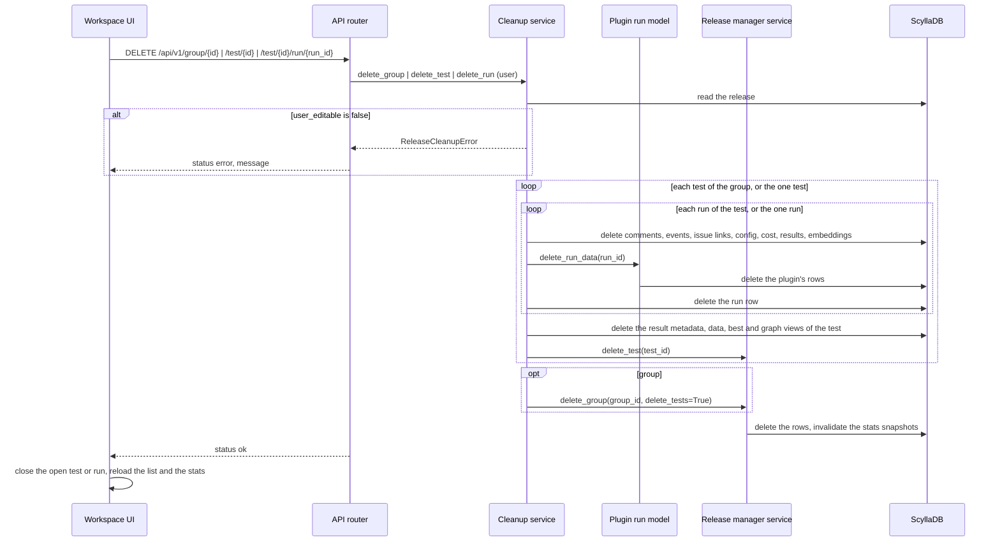

# ARGUS-129 — Users cannot remove their own runs and jobs from Argus

## Overview

A release gets a `user_editable` flag that an admin sets from the admin
panel. On a release with the flag, any logged-in user removes a run from the
run selector, a test from the workspace sidebar, or a group from the
workspace sidebar. Three new API routes carry the removals. A cleanup
service checks the flag, removes the rows that belong to the entity, and
cascades: a group takes its tests, a test takes its runs, a run takes its
comments, events, issue links, configuration, cost, results and the rows
the plugin keeps for it. A confirmation modal guards each removal, and the
group and test removals ask for the name of the entity.

## Constraints

- The admin panel keeps its routes and its behavior. The admin group and
  test deletes keep leaving runs in place.
- No new versioned table. The flag is one additive column.
- No new secondary index. Every cleanup read goes through a partition key
  or an index that exists today.
- The removal of a run needs no plugin name from the caller. The service
  finds the plugin from the run id.

## Design

- **Release model** carries `user_editable`, default `false`, and every
  read that returns a release carries it: the release list, the release
  details, the test info and the search index.
- **Admin panel** sets the flag with a switch next to Dormant and with the
  release editor, through the release manager service.
- **Cleanup service** holds the three removals. It checks the flag once per
  request, cascades, and delegates the hierarchy rows to the release manager
  service that the admin panel already uses.
- **Plugin run model** gets a hook that removes the rows the plugin keeps
  for one run. SCT removes its events, nemeses, resources, stress commands
  and junit reports. The other plugins keep the default, which removes
  nothing, because their rows live in the core tables.
- **Workspace sidebar** shows a trash button on each group row and each
  test row of a flagged release. **Run selector** shows a trash button next
  to the close button of an open run of a flagged release.
- **Confirmation modal**, shared by the sidebar and the run selector, asks
  for the entity name when the removal cascades.



The runs of a test are the runs of every plugin whose `build_id` equals the
test's `build_system_id`, united with the runs that carry the test's id,
deduplicated by run id. A run submitted before its test existed has no
`test_id`, and a test without `build_system_id` has runs only by `test_id`.

| Condition | Behavior |
|---|---|
| The release has no `user_editable`, or it is `false` | `ReleaseCleanupError` before any write. The response is the error envelope with the message |
| The run is not a run of the test in the path | `ReleaseCleanupError` before any write |
| The test or the group does not exist | `DocumentNotFound` through the catch-all handler, the error envelope |
| The run does not exist in any plugin | `ReleaseCleanupError` before any write |
| A cleanup write fails midway | The exception propagates. The rows written so far stay deleted. A second request removes the rest |
| The user is not logged in | 403 from `api_current_user`, as every API route |

Rows the removal leaves behind, by decision: notifications, which are
partitioned by receiver and carry no index; GitHub and Jira issue rows whose
last link went, which the issue list no longer reaches; the distinct
version and image indexes of the release; the references that user views
and release plans hold, which the view refresh drops after an hour; and the
in-process search index, which expires after a minute.

## Contracts

### Inputs

```
GET /api/v1/releases                # field: user_editable, read by the sidebar
GET /api/v1/test-info?testId=<id>   # field: release.user_editable, read by the run selector
```

### Outputs

The column on the release table:

```sql
ALTER TABLE argus_release_v2 ADD user_editable boolean;
```

`sync-models` applies it. A row without the column reads as `false`.

The admin switch:

```
POST /admin/api/v1/release/set_user_editable
{"release_id": "<uuid>", "user_editable": true}
-> {"status": "ok", "response": {"updated": true}}

POST /admin/api/v1/release/edit
{..., "user_editable": true}       # new field, default false
```

The removals, each for a logged-in user:

```
DELETE /api/v1/group/{group_id}
-> {"status": "ok", "response": {"deleted": "<group_id>"}}

DELETE /api/v1/test/{test_id}
-> {"status": "ok", "response": {"deleted": "<test_id>"}}

DELETE /api/v1/test/{test_id}/run/{run_id}
-> {"status": "ok", "response": {"deleted": "<run_id>"}}

-> {"status": "error", "response": {"exception": "ReleaseCleanupError",
    "message": "...", "arguments": ["Release <name> is not user editable"], ...}}
```

The release object every reader gets:

```python
class ArgusRelease(Document):
    ...
    dormant: bool = False
    user_editable: bool = False
```

### Module API

```python
class ReleaseCleanupError(Exception): ...

class ReleaseCleanupService:
    async def delete_group(self, group_id: UUID, user: User) -> None: ...
    async def delete_test(self, test_id: UUID, user: User) -> None: ...
    async def delete_run(self, test_id: UUID, run_id: UUID, user: User) -> None: ...
```

```python
class PluginModelBase(Document):
    @classmethod
    async def delete_run_data(cls, run_id: UUID) -> None: ...   # default: nothing
```

```python
class ReleaseManagerService:
    async def set_release_user_editable(self, release_id: UUID, user_editable: bool) -> bool: ...
```

The shared modal:

```ts
interface Props {
    title: string;
    confirmName?: string | null;   // when set, the confirm button waits for this exact text
    working?: boolean;
    onConfirm: () => void;
    onCancel: () => void;
    children?: Snippet;            // the body text
}
```

## Risks

| Risk | Response |
|---|---|
| The Jenkins monitor or a replay recreates a removed job | Accepted. The job comes back with new runs only, and the user removes it again |
| Two users remove the same entity at once | Accepted. The second request fails on a missing document, and nothing is left half removed that a third request cannot finish |
| A removed run keeps a best-result row that points at it | Accepted. The best result table is per test and name, and the row does not name a run the reader opens |

## Deferred work

None.

## Decisions

- The flag is named `user_editable`. (spec)
- Any logged-in user removes on a flagged release. The flag marks a
  staging or personal release, where everyone who reaches it is trusted.
  (spec)
- A run removal takes the run row and every table keyed by the run id,
  the plugin's own tables included, through a hook on the run model. (spec)
- The admin panel keeps its deletes as they are. The cleanup service calls
  the release manager service for the hierarchy rows, so the two paths do
  not drift on those rows. (spec)
- The run selector shows the trash button on an open run only, next to its
  close button, so the selector keeps its width. (spec)
- A cascading removal asks for the entity name. A run removal asks for a
  plain confirmation. (spec)
- The removal routes are `DELETE` routes, as the team and plan routes are.
  (spec)
