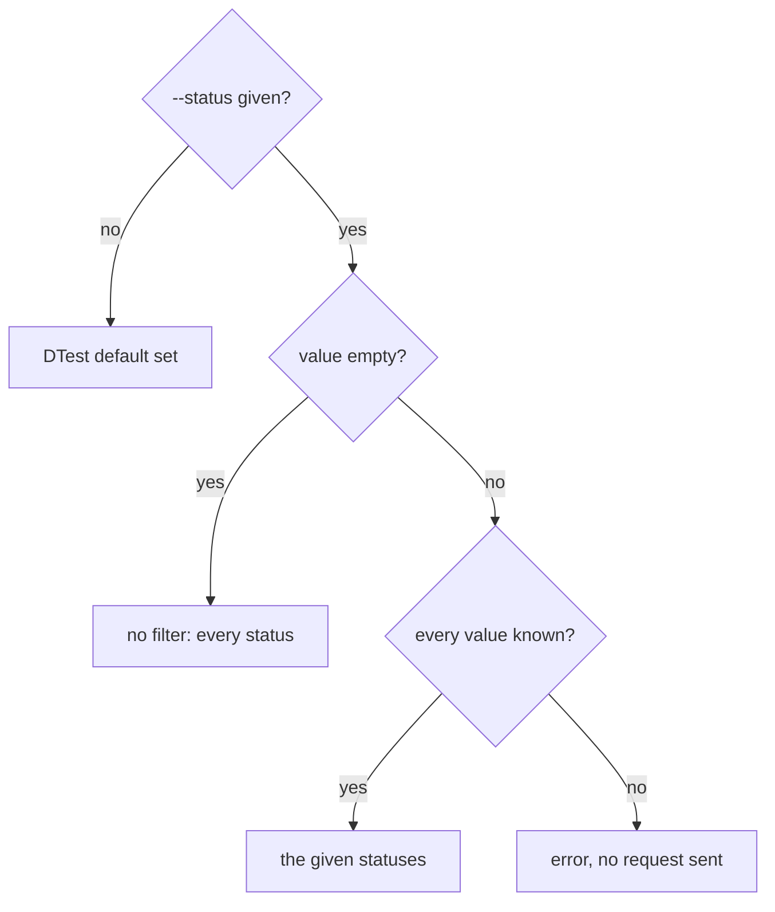

# ARGUS-133 — Trim the run, log and pytest output of the Argus CLI

## Overview

The change touches the CLI only. `argus run get` takes `--full` and then
prints the whole run, as `argus run details` does today, and `run details`
goes away. `argus run logs list` prints the log names without the stored
links. `argus run pytest-results` and `argus pytest results` take one
`--status` filter whose default is the set the DTest tab shows: the failures.
A given value replaces the default, and `--status ""` lifts it.

## Constraints

- No backend or frontend change. The CLI reads the endpoints it reads today.
- Every field that `run details` prints stays readable from the CLI.
- The `--status` grammar matches the `--status` of `argus my-jobs`.

## Design

- **`run get`** resolves the run type as today. Without `--full` it prints the
  Details-tab summary, unchanged. With `--full` it prints the whole typed run
  through the run cache that the test ID lookup already fills.
- **`run logs list`** reads the whole run as today and prints one row per log
  name. `run logs download` takes the name and keeps fetching through Argus,
  so a link outside S3 still downloads.
- **`run pytest-results`** fetches and caches every result of the run as
  today, then keeps the rows whose status the filter allows. Its endpoint
  takes no filter.
- **`pytest results`** sends the filter as `status[]`, an inclusion list the
  server applies to the `status` clustering column of `pytest_v2`.



| Condition | Behavior |
|---|---|
| `--status` holds an unknown value | Exit with `unknown status "<v>" (expected one of: …)` before any request |
| `run get --full --type` names an unknown plugin | Exit with `unknown run type "<t>", valid types: …` |
| `argus run details` | Not a command any more |

`status` precedes `id` in the clustering key of `pytest_v2`, so the default
`status[]` also lets `pytest results --before/--after` run without
`--status`. The backend test of the widget notes the rule: "status[] is
required when filtering by id range".

## Contracts

### Inputs

```
GET /api/v1/run/<run_id>/type                         # run_type
GET /api/v1/run/<run_type>/<run_id>                   # the whole run, logs
GET /api/v1/run/<run_id>/pytest/results               # status of each result
GET /api/v1/views/widgets/pytest/results?status[]=…   # inclusion list, unchanged
```

### Outputs

The command surface:

```
argus run get --run-id <id> [--type <plugin>] [--full]
argus run logs list --run-id <id>
argus run pytest-results --run-id <id> [--status <status>]...
argus pytest results [--status <status>]... [--test …] [--limit …] [--before …] [--after …] [--query …] [--filter …] [--marker …]
```

`argus run details` is removed. `run get --full` prints what it printed: the
typed run as JSON, or a key and value table with `--text`.

`run logs list`, JSON. The `url` key is gone:

```json
[{"name": "sct-runner-events-a1b2c3d4.tar.zst"}, {"name": "db-cluster-a1b2c3d4.tar.zst"}]
```

The status sets, in the order of the backend enum `PytestStatus`:

```go
PytestStatuses        = []string{"error", "passed", "failure", "skipped", "xfailed", "xpass",
    "passed & error", "failure & error", "skipped & error", "error & error"}
DefaultPytestStatuses = []string{"error", "failure",
    "passed & error", "failure & error", "skipped & error", "error & error"}
```

`--status` takes repeated or comma-separated values, matched case-insensitively
after trimming. Given values replace the default. An empty value lifts the
filter.

## Risks

| Risk | Response |
|---|---|
| A script calls `argus run details` | It fails. `argus run get --full` prints the same output. The pull request names the change |
| A script reads `url` from `run logs list` | The key is gone. `run logs download <name>` fetches the log |
| A caller of either pytest command expects every status | `--status ""` returns every status. The help of `--status` says so |
| `pytest results --status "" --before …` | The server rejects the id range without a status, as today |

## Decisions

- `run get --full` takes over the output of `run details`. Several fields of
  a run have no other reader in the CLI. (spec)
- The log listing drops the stored link. Nothing reads it, and
  `run logs download` serves every log by name. (spec)
- Both pytest commands take the default. `run pytest-results` is the DTest
  tab of one run, and `pytest results` searches the same results across
  runs. (spec)
- `--status` follows `my-jobs`, so the CLI keeps one filter grammar. (spec)
- `run pytest-results` filters after the cache, so the cache keeps every
  result and a new `--status` needs no fetch. (spec)
