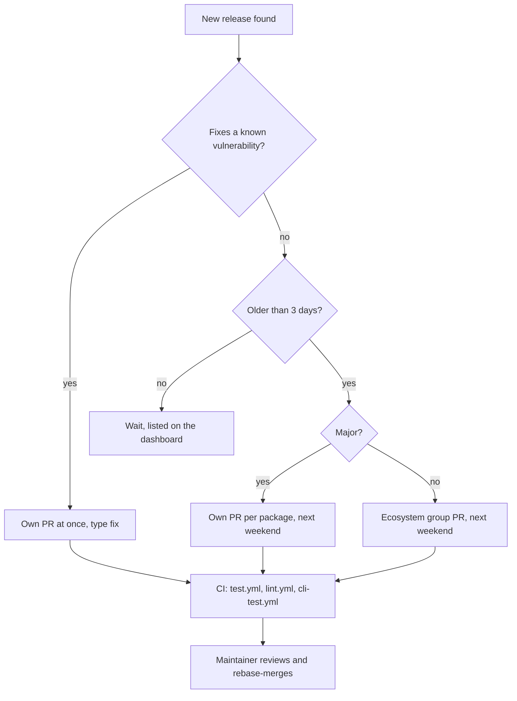

# ARGUS-140 — Automatic dependency updates

## Overview

A `renovate.json` at the repository root turns on the Renovate GitHub App,
which the scylladb organization already runs for scylla-cluster-tests. Every
weekend Renovate opens pull requests for the dependencies of the root
`pyproject.toml` (backend and client), the root `package.json` (frontend) and
`cli/go.mod` (CLI). Each ecosystem gets one grouped pull request for its minor
and patch releases, and each major release gets its own pull request. A
monthly pull request refreshes the lockfiles. Vulnerability fixes skip the
schedule. The existing CI runs on every pull request, and a maintainer merges
it by hand.

## Constraints

- Merges are rebase-only, so each Renovate commit lands on master as written.
  It must pass `commitlint.config.cjs`. Our type list has no `chore`. A scope
  needs at least 5 characters, a header at most 72, and a body at least 30
  characters with lines of at most 100.
- `argus-alm` is published to PyPI and SCT installs it. An update must not
  raise the version floors in `[project] dependencies`.
- Master has no branch protection and GitHub auto-merge is off, so no
  required check would stop a red pull request from merging.
- GitHub's vulnerability alerts are off for the repository.
- `qatools-health` is a uv path source of the root project. It and
  `pytest-argus-reporter` have their own `pyproject.toml` and stay out of
  scope.

## Design

Renovate runs as the organization's GitHub App. The repository holds only
its configuration. It runs three managers:

| Manager | Manifest | Lockfile | Commit scope |
|---|---|---|---|
| `pep621` | `pyproject.toml` | `uv.lock` | `python` |
| `npm` (yarn 1) | `package.json` | `yarn.lock` | `frontend` |
| `gomod` | `cli/go.mod` | `cli/go.sum` | `cli/go` |

How an update becomes a pull request:



Further rules:

- **Range strategy.** Python uses `update-lockfile`. A release inside the
  declared range changes only `uv.lock`. A release outside it, such as a
  `~=` pin, rewrites the range. The client's `>=` floors never move. npm
  keeps Renovate's default.
- **Lockfile maintenance.** On the first day of the month one pull request
  re-resolves `uv.lock` and `yarn.lock` within the declared ranges. That
  picks up transitive releases that no direct bump touches.
- **Go.** `go mod tidy` runs after every update. A major update also
  rewrites the import paths. The `go` directive gets its own pull request,
  because it also sets the toolchain CI builds the CLI with.
- **Grouped families.** Packages released together by one project share a
  pull request: Renovate's monorepo presets, plus the four `@fortawesome/*`
  packages.
- **Dashboard.** Renovate keeps one Dependency Dashboard issue. It lists
  pending updates, the ones waiting on their release age and the
  rate-limited ones, with a box to start any of them early.
- **Merging.** Nothing merges automatically.

| Condition | Behavior |
|---|---|
| The CI of a Renovate PR fails | The PR stays open. A maintainer fixes it on the Renovate branch or closes it, which ignores that version |
| A release is yanked within 3 days | Never proposed, because of the release age |
| Renovate cannot update a lockfile | Renovate posts the error on the PR and the dashboard |
| More than 10 PRs are open | Renovate holds the rest on the dashboard (the `config:recommended` limit) |

## Contracts

### Outputs

The configuration, `renovate.json`:

```json
{
  "$schema": "https://docs.renovatebot.com/renovate-schema.json",
  "extends": ["config:recommended"],
  "enabledManagers": ["pep621", "npm", "gomod"],
  "ignorePaths": ["**/node_modules/**", "qatools-health/**", "pytest-argus-reporter/**"],
  "schedule": ["* * * * 0,6"],
  "minimumReleaseAge": "3 days",
  "labels": ["dependencies"],
  "semanticCommits": "enabled",
  "commitMessageAction": "bump",
  "commitMessageTopic": "{{depName}}",
  "commitBodyTable": true,
  "postUpdateOptions": ["gomodTidy", "gomodUpdateImportPaths"],
  "lockFileMaintenance": { "enabled": true, "schedule": ["* 0-3 1 * *"] },
  "packageRules": [
    { "matchPackageNames": ["*"], "semanticCommitType": "improvement" },
    { "matchManagers": ["pep621"], "semanticCommitScope": "python", "rangeStrategy": "update-lockfile" },
    { "matchManagers": ["npm"], "semanticCommitScope": "frontend" },
    { "matchManagers": ["gomod"], "semanticCommitScope": "cli/go" },
    { "matchManagers": ["pep621"], "matchUpdateTypes": ["minor", "patch"], "groupName": "python non-major" },
    { "matchManagers": ["npm"], "matchUpdateTypes": ["minor", "patch"], "groupName": "frontend non-major" },
    { "matchManagers": ["gomod"], "matchUpdateTypes": ["minor", "patch"], "groupName": "cli non-major" },
    { "matchPackageNames": ["@fortawesome/**"], "groupName": "fontawesome" },
    { "matchDepTypes": ["golang"], "groupName": null },
    { "matchUpdateTypes": ["lockFileMaintenance"], "semanticCommitScope": "dependencies",
      "commitBody": "Re-resolve the lockfiles to the newest versions the declared ranges allow." }
  ],
  "osvVulnerabilityAlerts": true,
  "vulnerabilityAlerts": {
    "semanticCommitType": "fix",
    "commitMessageSuffix": "",
    "schedule": [],
    "minimumReleaseAge": null,
    "addLabels": ["security"]
  }
}
```

A later rule in `packageRules` wins over an earlier one. The first rule
overrides the `chore`/`fix` types that `config:recommended` would set.

Commit and pull request title, one for each kind of update:

```
improvement(python): bump python non-major
improvement(frontend): bump @sveltejs/vite-plugin-svelte to v8
improvement(cli/go): bump go to 1.26.1
improvement(dependencies): lock file maintenance
fix(python): bump requests to v2.34.2
```

The longest header any of our direct dependencies can produce is 67
characters: `improvement(frontend): bump @typescript-eslint/eslint-plugin to v10`.
Every header therefore stays at 72 or fewer. The body is the update
table, one row per package:

```
| datasource | package | from    | to      |
| ---------- | ------- | ------- | ------- |
| pypi       | fastapi | 0.141.1 | 0.162.5 |
```

## Risks

| Risk | Response |
|---|---|
| The Renovate App is not installed on argus | Prerequisite: an org admin adds argus to the App's repositories. Until then the file does nothing |
| A red PR is merged by hand, since master requires no checks | Merges are manual. The PR shows the CI result, and the reviewer checks it |
| CI misses a break: it runs no `svelte-check`, Ruff skips `argus/`, and Python 3.13 is untested while the bundle runs 3.13 | A major PR gets a manual check before merge. The gaps are listed under Deferred work |
| The first weekends open many PRs (32 Python, 44 npm and 8 Go updates are pending today) | The `config:recommended` limits cap open PRs. The dashboard holds the rest |
| Grouping keys on the group name; a shared name would merge ecosystems into one PR | Each group name is unique per manager |
| The Jira sync workflow runs on bot PRs that carry no key | It does nothing without a key. Checked on the first Renovate PR |

## Deferred work

- Auto-merge for minor and patch updates, once master requires the CI checks.
- GitHub Actions, the Dockerfile and the pre-commit revisions as further managers.
- `qatools-health/` and `pytest-argus-reporter/`.
- Turning on GitHub vulnerability alerts in the repository settings (admin).
  OSV covers vulnerability fixes until then.
- A Python 3.13 test job and `svelte-check` in CI.

## Decisions

- Renovate, not Dependabot. The org already runs its App, and only Renovate lets the commit header and body pass commitlint. (spec)
- Scope: the root `pyproject.toml`, the root `package.json` and `cli/go.mod`. (spec)
- Nothing merges automatically. Master has no required checks. (spec)
- One weekly PR per ecosystem for minor and patch, one PR per package for a major. (spec)
- PRs open on the weekend, a release waits 3 days, and vulnerability fixes skip both. (spec)
- A monthly PR refreshes `uv.lock` and `yarn.lock`. (spec)
- The commit type is `improvement`, and `fix` for a vulnerability fix. The scope names the ecosystem. With a single `dependencies` scope, a major bump of a long npm name would overflow 72 characters. (spec)
- Bot PRs carry no Jira key and no `closes`/`refs` last line. They are not tasks. (spec)
- No reviewers are assigned. The repository has no CODEOWNERS; the dashboard and the PR list are the queue. (spec)
- Vulnerability fixes come from OSV, because GitHub's alerts are off. (spec)
