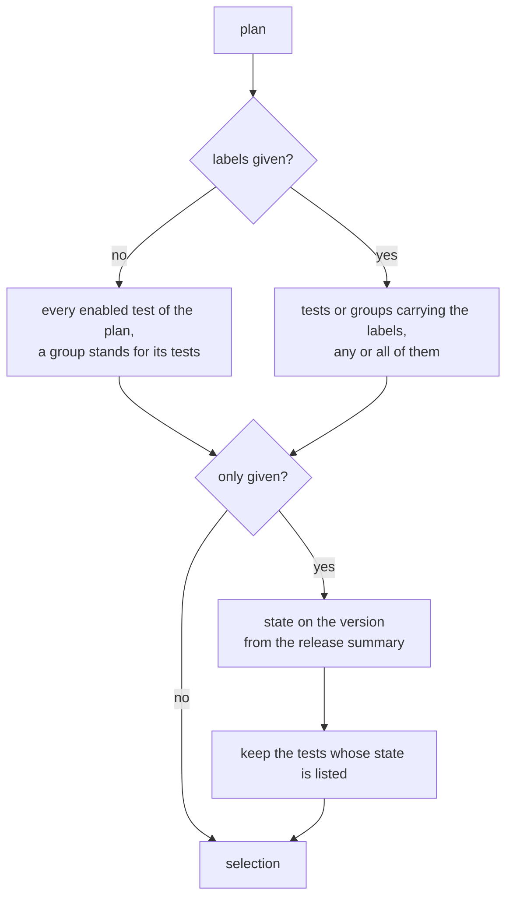
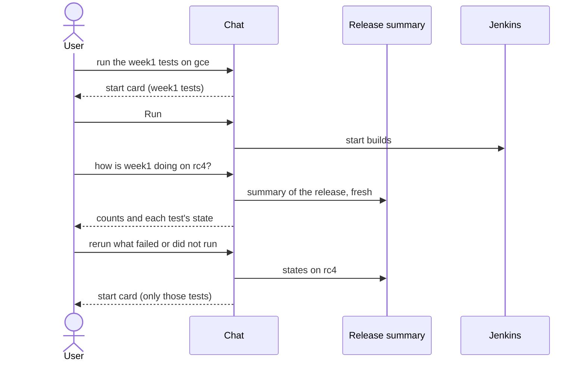

# ARGUS-148 — Run planned tests by label, with labels visible and the chat explained

## Overview

The chat gains a plan progress tool that reads the release summary and gives
the state, on a version, of each test that a plan or a plan label selects.
The plan start tool narrows its selection by that state, so "rerun the week1
tests that failed or did not run on rc4" proposes one card. The read tools
that list tests, results and assignees take a plan and labels as a filter.
The planner shows, edits and filters plan labels and stops losing them. The
release dashboard filters by a plan label. An empty chat shows grouped
example questions, and a help panel shows the same examples with a link to
the documentation.

## Constraints

- No new table or column: labels stay in `ArgusReleasePlan.options`, and the
  planner writes them through the existing `/plan/create` and `/plan/update`
  payloads.
- A start still needs a user's confirmation, or Auto mode for the asker's own
  question.
- The plan start keeps its limit of 50 tests.
- The state of a test on a version is the one the release summary gives, so
  the chat, the summary and the dashboard agree.
- A picked example never sends a question on its own.

## Design

### Selecting a plan's tests

One selection serves the start, the progress and the filters. A test is
selected when it is enabled and in an enabled group, and when the plan holds
it directly or through its group. With labels, the test or its group must
carry one of them, or all of them with `match_all`. Labels match ignoring
case. With `only`, the test's state on the version must be one of the listed
states.



The version is the one the request names, or else the plan's target
version. A state is `passed`, `failed`, `aborted`, `in_progress` or
`not_run`. `failed` covers `failed`, `test_error` and `error`, and
`in_progress` covers `created` and `running`, as the summary tool groups
them. A test without a run on the version is `not_run`.

### A batch with a check in between



The progress and the `only` filter wait for a fresh summary when the stored
one is stale, so a run that just finished counts.

### Labels in the web UI

- **Planner editor:** each test and group shows its labels as badges.
  - A badge can be removed, and an input adds a label, suggesting the plan's
    other labels.
  - A filter above the list shows only the items that carry the chosen
    labels. It hides rows and changes nothing in the plan.
  - Saving sends the labels with the plan.
  - Splitting a group gives each of its tests the group's labels, as it
    already does with the assignee.
- **Plan card:** lists the plan's labels with the number of tests each one
  selects.
- **Grid view:** shows the labels of the planned tests and groups.
- **Release dashboard and view dashboard:**
  - A plan-label filter lists "plan · label" for the plans of the
    dashboard's releases.
  - It keeps the tests that carry the label, directly or through their
    group.
  - The filter is saved with the other filters of the dashboard.

### Chat hints

- One list of example questions in four groups: asking, running tests, plans
  and labels, memories and Zeus.
- A note under the list says that a start proposes a card and runs only
  after **Run**, and what Auto mode does.
- The empty chat shows the list.
- A help button in the chat header opens it as a side panel at any time,
  with a link to `docs/release_chat.md`.
- Picking an example puts its text in the question box and focuses it.

### Failure behavior

| Condition | Behavior |
|---|---|
| No version given and the plan has no target version | The tool answers that it needs a version |
| No test matches the labels | The tool lists the plan's labels, as today |
| `only` leaves no test | The tool gives the counts per state and proposes nothing |
| Labels given without a plan to a read tool | The tool asks for the plan |
| The summary cannot be recomputed | The stored summary is used, marked stale in the result |
| A planner save fails | The editor shows the API error, as today; the labels are not saved |
| The plans of a dashboard fail to load | The plan-label filter is empty; the other filters work |

## Contracts

### Inputs

```
GET  /api/v1/planning/release/{release_id}/all   # plans[]: id, name, key, tests, groups, options (JSON text)
ReleaseSummaryService.get(release_id, test_ids, wait=True)
     # families[].versions[]: version, tests[]: test_id, status, run_id, build_number; stale
```

### Outputs

The chat tools, as the model sees them:

```python
class PlanFilter(BaseModel):          # added to read_release, get_summary, get_assignees
    plan: str | None                  # plan id, key (release#n) or name
    labels: list[str] | None          # needs plan
    match_all: bool = False

class PlanProgressArgs(BaseModel):    # new tool get_plan_progress
    plan: str
    labels: list[str] | None = None
    match_all: bool = False
    version: str | None = None        # defaults to the plan's target version

class ExecutePlanArgs(StartArgs):     # execute_plan_tests, changed
    plan: str
    labels: list[str] | None = None   # was required; none takes the whole plan
    match_all: bool = False
    version: str | None = None        # for only; defaults to the plan's target version
    only: list[Literal["passed", "failed", "aborted", "in_progress", "not_run"]] | None = None
    dry_run: bool = False
```

`get_assignees` takes `tests` or a `plan`; with a plan and no tests it lists
the plan's selected tests.

`get_plan_progress` answers:

```json
{"plan": "week plan", "key": "2025.1#3", "version": "2025.1.0~rc4", "labels": ["week1"], "stale": false,
 "counts": {"passed": 10, "failed": 2, "aborted": 0, "in_progress": 1, "not_run": 3},
 "tests": [{"test": "upgrades/rolling-upgrade-ami-test", "state": "failed", "status": "test_error",
            "run_id": "…", "build_number": 41}]}
```

The planner sends labels in the payloads it already uses:

```
POST /api/v1/planning/plan/create   # + options: {"<test-or-group-id>": {"labels": ["week1"]}}
POST /api/v1/planning/plan/update   # + options_set: {"<id>": {"labels": [...]}}, options_remove: ["<id>"]
```

`options_set` carries the whole label list of each changed entity, and an
entity whose last label is removed goes in `options_remove`.

## Risks

| Risk | Response |
|---|---|
| Waiting for a fresh summary slows a progress answer on a large release | Only the progress and the `only` filter wait; the other tools keep the stored summary |
| A planner save races a chat plan edit | The plan update stays last-edit-wins per field, as for assignees today |
| Long label lists crowd the planner rows | Labels are small badges that wrap |

## Deferred work

- Starting a plan's tests when release engineering promotes a release
  candidate. The selection by plan, label and state is the one such a
  trigger would use.

## Decisions

- The chat gets a plan progress tool, a state filter on the plan start, and
  a plan filter on the read tools. (spec)
- The planner shows, edits and filters labels. The release dashboard filters
  by a plan label. (spec)
- The chat shows clickable examples when empty and in a help panel, with a
  link to the documentation. (spec)
- A plan start without labels takes the whole plan, so "run what did not run
  of the plan" needs no label. (spec)
- The progress and the state filter read the release summary, waiting for a
  fresh one, so the chat agrees with the summary. (spec)
- The dashboard's label filter offers every plan of the dashboard's
  releases, completed plans included. (spec)
- Labels are free text, trimmed. The editor refuses an empty label and a
  second copy of a label on the same item, ignoring case. (spec)
