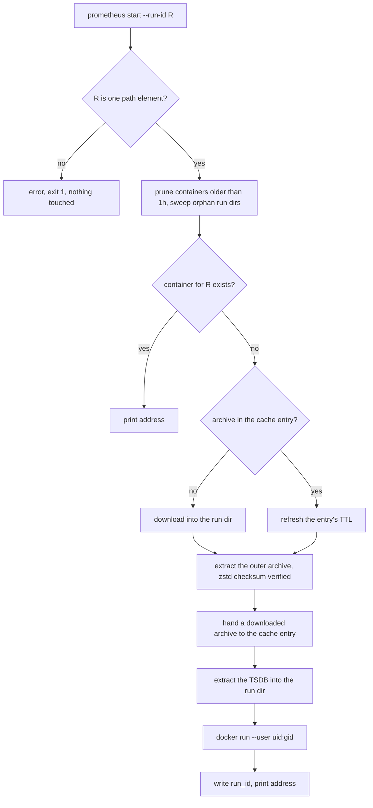

# ARGUS-159 — Keep prometheus data owned by the user and inside the cache's lifetime

## Overview

`argus prometheus start` runs the container as the calling user, so every file
Prometheus writes belongs to that user and the CLI no longer opens the data to
everyone. The downloaded monitor-set archive moves into its cache entry,
`cache/prometheus-logs/<run-id>/`, so it expires, clears and counts with that
entry. The extracted TSDB under `prometheus/<run-id>/` becomes container state:
`stop`, `stop --all`, the one-hour prune, a sweep on `start` and a failed
`start` remove it. The cache refuses a key that leaves its root, the prometheus
commands refuse a run ID or archive name that leaves theirs, and `--no-cache`
no longer moves the cache root into the current directory.

## Constraints

- Rootful Docker on Linux, and Docker Desktop on macOS and Windows. Windows has
  no uid, so the container keeps the image's user there.
- `PurgeExpired` runs in a goroutine at the start of every command, so it runs
  while `prometheus start` does. A purge never removes a file that `start` is
  reading.
- Under `--no-cache`, `start` downloads the archive, uses it and drops it. It
  caches nothing.
- Two `start` commands for different runs may run in parallel. Agents do. A
  `start` never removes the data of another run that is still starting.
- A second `start` for the same run within the TTL does not download the archive
  again.
- No new dependency.

## Design

**Components**

- Cache (`internal/cache`): owns `<cache-dir>/cache/`. An entry is a directory,
  and every file in it belongs to the entry. Refuses a key that leaves the root.
  A cache built with no root reads, writes and removes nothing.
- `prometheus start`: validates the run ID, prunes old containers, sweeps
  orphan run dirs, takes the archive from the cache or downloads it, hands a
  verified download to the cache, extracts the TSDB, and runs the container as
  the calling user.
- `prometheus stop` and `stop --all`: remove the containers and their run dirs.
  They never touch the cache.
- Root command: builds the cache on the configured cache directory every time.
  `--no-cache` switches it to pass-through mode.



**Lifetimes**

| Data | Lives in | Removed by |
|---|---|---|
| monitor-set archive | `cache/prometheus-logs/<run-id>/` | `PurgeExpired` 7 days after the last `start` that used it, `cache clear` |
| TSDB, `wal/`, `prometheus.yml`, `run_id` | `prometheus/<run-id>/` | `stop --run-id`, `stop --all`, the sweep on `start`, a failed `start` |

The sweep on `start` removes a run dir that has no container when the dir holds
`run_id`, or when the dir is older than one hour. A dir with no `run_id`
belongs to a `start` that has not yet created its container.

| Condition | Behavior |
|---|---|
| `--run-id` is empty, `.`, `..`, or holds a path separator | `invalid run ID`, exit 1, before any file system or docker call |
| The server's monitor-set name is not a plain file name | Error naming the file, exit 1, nothing written |
| The cache entry names a file that is not a plain file name, or that is missing | Cache miss, download |
| A cache key leaves the cache root | `Get`, `Set` and `Invalidate` return `ErrInvalidKey` and change nothing on disk |
| Download, extraction or `docker run` fails, or the user interrupts | The run dir is removed. A downloaded archive is cached only after its checksum passes |
| The archive cannot move into the cache entry | Warning; `start` goes on, and the archive is removed with the run dir |
| A run dir cannot be fully removed (files from an earlier version owned by `nobody`) | Warning naming the file; the command goes on |
| `docker ps` fails during the sweep | Warning; `start` goes on without the sweep |
| `PurgeExpired` removes the entry while `start` runs | `start` keeps working from the run dir. At worst the archive is not cached and the next `start` downloads it |

## Contracts

### Inputs

```
GET /api/v1/run/{run_type}/{run_id}                     # logs[]: the monitor-set entry's name must be a plain
                                                        # file name (filepath.IsLocal, equal to its filepath.Base)
GET /api/v1/tests/{plugin}/{run_id}/log/{name}/download # the archive stream (unchanged)
```

### Outputs

The on-disk layout under `config.CacheDir()` (`$XDG_CACHE_HOME/argus-cli`):

```
argus-cli/
├── cache/
│   └── prometheus-logs/<run-id>/
│       ├── meta.json                   # TTL 7d, refreshed by each start that uses it
│       ├── data.json                   # "monitor-set-<id>.tar.zst"
│       └── monitor-set-<id>.tar.zst    # the archive, removed with the entry
└── prometheus/<run-id>/                # container state, all files owned by the user
    ├── 01K…/  wal/  chunks_head/  queries.active
    ├── prometheus.yml
    └── run_id                          # written once the container exists
```

The data root moves from `os.UserCacheDir()/argus-cli/prometheus` to
`config.CacheDir()/prometheus`. On Linux and macOS the path stays the same
unless `XDG_CACHE_HOME` is set. On Windows it moves under
`%LocalAppData%\cache\`.

The container:

```
docker run -d --name argus-prom-<run-id[:8]> --user <uid>:<gid> \
  -v <data-root>/<run-id>:/prometheus \
  -v <data-root>/<run-id>/prometheus.yml:/etc/prometheus/prometheus.yml:ro \
  -p 0:9090 prom/prometheus:latest --config.file=… --storage.tsdb.path=/prometheus …
# --user is absent where os.Getuid() is -1 (Windows)
```

| Command | Today | After |
|---|---|---|
| `prometheus stop --run-id R` | Removes the container and the data except the archive and `run_id`; drops errors | Removes the container and `prometheus/R/`. The archive stays cached. Prints a warning on a failure |
| `prometheus stop --all` | Removes the containers and `prometheus/`, archives included | Removes the containers and `prometheus/`. Archives stay cached |
| `cache clear` | Empties `cache/`; under `--no-cache` empties `./cache/` | Empties `cache/`, archives included, with or without `--no-cache` |
| `cache info` | Counts `data.json` and `meta.json` | Counts every file of an entry. Reports the real cache under `--no-cache` |
| `--no-cache` | Cache root becomes the relative `cache` | Cache root unchanged. `Get`, `Set`, `Invalidate` and `PurgeExpired` pass through |

### Module API

```go
package cache

// ErrInvalidKey: the key does not name a directory inside the cache root.
var ErrInvalidKey = errors.New("cache: key leaves the cache root")

// ErrDisabled: the cache is in pass-through mode and has no entry directories.
var ErrDisabled = errors.New("cache: disabled")

// New with an empty baseDir builds a cache with no root: Clear and Stats find
// nothing, and nothing is read, written or removed.
func New(baseDir string, opts ...Option) *Cache

// EntryDir returns the directory of key's entry. A file placed there belongs to
// the entry: Stats counts it, and Invalidate, PurgeExpired and Clear remove it.
func (c *Cache) EntryDir(key string) (string, error) // ErrDisabled, ErrInvalidKey

func Get[T any](c *Cache, key string) (T, Meta, error)                                  // + ErrInvalidKey
func Set[T any](c *Cache, key string, value T, sourceURL string, ttl time.Duration) error // + ErrInvalidKey
func (c *Cache) Invalidate(key string) error                                             // + ErrInvalidKey
func (c *Cache) Stats() (Stats, error) // Bytes: every regular file in an entry
```

A key is valid when `filepath.IsLocal(filepath.FromSlash(key))` holds. Every
caller of `Get` treats an error as a miss and asks the API, which rejects the
ID itself.

## Risks

| Risk | Response |
|---|---|
| Rootless Docker and Podman map `--user` to a subordinate uid, so Prometheus cannot write the run dir. The 0777 used to hide this | Out of scope. `start` fails with Prometheus's own error. Detection is deferred work |
| Run dirs from earlier versions keep files owned by `nobody` | Each sweep prints a warning naming the file. The pull request says to run `sudo rm -rf ~/.cache/argus-cli/prometheus` once |
| On Windows the data root moves, so the old `%LocalAppData%\argus-cli\prometheus` is left behind | Its files have no ownership problem. The pull request names the path |
| A process killed while `PurgeExpired` removes an entry can leave the archive without `meta.json`, which no purge sees | The window is a few microseconds. `cache clear` still removes it |
| `stop --all` used to free the archives and no longer does | `cache clear` frees them, and the entry expires 7 days after its last use |

## Deferred work

- Rootless Docker and Podman: read `docker info` and choose `--user 0:0` or
  `--userns=keep-id`. The `start` sequence has one place for the user flags.
- A `docker run` that fails after creating its container leaves it `Created`,
  and the next `start` prints an empty port. This needs its own issue.

## Decisions

- The container runs as the calling user's uid and gid. Rootful Docker and
  Docker Desktop are the targets, and rootless Docker and Podman are a risk.
  (spec)
- The archive lives in its cache entry, so `PurgeExpired`, `cache clear` and
  `cache info` cover it with no Prometheus-specific code in the cache. (spec)
- Files left as `nobody` by earlier versions get no code. The pull request
  tells the user to remove them once. Every cleanup failure prints a warning.
  (spec)
- Komachi added the path traversal fixes and the `--no-cache cache clear`
  defect to this task. (spec)
- The TTL keeps sliding: a `start` that uses the cached archive refreshes the
  entry, as it does today. (spec)
- `--no-cache` bypasses the cached responses, not the cache commands. `cache
  clear` and `cache info` act on the real cache. (spec)
- `stop` manages containers and their run dirs, and the cache commands manage
  downloads. (spec)
- `prometheus.yml` is written with mode 0644 and no forced chmod. The container
  user owns the file, and Docker Desktop does not apply host modes. (spec)
- The data root moves to `config.CacheDir()`, so the archive moves into the
  cache entry with a rename on one file system. (spec)
