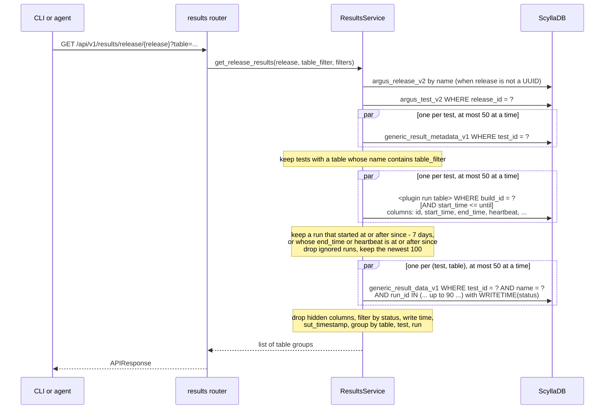

# ARGUS-176 — Generic results across the tests of a release

## Overview

A new `results` router answers two reads for one release. The first lists the
generic result table names of the release. The second returns the cells of
the tables whose name matches a substring, for every test of the release.
The service reads the tests of the release and their table metadata. It
selects the runs of each test that can hold results written in the time
window from the run table, keeps the newest 100, leaves out the ignored
runs, then reads the cells of only those runs. It groups the cells by table, then by test, then by run. The CLI gets
`argus results tables` and `argus results query` on top of the two routes.
The per-test results endpoints move from `api.py` into the same router, and
the frontend calls their new routes.
The schema does not change, so results that exist today are readable at once.

## Constraints

- No schema change and no backfill. The release read is needed now.
- No `ALLOW FILTERING` query. Every read names a full partition key, or the
  `release_id` index of `argus_test_v2`.
- The time filter uses the write time of the result, as soyacz asked.
  `sut_timestamp` is a second, separate filter.
- The cost of the cell read follows the time window, not the full history of
  a test.
- One request reads a bounded amount of data: at most 500 (test, table)
  pairs, and at most 100 runs per test.

## Design

### Approaches

| Approach | For | Against |
|---|---|---|
| A. Fan-out over the full `(test_id, name)` partitions, bounded by one release | No schema change, no backfill, no new write path. Old results work at once. | Every read gets all runs a test ever sent, whatever the window. Time filters run in the application. No read across releases. |
| A′. A, but the runs of the window come first from the run table, keyed by `(build_id, start_time)`, and the data read names them with `run_id IN` | Everything A gives. ScyllaDB prunes by time. The run read also gives `investigation_status`, `build_number` and `scylla_version`. | One more query per test, over the small columns of the run partition. A read with no window reads all runs, so the window has a default. No read across releases. |
| B. A query table keyed by `(name, day bucket)`, written next to `generic_result_data_v1` at submit | One partition read per table and day. Time ranges are cheap. Reads across releases work. | A new table, a second write on every submit, and a backfill job for old results. |
| C. A materialized view of `generic_result_data_v1` keyed by `name` | ScyllaDB builds the view and fills old rows. No new write in the application. | One partition per table name grows without bound. A view cannot carry `WRITETIME`. View builds and view consistency add operational risk. |
| D. A full scan of `generic_result_metadata_v1` with one `ALLOW FILTERING` read per pair (PR #1033) | No schema change. | Reads every test in Argus. The review of PR #1033 stopped it. |

This spec selects A′. A release bounds the fan-out, a release is the scope
that the users need now, and the run table already holds the time index.
B is the path when a read across releases becomes necessary, see
`Deferred work`.

### Read flow



The tables read follows the same path up to the metadata step. It counts the
tests per table name and merges the column names.

### Failure behavior

| Condition | Behavior |
|---|---|
| The release name or UUID matches no release | `DataValidationError`, the response has `status: error` |
| `table` is empty or blank | `DataValidationError` |
| `table` matches more than 500 (test, table) pairs | `DataValidationError` that asks for a longer filter |
| A test has more than 100 runs that qualify | The newest 100 by start time, and `runs_truncated` is true |
| A column is marked `visible=False` | The column is left out, unless `includeHidden=true` |
| No table name matches `table` | An empty list |
| A test or a run has no cell after the filters | The test or the run is left out of the output |
| A cell has no `sut_timestamp` and a `sut_*` filter is set | The cell is left out |
| The request has no `since` | `since` is 30 days before `until`, or before the request when `until` is not set |
| A status is in lower case | The router compares it in upper case |
| A run is marked as ignored | The run is left out |
| A test has no `plugin_name` or no `build_system_id` | The test is left out |

## Contracts

### Outputs

```
GET /api/v1/results/release/{release}/tables
    release        release name or UUID
    includeHidden  true lists the columns marked as hidden
```

```json
{"status": "ok", "response": [
  {"name": "throughput", "description": "...", "columns": ["ops", "p99"], "tests": 12}
]}
```

```
GET /api/v1/results/release/{release}
    table      required, case-insensitive substring of the table name
    status[]   repeatable, any case, keeps cells with one of these statuses
    since      ISO-8601, write time of the result >= since, default 30 days before until or now
    until      ISO-8601, write time of the result <= until
    sutSince   ISO-8601, sut_timestamp >= sutSince
    sutUntil   ISO-8601, sut_timestamp <= sutUntil
    includeHidden  true keeps the cells of the columns marked as hidden
```

```json
{"status": "ok", "response": [
  {"table": "throughput", "description": "...", "tests": [
    {"test_id": "<uuid>", "test_name": "longevity-cdc", "build_id": "scylla-master/longevity/longevity-cdc",
     "runs_truncated": false,
     "runs": [
       {"run_id": "<uuid>", "build_number": 412, "scylla_version": "2026.2.0~dev",
        "submitted_at": "2026-10-20T08:12:00Z", "sut_timestamp": "2026-10-19T00:00:00Z",
        "cells": [{"row": "write", "column": "ops", "value": 1200.5, "status": "PASS"}]}
     ]}
  ]}
]}
```

Groups sort by table name. Runs sort by `submitted_at`, newest first.
`submitted_at` is the latest write time of the cells that the read keeps
for the run.
`build_id` is `build_system_id` of the test. `value` holds `value_text` when
the cell has no number.

```
argus results tables <release> [--show-hidden]
argus results query <release> --table <substring> [--status S]... \
    [--since T] [--until T] [--sut-since T] [--sut-until T] [--show-hidden]
```

The CLI prints the response as JSON, or one row per cell with `--text`.

The per-test endpoints keep their parameters and their responses. Only the
path and the route name change. The client API endpoints do not change.

| Before | After | Route name |
|---|---|---|
| `GET`, `HEAD /api/v1/test-results` | `GET`, `HEAD /api/v1/results/test` | `api.results.test_results` |
| `POST /api/v1/create-graph-view` | `POST /api/v1/results/graph-view/create` | `api.results.create_graph_view` |
| `POST /api/v1/update-graph-view` | `POST /api/v1/results/graph-view/update` | `api.results.update_graph_view` |

### Module API

```python
class ResultsService:
    async def get_release_result_tables(self, release: str, include_hidden: bool = False) -> list[dict]: ...
    async def get_release_results(self, release: str, table_filter: str, statuses: list[str] | None = None,
                                  since: datetime | None = None, until: datetime | None = None,
                                  sut_since: datetime | None = None, sut_until: datetime | None = None,
                                  include_hidden: bool = False) -> list[dict]: ...
```

## Risks

| Risk | Response |
|---|---|
| A release with many tests and tables sends many queries | `gather_limited` holds the reads at 50 at a time. The `table` filter cuts the data reads before they start. |
| A run writes results after its end time and its last heartbeat, and more than 7 days after it starts | Its late results fall outside the window. A run sends its results while it runs, so the case needs a run that writes after it ends. |
| The run partition of a test with a long history is large | The read selects seven small columns. The cell read, the large one, stays bounded by the window and the run cap. |
| A wide window still reads every run in it | The 30-day default bounds a read with no window. Approach B removes the cost. |
| `WRITETIME(status)` changes when a run sends the same cell again | `submitted_at` shows the last write of the cell, not the first. |

## Deferred work

- A read across releases. It needs approach B, a query table keyed by the
  table name and a time bucket, and a backfill. The service API keeps
  `release` as one argument, so a second method can sit next to it.

## Decisions

- The release is the scope of the read. The users need releases now, and a
  release bounds the fan-out. (spec)
- The change ships without a schema change or a backfill, so old results are
  readable at once. (spec)
- The release path parameter takes a name or a UUID, so an agent can pass
  the name it already knows. (spec)
- `since` defaults to 30 days, and the run window starts 7 days before
  `since`. (open)
- With only `until` set, the 30-day window ends at `until`, so a read of an
  old window is not empty. (review)
- The status filter takes any case, because the CLI help names the statuses
  and a user types them in lower case. (review)
- A run qualifies by its end time and its heartbeat too, so a long run that
  writes inside the window keeps its results. (review)
- Each test returns its newest 100 runs, and a filter can match at most 500
  (test, table) pairs, so one request cannot read the full history of a
  release. (review)
- The release read hides the columns marked as hidden, as the per-run read
  and the graphs do. (review)
- The old per-test paths are removed, not kept as aliases. The frontend is
  the only caller, and it ships in the same release. (build)
- A read across releases waits for approach B. (open)
