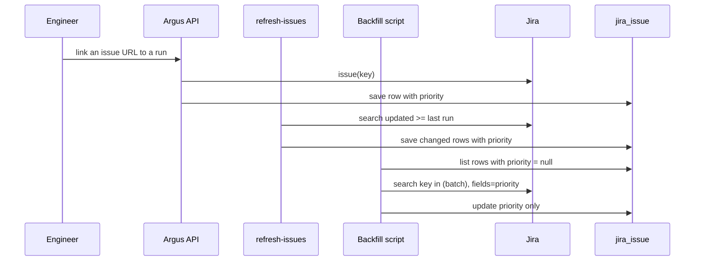
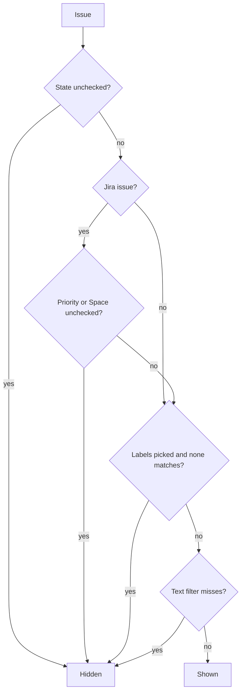

# ARGUS-178 — Jira issue priority, Space and status filters

## Overview

`JiraIssue` gains a `priority` column that holds the Jira priority name, such
as `P2`. `JiraService` sets it when an issue is first linked and on every
`refresh-issues` scan. A one-off script backfills the issues linked before the
change. The issue widget shows the priority on the Jira card. It filters the
fetched issues with checkboxes for status, priority and Jira Space, derived
from the issues it holds. It sorts by priority, and its "All Labels" panel
lists the labels of the fetched issues. A Jira card links to `/issues/<KEY>`
everywhere except on that page. A Jira label takes its color family from its
scope, and every label chip picks the text color with the higher contrast.

## Constraints

- `refresh-issues` asks Jira only for the issues updated since its last run, so
  the scan alone never reaches an unchanged issue.
- The scanner may run while the backfill runs. The backfill must not overwrite
  a column the scanner writes.
- Four workers serve the old and the new code during the deploy. Both must read
  a `jira_issue` row with or without the new column.

## Design

- **The model.** `JiraIssue` carries `priority: str | None`. `None` means Jira
  returned no priority, or the row predates the backfill.
- **The service.** `JiraService` reads `fields.priority.name` of the remote
  issue. It does so in `get_issue`, when an issue is first linked, and in
  `refresh_stale_issues`, the scan behind `refresh-issues`.
- **The backfill.** A dated script under `scripts/migration/` lists the rows
  without a priority. It asks Jira for them in batches with one
  `key in (...)` search per batch, and writes only the `priority` column of
  each returned row. A re-run skips the rows already filled.
- **The issue payloads.** They carry `priority` without a serializer change,
  because every one of them dumps the model.
- **The Jira card.** It shows the priority as a Bootstrap badge after the state
  pill. It links to `/issues/<KEY>` unless the page that mounts it turns the
  link off. The issue page turns it off.
- **Label colors.** The scope of a label is the text before its first `/` or
  `:`, in lowercase, or the whole name when it has neither.
  - The scope sets the hue of a Jira label, so `backport/2025.1` and
    `backport/6.2-done` share a color family.
  - The full name moves the hue by up to 12° and sets the lightness between 36%
    and 48%, so labels of one scope stay apart. The saturation stays at 65%.
  - A label chip, GitHub or Jira, takes white or black text, whichever has the
    higher contrast ratio against the chip. Across that palette the chosen text
    keeps at least 4.5:1.
- **The widget.** It replaces the fixed Open and Closed switches with three
  checkbox groups, plus a priority sort and a filled label panel.
  - **Status** lists every distinct state of the fetched issues.
  - **Priority** lists every distinct priority of the fetched Jira issues, with
    `none` for an issue without one.
  - **Space** lists every distinct project of the fetched Jira issues.
  - The groups record the values the user unchecked. A value that first appears
    after a re-fetch starts checked.
  - The "All Labels" panel lists the distinct label names of the fetched
    issues, in the colors their cards use. Picking one shares the selection
    that a click on a card label makes, and both match a label by its name.
  - "By priority" orders P0 to P4 when "Descending order" is on, and P4 to P0
    when it is off. Issues without a priority come last either way.



The filter the widget applies to each fetched issue:



| Condition | Behavior |
|---|---|
| Jira returns no `priority` field, or `priority` is null | Store `None`. The card shows no badge, and the issue counts as `none` in the filter |
| A backfill batch raises a Jira or network error | Log it, count the batch as failed, continue with the next batch. The summary asks for a re-run |
| Jira omits a key from a batch result (deleted, moved, not visible) | Leave the row unchanged and count it as missing |
| A Jira priority outside P0–P4 | Show it with the neutral badge and rank it after P4 |
| The fetched issues carry no labels | Hide the "All Labels" panel |
| The widget holds no Jira issues | Hide the Priority and Space groups |

## Contracts

### Inputs

```
GET /rest/api/2/issue/{key}                    # get_issue; fields used: priority.name (added), status.name, project.key, ...
GET /rest/api/2/search/jql  jql="updated >= …" # refresh-issues; fields used: priority.name (added)
GET /rest/api/2/search/jql  jql="key in (…)"   # backfill; fields=priority
```

The `jira` client sends the two searches through `search_issues`, which calls
`search/jql` on Jira Cloud.

### Outputs

The schema change, which `sync-models` applies:

```sql
ALTER TABLE jira_issue ADD priority text;
```

The Jira issue object in `GET /api/v1/issues/get`,
`GET /api/v1/issues/{key}/links` and the submit response gains one key. A
consumer treats a missing key and `null` the same way.

```json
{
  "key": "SCT-1234",
  "state": "in progress",
  "project": "SCT",
  "priority": "P2",
  "subtype": "jira"
}
```

The frontend type:

```ts
export interface JiraSubtype extends Issue {
    key: string;
    summary: string;
    project: string;
    priority: string | null;
    permalink: string;
    state: JiraState;
    assignees: string[];
}
```

The backfill command:

```
uv run python scripts/migration/migration_2026-10-15_backfill_jira_issue_priority.py [--key KEY]
```

### Module API

```python
class JiraService:
    @staticmethod
    def priority_name(fields) -> str | None: ...
```

```ts
export const JIRA_PRIORITIES: readonly string[];
export const priorityRank: (i: Issue) => number;   // index in JIRA_PRIORITIES, then unknown names, then Infinity
export const label2color: (label: Label) => string; // "hsl(<hue>, 65%, <36-48>%)"
export const labelTextColor: (background: string) => "white" | "black";
```

The Jira card takes one new prop, `showRunsLink?: boolean`, which defaults to
`true`.

## Risks

| Risk | Response |
|---|---|
| The backfill sends many requests and Jira throttles them | One search per 100 keys keeps the call count low. A throttled batch fails alone, and a re-run retries it |
| A moved issue comes back under its new key and the row keeps its old key | The row stays without a priority and counts as missing. The scan does not fix it either, which matches its handling of every other field |

## Deferred work

None.

## Decisions

- The column stores the priority name that Jira returns, with no fixed set.
  Jira owns the priority scheme, and today it is `P0` to `P4`. (spec)
- Filtering stays in the browser over the fetched issues, as the text and the
  label filters already do. (spec)
- The backfill writes the `priority` column alone through a partial update, so
  a concurrent scan keeps its writes. (spec)
- The runs link sits on the Jira card only, because `/issues/<KEY>` resolves
  Jira keys only. (spec)
- The "All Labels" panel fix and the priority sort join this task. (spec)
- Issues without a priority sort last in both directions, so the ordered
  priorities stay at the top. (spec)
- The label filter matches by name, not by id. GitHub gives the same label a
  different id in each repository, so the dev release dashboard listed `bug`
  three times. (build)
- A Jira label takes its hue from its scope rather than from a hash of the
  whole name, so related labels look related. The scope comes from a hash, so
  unrelated scopes still spread around the wheel. (build)
- A label chip picks its text color by contrast ratio. The brightness rule of
  `isDark()` left about 10% of the new palette below 4.5:1. (build)
