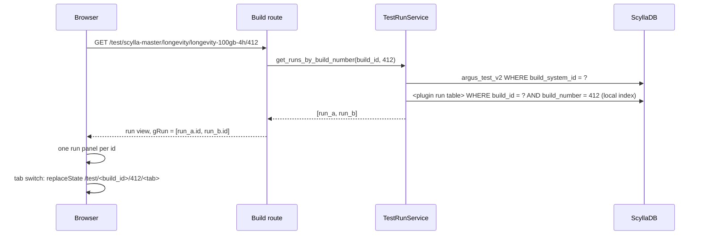
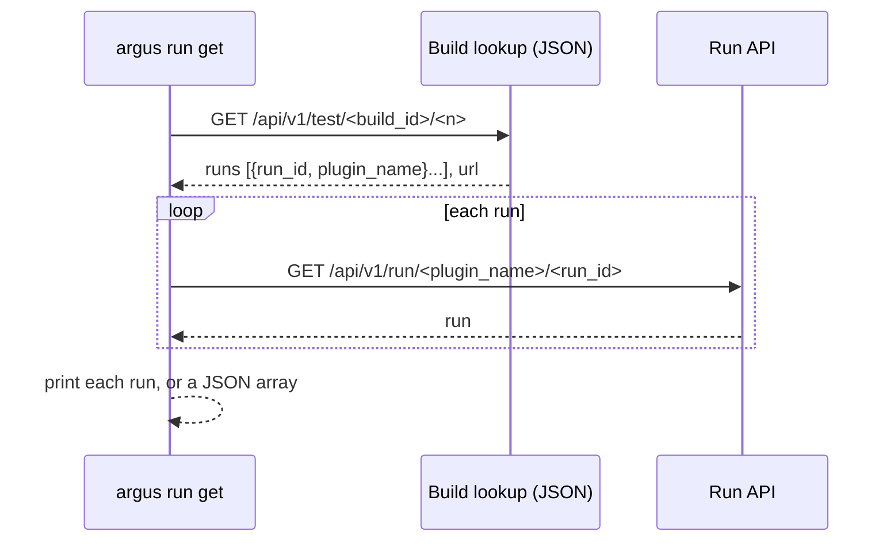

# ARGUS-184 — Link runs by build id and build number

## Overview

Every link to a run page that the web UI, the report email and the CLI produce
takes the form `/test/<build_id>/<build_number>`. That form is the existing
build route, `main.get_run_by_build`.

- **Lookup:** the build lookup returns every run of a build, not the first.
  The build page opens one panel per run, and the JSON lookup returns them
  all.
- **Response data:** the responses that carry only a run id gain the run's
  `build_id` and `build_number`.
- **Frontend:** one frontend helper builds every run link.
- **CLI:** `argus run get` accepts `--build-id` and `--build-number`, and
  `argus replay` prints the build link.

## Constraints

- The schema change is one additive local index per plugin run table, which
  `sync-models` creates. `build_id` is the partition key, so the index stays
  inside one partition, and the lookup needs no `ALLOW FILTERING`.
- No fallback link. A run's `build_id` is its test's `build_system_id`, and a
  run row without `build_number` is broken data.
- The `/tests/<plugin>/<run_id>` route stays registered. Links already shared
  in Jira, GitHub, Slack and old emails keep working.
- The results graph payload holds thousands of points. A point gains a
  number, not a string. The graph carries the one `build_id`.
- The Pytest widget reads at most one run row per distinct run, not per
  result row.

## Design

**Components**

- `TestRunService`: resolves a build to its runs. The test is found by
  `build_system_id`, the plugin by the test, and the runs by
  `build_id` + `build_number`, newest first.
- Build route (HTML): renders the run view with the id of every run of the
  build. The run view already mounts one panel per id in its list.
- Build lookup (JSON): returns the runs and the build page URL.
- Chat run reference: needs one run, and names the run ids when a build has
  several.
- Email partials: each one receives the run path in its options.
- Widget services (nemesis stats, graphed stats, summary, similar runs,
  results graphs, pytest): add the build fields to each run entry.
- Frontend `runUrl`: the one builder of a run link. The run views, the
  widgets, the cost explorer, the release summary and chat use it. On a tab
  switch the run view rewrites the address with it.
- CLI: `run get` resolves the build through the JSON lookup and then shows
  each run as `--run-id` does. `replay` builds its links with `RunURL`.





| Condition | Behavior |
|---|---|
| No test has the `build_system_id` | HTML: flash "Run <build_id> #<n> not found", redirect to the 404 page. JSON: `status: error` |
| The test exists, no run has the build number | Same as above |
| The test's plugin is not loaded | Same as above |
| The build has several runs | HTML: one panel per run. JSON: every run. CLI: every run. Chat: `TestReferenceError` that names the build and lists the run ids |
| The runs of the build have no `test_id` | The existing "has no test in Argus" flash and 404 redirect |
| The CLI gets `--run-id` together with a build flag, or one build flag alone | Flag error before any request |

## Contracts

### Outputs

The run page URL, unchanged, route name `main.get_run_by_build`:

```
GET /test/{build_id:path}/{build_number:int}[/{tab}]
```

The JSON build lookup, route name `api.get_run_by_build`, behind
`api_current_user`:

```
GET /api/v1/test/{build_id:path}/{build_number:int}
```

```json
{
  "status": "ok",
  "response": {
    "runs": [
      {"run_id": "a7b1…", "plugin_name": "scylla-cluster-tests"},
      {"run_id": "5c02…", "plugin_name": "scylla-cluster-tests"}
    ],
    "url": "https://argus.scylladb.com/test/scylla-master/longevity/longevity-100gb-4h/412"
  }
}
```

The top-level `run_id` and `plugin_name` fields go away. `runs` is newest
first and never empty: an unknown build returns `status: error`.

Fields added to existing responses. Each one is the run's stored value, and
`build_number` can be `null` on broken rows:

```ts
// GET /api/v1/views/widgets/nemesis_data, per run
{ build_id: string; build_number: number | null }
// GET /api/v1/views/widgets/graphed_stats, per test_runs entry and per nemesis_data entry
{ build_number: number | null }                    // build_id is already there
// GET /api/v1/views/widgets/summary/versioned_runs, per test per method
{ build_number: number | null }                    // build_id is already in test_info
// POST /api/v1/client/sct/similar_runs_info, per run; "build_id" keeps its "job#N" display string
{ build_job: string; build_number: number | null }
// results graphs (test page and graphs widget): per graph, and per point
graph: { build_id: string }   point: { build_number: number | null }
// pytest widget results (release and view), per result row
{ build_id: string; build_number: number | null }
```

The CLI:

```
argus run get --run-id <uuid> [--type <plugin>] [--full]          # unchanged
argus run get --build-id <job path> --build-number <n> [--full]
```

With the build flags, the text output prints each run as `--run-id` prints
it, in the order of `runs`. The JSON output is always an array of the
objects that `--run-id` prints. The run details text gains an `Argus URL`
line, `<base>/test/<build_id>/<build_number>`. `argus replay` prints that
same form in its text and in its JSON `url` field.

The report email partials receive `run_path`,
`/test/<build_id>/<build_number>`, and link
`http://argus.scylladb.com{{ options['run_path'] }}[/<tab>]`.

The schema change, applied by `sync-models` to `sct_test_run`, `generic_run`,
`driver_test_run` and `sirenada_run`:

```sql
CREATE INDEX IF NOT EXISTS <table>_build_number_local_idx ON <table> ((build_id), build_number);
```

### Module API

```python
class TestRunService:
    async def get_runs_by_build_number(self, build_id: str, build_number: int) -> list[PluginModelBase]: ...
```

```js
// frontend/Common/RunUtils.js; build_id keeps its slashes
export function runUrl(buildId, buildNumber, tab = undefined) { ... } // "/test/<buildId>/<buildNumber>[/<tab>]"
```

```go
// cli/internal/api: RunPageURL is removed; RunURL stays the one link builder
func RunURL(base, buildID string, number int) string
```

## Risks

| Risk | Response |
|---|---|
| A consumer outside this repository reads `run_id` from the JSON build lookup | None is known. The route shipped with the CLI work, and the new CLI call is its only reader. The PR names the shape change |
| A run whose `build_id` differs from its test's `build_system_id` gets a link that resolves to nothing | Accepted, as in ARGUS-209. Such a row is broken data |
| The Pytest widget of a large release reads many run rows | One indexed read per distinct run, run concurrently. Rows of the same run share it |
| Code without `allow_filtering()` reaches a database before `sync-models` has built the local index: the lookup errors, or returns partial results while the index builds | The PR says to run `sync-models` and wait for the index build before the new code serves traffic |
| A build page with several runs is slower to open | Each panel loads as a workspace panel does today. Parallel builds have a handful of runs |

## Decisions

- The links keep the `/test/` path. The CLI, chat, the issue links, the
  release summary and the cost explorer already emit it. (spec)
- A build with several runs shows them all: the build page, the JSON lookup
  and the CLI list every run, and chat asks for a run id. (spec)
- `argus run get` takes the build flags. The ticket names `run details`, a
  command that does not exist. (spec)
- The Pytest widget gains the build fields from the run rows, so its rows
  link by build like every other widget. (spec)
- The JSON build lookup drops the single `run_id`, and the CLI is its only
  reader. The repository standards keep no compatibility without a stated
  need. (spec)
- The report email keeps its hard-coded host. Moving it to `BASE_URL` is a
  separate change. (spec)
- Each plugin run table gets a local index on `(build_id), build_number`. A
  filter on `build_number` reads every full row of the build partition, about
  44 KB per SCT run: 44 ms at 3000 runs, against 0.2 ms through the index, for
  about 22% more cost on a heartbeat write. (build)
