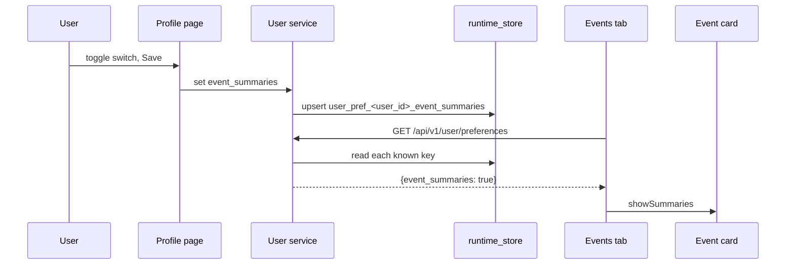
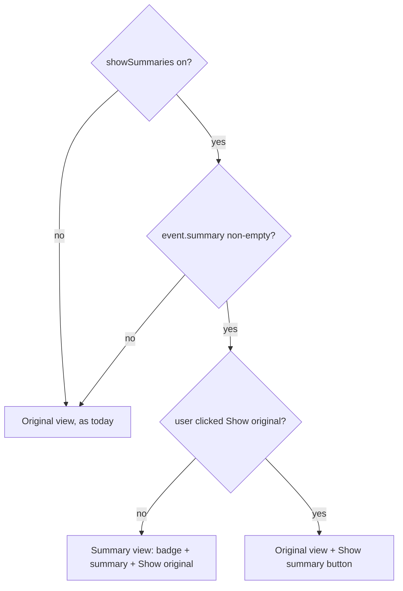

# ARGUS-193 — Opt-in AI summaries in the SCT events view

## Overview

The profile page gets a Preferences section with one switch: AI event summaries, off by
default. The switch is saved per user in the existing `runtime_store` table. The SCT Events tab
reads the user's preferences once through a new API endpoint. With the switch on, an event
card that has a summary shows that summary with an "AI summary" badge and a "Show original"
button. With the switch off, or for an event without a summary, the card renders as it does
today. The events API already returns `summary`, so the events read does not change.

## Constraints

- No new table and no schema change. Preferences live in `runtime_store`, keyed by user.
- `runtime_store` is read by its primary key only, so preferences are read through a fixed
  set of known keys, not a prefix scan.
- A failure to read preferences never blocks the Events tab. The tab falls back to the
  defaults.

## Design

- **User service** holds a fixed set of known preferences with their defaults. It reads and
  writes each one as a `runtime_store` row.
- **Profile page** (server-rendered) shows the current values and posts a form that saves
  them.
- **Preferences API** returns the caller's preferences, defaults included, to the frontend.
- **SCT Events tab** fetches the preferences once when it mounts and passes the summaries
  flag to every event card.
- **Event card** chooses between the summary view and the original view.





| Condition | Behavior |
|---|---|
| No `runtime_store` row for a preference | Return the default (`false`) |
| The preferences request fails | Log to the console, keep summaries off, no error toast |
| A form or API write names an unknown preference | Reject with `UserServiceException` |
| The user clicks copy in the summary view | Copy `event.message` |

The text filter and the period type badge keep reading `event.message`.

## Contracts

### Inputs

```
sct_event.summary   # text, null until summarized; already in the events API response
```

### Outputs

Storage (an existing table, new rows only):

```
runtime_store
  key            = "user_pref_<user_id>_event_summaries"   # user_id is the User UUID
  value_type     = "boolean"
  value_boolean  = true | false
```

Profile form:

```
POST /profile/update/preferences          (form, session auth)
  event_summaries=on                      # present = on, absent = off
-> 302 /profile/
```

Preferences API:

```
GET /api/v1/user/preferences              (session or API token)
-> {"status": "ok", "response": {"event_summaries": false}}
```

The response always carries every known preference. A consumer reads a key and treats a
missing key as off.

Frontend type (`SCTEvent`):

```ts
summary?: string | null;
```

### Module API

```python
class UserService:
    PREFERENCE_DEFAULTS: dict[str, bool] = {"event_summaries": False}

    async def get_preferences(self, user: User) -> dict[str, bool]: ...
    async def set_preference(self, user: User, key: str, value: bool) -> None: ...
```

## Risks

| Risk | Response |
|---|---|
| A reader takes a summary for raw output | A badge marks every summary, and the original is one click away |
| A summary drops a fact the triager needs | Off by default. The original stays available on the card, and copy always copies the original |

## Decisions

- Preferences are stored server-side in `runtime_store`, so they follow the user across
  browsers. This replaces the localStorage default from the Jira description. (spec)
- The key carries the user id, not the username, so a rename keeps the preferences. (spec)
- Summaries are opt-in and off by default. With the setting off, the card does not offer a
  summary at all. (spec)
- The show-original choice lasts for the page view and is not saved. (spec)
