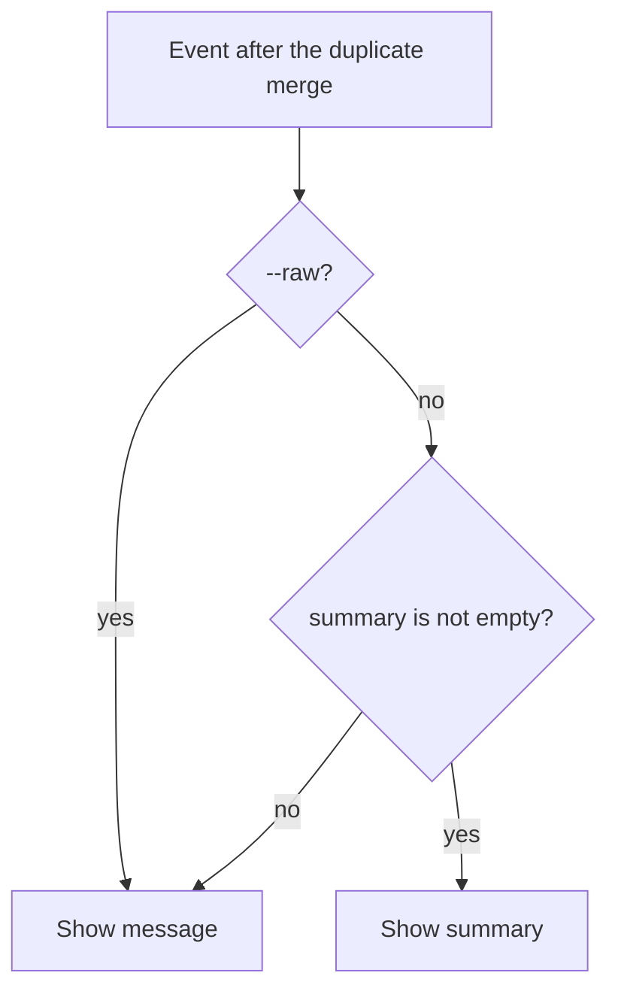

# ARGUS-194 — SCT event summary output in argus CLI (--raw flag)

## Overview

`argus run events` shows one text per event. When the event has a summary,
the output shows the summary. When it has none, the output shows the
message. The new flag `--raw` makes the output show the original message of
every event. The cache and the duplicate merge keep the full event. The
choice of text happens only when the command writes the output, in the JSON
output and in the `--text` table.

## Constraints

- JSON is the default output. Scripted callers, and Zeus first, read it, so
  the JSON output must carry the token savings, not only the table.
- The cache stores the full event. A cached response must serve both modes,
  with and without `--raw`, with no second fetch.
- An event never shows a blank text.

## Design

The events command reads `--raw` and passes the mode to the response value.
The response value selects the text for each event when it is written.



A promoted duplicate is an event like the others. The server gives a
duplicate no summary, so a promoted duplicate shows its message.

| Condition | Behavior |
|---|---|
| The summary is null or missing | Show the message |
| The summary and the message are both empty | Show the message key with an empty value |
| A cache entry has no summary | Show the message. The summary shows after the 5-minute TTL ends |

## Contracts

### Inputs

```
GET /api/v1/client/sct/<run_id>/events/<severity>/get?limit=&before=&after=
    # fields: event_id, duplicate_id, ts, message, summary (null when absent)
```

### Outputs

The command line:

```
argus run events --run-id <uuid> [--before T] [--after T] [--limit N] [--raw] [--text]
```

`--raw` (bool, default `false`): show the original message of every event.

The JSON output. Each event has exactly one of `message` and `summary`. A
reader takes the key that is present. All other fields stay the same.

```json
[
  {"event_id": "a1", "severity": "ERROR", "ts": "2026-10-01T10:00:00Z",
   "event_type": "DatabaseLogEvent", "summary": "Node 2 ran out of disk space", "...": "..."},
  {"event_id": "b2", "severity": "CRITICAL", "ts": "2026-10-01T10:05:00Z",
   "event_type": "CoreDumpEvent", "message": "<full message, no summary>", "...": "..."}
]
```

With `--raw`, every event has `message` and no `summary`.

The `--text` table has one text column, `Message`, which holds the selected
text, cut at 200 bytes:

```
Severity | Timestamp | Type | Node | Nemesis | Repeats | Message
```

## Risks

| Risk | Response |
|---|---|
| A script reads `.message` from the JSON and gets nothing for an event with a summary. Zeus `runtime/agents/past-runs.md` runs `test` and `split` on `.message`, and jq stops with a type error. The SCT `perf-weekly-status-report` skill looks for `CapacityReservationError` in `message` | A caller that matches on the original text adds `--raw`. The help text of `run events` names `--raw` |
| A CLI built before this change rejects `--raw` as an unknown flag | A caller adds `--raw` after the hosts that run it have the new CLI |
| The summary hides a detail that the triage needs | The caller runs the command again with `--raw` |

## Deferred work

The Zeus `triage.md` in scylladb/qatools reads `summary` first and `message`
second. That change ships in qatools after this CLI is released.

The callers that match on the original text add `--raw` after this CLI is
released:

- scylladb/zeus: `runtime/agents/past-runs.md`, and the event fields in
  `runtime/.opencode/skills/sct/SKILL.md` and `references/argus-api.md`.
- scylladb/scylla-cluster-tests: `skills/perf-weekly-status-report/`, in
  `SKILL.md`, `workflows/generate-report.md` and
  `references/argus-data-format.md`.

## Decisions

- The default JSON leaves out `message` when a summary exists, and `--raw`
  leaves out `summary`. Zeus reads the default JSON, and this saves the most
  tokens. (spec)
- The table merges the `Message` and `Summary` columns into one text column.
  Two columns show the same event twice. (spec)
- The choice of text happens at output time, not at fetch time, so the cache
  holds the full event for both modes. (spec)
- The default JSON keeps the summary-first shape. The callers that need the
  original text change to `--raw`, because the token savings are the purpose
  of the task. (review)
