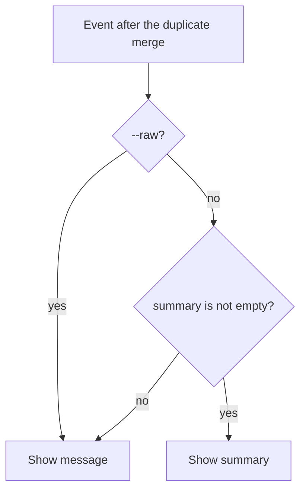

# ARGUS-194 — SCT event summary output in argus CLI (--raw flag)

## Overview

`argus run events` shows one text per event in `message`. When the event has
a summary, `message` holds the summary and the event gets
`"summarized": true`. When it has none, `message` holds the original
message. The new flag `--raw` makes the output show the original message of
every event. The cache and the duplicate merge keep the full event. The
choice of text happens only when the command writes the output, in the JSON
output and in the `--text` table.

## Constraints

- JSON is the default output. Scripted callers, and Zeus first, read it, so
  the JSON output must carry the token savings, not only the table.
- The cache stores the full event. A cached response must serve both modes,
  with and without `--raw`, with no second fetch.
- Every event keeps the `message` key, so a script that reads `.message`
  still gets a string.
- An event shows a blank text only when its summary and its message are
  both empty.

## Design

The events command reads `--raw` and passes the mode to the response value.
The response value selects the text for each event when it is written.



A promoted duplicate is an event like the others. The server gives a
duplicate no summary, so a promoted duplicate shows its message.

| Condition | Behavior |
|---|---|
| The summary is null or missing | Show the message |
| The summary and the message are both empty | Show `message` with an empty value, and no `summarized` |
| A cache entry has no summary | Show the message. The summary shows after the 5-minute TTL ends |

## Contracts

### Inputs

```
GET /api/v1/client/sct/<run_id>/events/<severity>/get?limit=&before=&after=
    # fields: event_id, duplicate_id, ts, message, summary (null when absent)
```

### Outputs

The command line:

```
argus run events --run-id <uuid> [--before T] [--after T] [--limit N] [--raw] [--text]
```

`--raw` (bool, default `false`): show the original message of every event.

The JSON output. Each event has `message` and no `summary`. An event whose
`message` holds the summary has `"summarized": true`. Other events have no
`summarized` key, so the flag costs no tokens on them. All other fields stay
the same.

```json
[
  {"event_id": "a1", "severity": "ERROR", "ts": "2026-10-01T10:00:00Z",
   "event_type": "DatabaseLogEvent", "message": "Node 2 ran out of disk space",
   "summarized": true, "...": "..."},
  {"event_id": "b2", "severity": "CRITICAL", "ts": "2026-10-01T10:05:00Z",
   "event_type": "CoreDumpEvent", "message": "<full message, no summary>", "...": "..."}
]
```

With `--raw`, every event has its original `message` and no `summarized`.

The `--text` table has one text column, `Message`, which holds the selected
text, cut at 200 bytes:

```
Severity | Timestamp | Type | Node | Nemesis | Repeats | Message
```

## Risks

| Risk | Response |
|---|---|
| A script matches on the original text in `.message` and gets the summary. Zeus `runtime/agents/past-runs.md` runs `test` on `.message`. The SCT `perf-weekly-status-report` skill looks for `CapacityReservationError` in `message` | A caller that matches on the original text adds `--raw`. The match misses until then, and nothing fails. The help text of `run events` names `--raw` |
| A CLI built before this change rejects `--raw` as an unknown flag | A caller adds `--raw` after the hosts that run it have the new CLI |
| The summary hides a detail that the triage needs | The caller runs the command again with `--raw` |

## Deferred work

The callers that match on the original text add `--raw` after this CLI is
released:

- scylladb/zeus: `runtime/agents/past-runs.md`, and the event fields in
  `runtime/.opencode/skills/sct/SKILL.md` and
  `runtime/.opencode/skills/sct/references/argus-api.md`.
- scylladb/scylla-cluster-tests: `skills/perf-weekly-status-report/`, in
  `SKILL.md`, `workflows/generate-report.md` and
  `references/argus-data-format.md`.

## Decisions

- The default JSON puts the selected text in `message` and leaves out
  `summary`. Zeus reads the default JSON, and one text per event saves the
  most tokens. (spec)
- The table merges the `Message` and `Summary` columns into one text column.
  Two columns show the same event twice. (spec)
- The choice of text happens at output time, not at fetch time, so the cache
  holds the full event for both modes. (spec)
- Every event keeps `message`, and `"summarized": true` marks a summary.
  A script that reads `.message` keeps a string, and a reader checks
  `.summarized` to know which text it got. (review)
- The eval harness, `argusAI/eval/events_source.py`, passes `--raw`. It
  measures the summarizer on the original text. (review)
