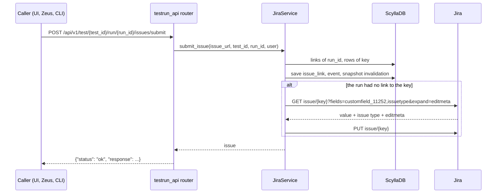
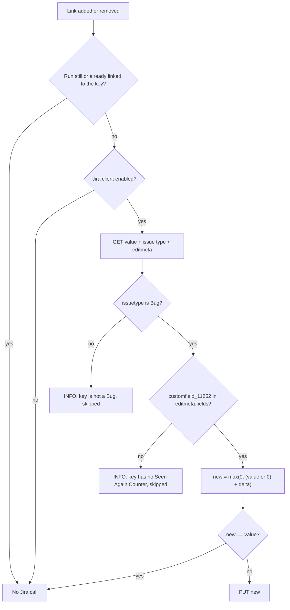

# ARGUS-212 — Linked runs raise the Jira Seen Again Counter

## Overview

When `JiraService` records the first link between a run and a Jira bug, it
adds one to the issue's Seen Again Counter (`customfield_11252`). When it
removes the run's last link to that key, it subtracts one. A single read of the
issue returns the counter, the issue type and the edit screen. Argus skips an
issue that is not a Bug, or whose edit screen lacks the field, and logs at INFO.
The write runs in the request after the link is saved and logs a WARNING when
it fails. The link is never affected. Jira emails the issue's watchers about
each change.

## Constraints

- Whether an issue carries the field cannot be read from its value or its
  edit screen. ARGUS-212, a Story whose issue view does not show the field,
  returns `0` as SCT-684 does, and both edit screens hold the same 30 fields,
  the counter among them. The issue type separates them. Jira rejects a write
  to a field that is not on the issue's edit screen.
- Several `JiraIssue` rows can share one key, because the lookup matches the
  exact permalink. The counter counts runs per Jira key, not rows.
- Submitting a link that already exists is an upsert of the same
  `issue_link` row. It must not count again.
- Jira has no atomic increment. The write reads the value and sets value ± 1.
- The production Argus Jira account sets the counter in projects it does not
  own (SCT, SCYLLADB, QATOOLS, ARGUS and others). It holds Edit Issues but not
  project admin, and Jira refuses `notifyUsers=false` without project admin:
  `To discard the user notification either admin or project admin permissions are required.`

## Design

**Components**

- `JiraService.submit_issue` (existing): before it saves the link, it checks
  whether the run already links any `JiraIssue` row with the same key. After the
  save, the event and the snapshot invalidation, it raises the counter by one
  when the run had no such link.
- `JiraService.delete_issue` (existing): after it deletes the link, it checks
  whether the run still links any row with the same key. When none remains, it
  lowers the counter by one.
- Counter adjuster (new, in `JiraService`): reads the issue's counter, type
  and edit screen, decides, writes, and keeps every Jira failure inside itself.



Removal follows the same order through `POST /api/v1/issues/delete`. Argus
deletes the link first, then checks the run's remaining links, and calls Jira
last.

**Counter rules**



- A link counts once per run and Jira key: one run with three links to SCT-684
  adds one.
- A null value counts as 0. The counter never goes below 0, so removing a link
  from an issue at 0 writes nothing.
- Only issues of type Bug count. A counter on a Task, a Story or a sub-task
  is left alone. The edit screen then excludes a project whose bugs lack the
  field.
- Jira emails the issue's watchers about each change, as it does for any edit.
- Links that existed before this change were never counted. Removing one of
  them lowers the counter, unless it is already at 0.

**Failure behavior**

| Condition | Behavior |
|---|---|
| Jira is disabled (`JIRA_ENABLED: false`, dry run) | No Jira call. The link succeeds |
| The issue is not a Bug | INFO log, no write. The link succeeds |
| The field is not on the issue's edit screen | INFO log, no write. The link succeeds |
| Jira answers 429, 503, or the connection drops | The Jira client retries with exponential backoff, then fails as below |
| GET or PUT fails (`JIRAError`, `requests.RequestException`) | WARNING log with the key and the traceback. The link stays saved. No Argus retry |
| The account lacks Edit Issues in the project | Same as the row above: Jira answers 400 or 403 |

## Contracts

### Inputs

```
GET {JIRA_SERVER}/rest/api/2/issue/{key}?fields=customfield_11252,issuetype&expand=editmeta
# fields used:
#   fields.customfield_11252                  number | null   the current counter
#   fields.issuetype.name                     string          only "Bug" counts
#   editmeta.fields.customfield_11252         present only when the field is on the edit screen
```

```json
{
  "key": "SCT-684",
  "fields": {"customfield_11252": 0.0, "issuetype": {"name": "Bug"}},
  "editmeta": {"fields": {"customfield_11252": {"name": "Seen Again Counter", "schema": {"type": "number"}, "operations": ["set"]}}}
}
```

### Outputs

```
PUT {JIRA_SERVER}/rest/api/2/issue/{key}
{"fields": {"customfield_11252": 1}, "update": {}}
-> 204 No Content, and an email to the issue's watchers
```

The Argus API responses of `issues/submit`, `issues/event/{event_id}/submit`
and `issues/delete` do not change.

## Risks

| Risk | Response |
|---|---|
| Two requests for the same key at the same moment race: links of two runs can lose one increment, and a double submit of one run can count it twice | Accepted. Links arrive at the pace of triage. The spec records the limit |
| A failed write leaves the counter one short, and nothing repairs it | Accepted. The WARNING names the key, and an operator can correct the value in Jira |
| The Argus Jira account lacks Edit Issues in a project | Every counted link there logs a WARNING |
| Each counted link emails the issue's watchers | Accepted. The Zeus occurrence comments email them as often today, and QATOOLS-417 removes those |
| A throttled or hung Jira holds the link request, through the client's retries and its missing timeout | Accepted. `get_issue` has the same exposure today |
| Each counted link edits the issue, so the issue's `updated` moves and the issue refresh job reads it again | Accepted. That costs one row update per sync |

## Decisions

- An issue is counted when it is a Bug and the field is on its edit screen.
  The edit screen alone also admits Stories such as ARGUS-212, whose issue
  view does not show the field, and a counter used on another type is left
  alone. (build)
- The write keeps Jira's watcher email. The production Argus Jira account lacks
  the project admin that `notifyUsers=false` needs. (build)
- The Jira write runs in the request, after the link is saved. (spec)
- The counter counts runs per Jira key, so duplicate `JiraIssue` rows and
  repeated submits count once. (spec)
- The field id `customfield_11252` is a constant in `JiraService`. Argus talks
  to one Jira instance. (spec)
- Links that exist before the deploy are not backfilled. (spec)
