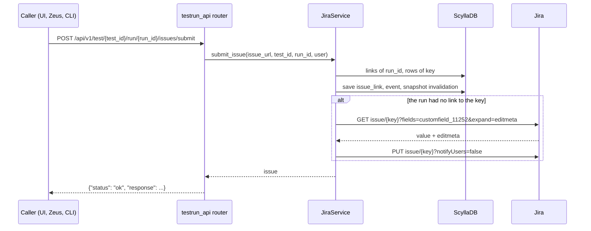
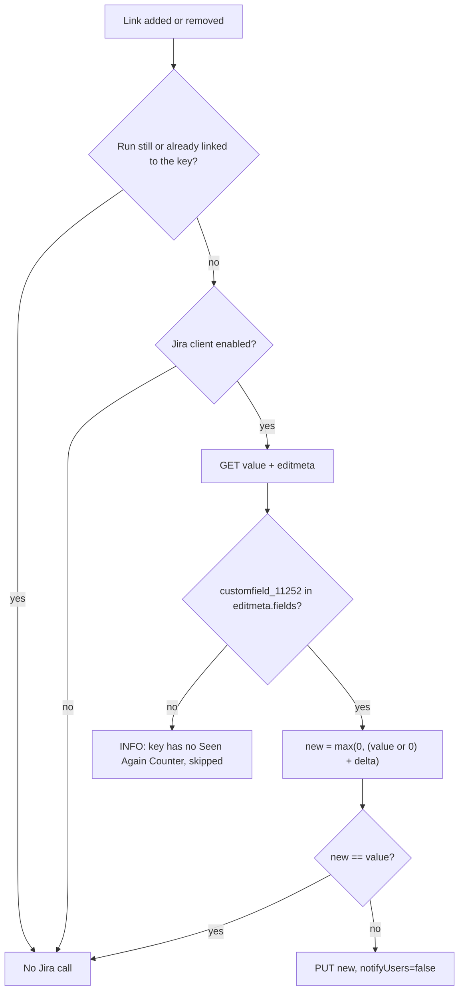

# ARGUS-212 — Linked runs raise the Jira Seen Again Counter

## Overview

When `JiraService` records the first link between a run and a Jira key, it
adds one to the issue's Seen Again Counter (`customfield_11252`). When it
removes the run's last link to that key, it subtracts one. A single read of the
issue returns the counter and the issue's edit screen. When the field is not on
that screen, Argus skips the issue and logs at INFO. The write runs in the
request after the link is saved, sends `notifyUsers=false`, and logs a WARNING
when it fails. The link is never affected.

## Constraints

- Whether an issue carries the field cannot be read from its value: ARGUS-212
  does not show the field and still returns `0`, as SCT-684 does. Jira rejects
  a write to a field that is not on the issue's edit screen.
- Several `JiraIssue` rows can share one key, because the lookup matches the
  exact permalink. The counter counts runs per Jira key, not rows.
- Submitting a link that already exists is an upsert of the same
  `issue_link` row. It must not count again.
- Jira has no atomic increment. The write reads the value and sets value ± 1.
- The Argus Jira account sets the counter in projects it does not own (SCT,
  SCYLLADB, QATOOLS, ARGUS and others). Watchers must not get an email for
  each counted link.

## Design

**Components**

- `JiraService.submit_issue` (existing): before it saves the link, it checks
  whether the run already links any `JiraIssue` row with the same key. After the
  save, the event and the snapshot invalidation, it raises the counter by one
  when the run had no such link.
- `JiraService.delete_issue` (existing): after it deletes the link, it checks
  whether the run still links any row with the same key. When none remains, it
  lowers the counter by one.
- Counter adjuster (new, in `JiraService`): reads the issue's counter and edit
  screen, decides, writes, and keeps every Jira failure inside itself.



Removal follows the same order through `POST /api/v1/issues/delete`. Argus
deletes the link first, then checks the run's remaining links, and calls Jira
last.

**Counter rules**



- A link counts once per run and Jira key: one run with three links to SCT-684
  adds one.
- A null value counts as 0. The counter never goes below 0, so removing a link
  from an issue at 0 writes nothing.
- The issue type and the project do not matter. The edit screen decides.
- Links that existed before this change were never counted. Removing one of
  them lowers the counter, unless it is already at 0.

**Failure behavior**

| Condition | Behavior |
|---|---|
| Jira is disabled (`JIRA_ENABLED: false`, dry run) | No Jira call. The link succeeds |
| The field is not on the issue's edit screen | INFO log, no write. The link succeeds |
| Jira answers 429, 503, or the connection drops | The Jira client retries with exponential backoff, then fails as below |
| GET or PUT fails (`JIRAError`, `requests.RequestException`) | WARNING log with the key and the traceback. The link stays saved. No Argus retry |
| The account lacks the permission for `notifyUsers=false` or for the edit | Same as the row above: Jira answers 400 or 403 |

## Contracts

### Inputs

```
GET {JIRA_SERVER}/rest/api/2/issue/{key}?fields=customfield_11252&expand=editmeta
# fields used:
#   fields.customfield_11252                  number | null   the current counter
#   editmeta.fields.customfield_11252         present only when the field is on the edit screen
```

```json
{
  "key": "SCT-684",
  "fields": {"customfield_11252": 0},
  "editmeta": {"fields": {"customfield_11252": {"name": "Seen Again Counter", "schema": {"type": "number"}, "operations": ["set"]}}}
}
```

### Outputs

```
PUT {JIRA_SERVER}/rest/api/2/issue/{key}?notifyUsers=false
{"fields": {"customfield_11252": 1}, "update": {}}
-> 204 No Content
```

The Argus API responses of `issues/submit`, `issues/event/{event_id}/submit`
and `issues/delete` do not change.

## Risks

| Risk | Response |
|---|---|
| Two links to the same key at the same moment on different workers lose one increment | Accepted. Links arrive at the pace of triage. The spec records the limit |
| A failed write leaves the counter one short, and nothing repairs it | Accepted. The WARNING names the key, and an operator can correct the value in Jira |
| The Argus Jira account lacks Edit Issues or Administer Projects in a project | Every counted link there logs a WARNING. Confirm the permissions with a Jira admin before the deploy |
| A throttled or hung Jira holds the link request, through the client's retries and its missing timeout | Accepted. `get_issue` has the same exposure today |
| Each counted link edits the issue, so the issue's `updated` moves and the issue refresh job reads it again | Accepted. That costs one row update per sync |

## Decisions

- An issue carries the counter when the field is on its edit screen, whatever
  its type or project. (spec)
- The write sends `notifyUsers=false`, so watchers get no email per link. (spec)
- The Jira write runs in the request, after the link is saved. (spec)
- The counter counts runs per Jira key, so duplicate `JiraIssue` rows and
  repeated submits count once. (spec)
- The field id `customfield_11252` is a constant in `JiraService`. Argus talks
  to one Jira instance. (spec)
- Links that exist before the deploy are not backfilled. (spec)
