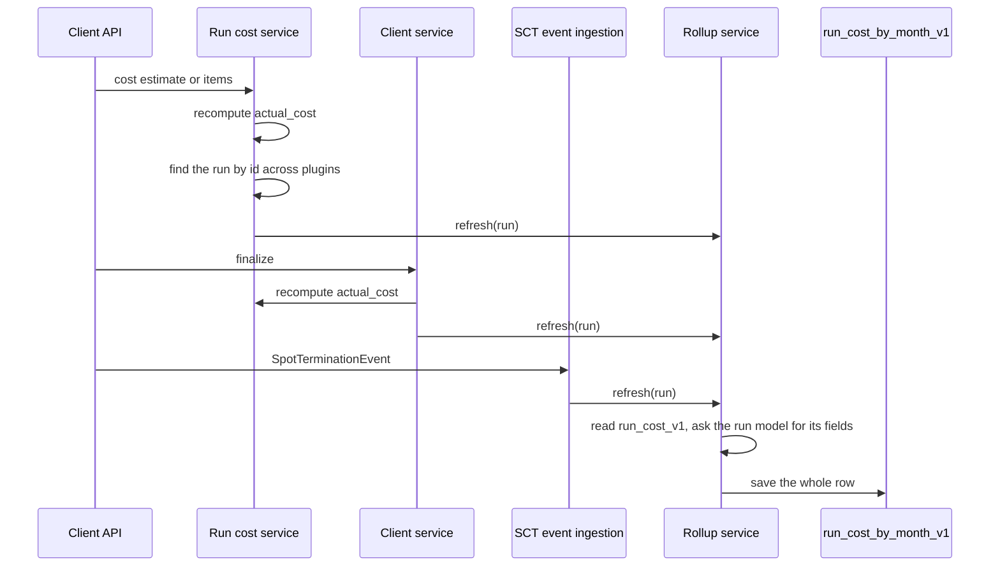
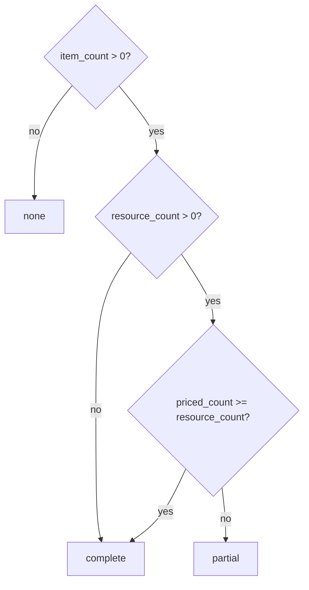

# ARGUS-218 — Cost Explorer

**Date**: 2026-10-29

## Overview

Every run gets one row in a new rollup table, keyed by the month of its start
time, its release and the run, carrying the run's dimensions, its cost sums
per pricing tier, its leaked cost and a coverage verdict. Argus rewrites that
row from fresh reads whenever a cost item or estimate lands, when the run
finalizes, and when a spot termination event arrives, so a late item from the
cleanup sweep is absorbed. One read endpoint folds the rows of the months in
range into every panel of a `Costs` page: tiles, spend over time by backend,
a breakdown per release by group or by test, the most expensive runs,
coverage, the tier split and spot terminations. A view widget calls the same
fold with the view's ids. A one-off script backfills the runs that reported
cost since ARGUS-205 landed.

## Constraints

- A page read costs a bounded number of partition reads, independent of the
  number of runs: no secondary index read and no `ALLOW FILTERING` on a run
  or cost table at read time.
- No module under `argus/backend/service/` imports an SCT plugin module at
  module level. The plugin graph imports the services, and a cycle breaks
  the loader.
- A cost write by a client and a run finalize never fail because the rollup
  write failed. The guard the finalize recompute uses today applies.
- `run_cost_v1` stays the per-run source of truth. The run page keeps
  reading it; the rollup is a copy a script can rebuild.
- The schema change is additive: one new table, applied by `sync-models`,
  so old and new workers serve during a deploy.
- No instance-hours. The producer sends a cost per item and no duration.

## Design

Four components take part. The **rollup service** turns one loaded run into
one row: it reads the run's cost partition, asks the run model for its
plugin-specific fields, then saves the row. The **run cost service** finds a
run across the plugins by id, through the index on `id` with the rollup
columns only, when a caller holds nothing but the run id; the finalize and
the event paths hold the run already. The **plugin run model** answers the
field question through two hooks on the base class; the SCT model fills
backend, region, the spot marker and the resource counts, every other plugin
returns nothing. The **explorer service** reads the
month partitions covering the window and the one before it, filters in
Python, resolves names, and folds the rows into the response. The **page**
and the **view widget** render that response.



A refresh recomputes the whole row from fresh reads and saves it, so the
write is idempotent and the last writer leaves a self-consistent row. The
month comes from the start time normalised to UTC, so a backfill and a live
write land on the same key.



`resource_count` is the number of the run's SCT resources without the runner,
and `priced_count` the number of them with a cost item of the same name. The
producer names an item after the node it priced.

The explorer read: the months covering `[start - (end - start), end)` are read
once, one query per month, restricted to the release when one is given.
Rows before `start` feed the trend only. Buckets are the ISO date of the
bucket start: the day, the Monday of the week, the first of the month, all in
UTC. Spend is `actual_cost`, or the spot or on-demand sum when the tier
filter is set; a run with no items contributes no spend and counts as "no
data". Cost per run divides by the runs with a figure.

| Condition | Behavior |
|---|---|
| The run id names no run in any plugin | The cost write stays; no row; the finalize refresh catches up |
| The run has no release | The row lands under the zero UUID, shown as "Unassigned" |
| The database fails during a refresh | Log with the run id; the client call succeeds |
| A leaked item arrives after finalize | Its own refresh rewrites the row; status and end time stay |
| The window exceeds 366 days or ends before it starts | `DataValidationError` |
| The month partitions in range hold no row | Every panel is empty and coverage reads zero runs |

## Contracts

### Inputs

```
sct_test_run, generic_run, sirenada_run, driver_test_run   # by id: build_id, start_time, id,
    release_id, group_id, test_id, status, end_time, build_number;
    SCT adds cloud_setup, sct_runner_host, region_name
run_cost_v1          # by run_id: name, cost, pricing_tier, leaked, estimated_cost, actual_cost
sct_resource         # by run_id: name, resource_type
sct_event            # by (run_id, CRITICAL): event_type, for a SpotTerminationEvent
sct_event submit     # event_type == "SpotTerminationEvent", any case
argus_user_view      # by id: release_ids, group_ids, tests
argus_release_v2, argus_group_v2, argus_test_v2   # by id: name, pretty_name
```

### Outputs

```sql
CREATE TABLE run_cost_by_month_v1 (
    month text,                 -- "2026-10", UTC month of start_time
    release_id uuid,            -- 00000000-0000-0000-0000-000000000000 when the run has none
    start_time timestamp,
    run_id uuid,
    plugin_name text,
    build_id text,
    build_number int,
    group_id uuid,
    test_id uuid,
    status text,
    end_time timestamp,
    backend text,               -- SCT: cloud_setup.backend, else sct_runner_host.provider
    region text,                -- SCT: first of region_name
    spot_terminated boolean,
    estimated_cost double,
    actual_cost double,
    spot_cost double,
    on_demand_cost double,
    untiered_cost double,
    leaked_cost double,
    item_count int,
    spot_count int,
    on_demand_count int,
    untiered_count int,
    leaked_count int,
    resource_count int,         -- null for a plugin without resources
    priced_count int,
    coverage text,              -- complete | partial | none
    PRIMARY KEY (month, release_id, start_time, run_id)
) WITH CLUSTERING ORDER BY (release_id ASC, start_time DESC, run_id ASC);

CREATE TABLE run_cost_release_span_v1 (
    release_id uuid PRIMARY KEY,
    first_start timestamp,      -- earliest run start the rollup has seen for the release
    last_start timestamp        -- latest
);
```

Read, for the page and the widget, under `/api/v1`, authenticated like every
API route:

```
GET /cost/explorer?from=<ISO>&to=<ISO>&releaseName=&groupId=&testId=&viewId=
                  &backend=&plugin=&status=&tier=spot|on-demand
                  &breakdown=group|test&granularity=day|week|month
                  # releaseName, groupId, testId, backend, plugin, status and tier repeat
GET /views/widgets/costs?view_id=<uuid>&days=<1..366>
```

`from` and `to` default to the last 90 days; `to` is exclusive. Every
filter repeats: a run must match one value of each parameter given, and a
parameter left out matches every run. `releaseName` is the release's name,
resolved through its index, so a link can be typed by hand; an unknown name
is an error. `viewId` expands to the view's release, group and test ids, and
a run matches any of them. `breakdown` defaults to `group`, `granularity` to
`week`, and no `tier` sums every tier. The widget reads `days` back from now, by day up to 31 days and by week
beyond. Both return the same envelope, in the standard response shape:

```json
{"window": {"from": "...", "to": "...", "granularity": "week", "breakdown": "group", "tiers": []},
 "span": {"from": "2026-02-03T09:12:00+00:00", "to": "2026-10-28T22:40:00+00:00"},
 "tiles": {"spend": 118406.2, "previous_spend": 105340.0, "weekly_run_rate": 9208.3,
           "errored_spend": 21733.0, "leaked_spend": 4918.0, "leaked_count": 31,
           "runs": 1284, "priced_runs": 1182},
 "series": {"buckets": ["2026-09-21", "2026-09-28"], "backends": {"aws": [1.0, 2.0], "gce": [0.5, 0.0]}},
 "releases": [{"id": "...", "name": "2026.1", "runs": 300, "priced_runs": 280, "spend": 40000.0,
               "rows": [{"id": "...", "name": "longevity", "runs": 120, "priced_runs": 118,
                         "spend": 20000.0, "cost_per_run": 169.5}]}],
 "top_runs": [{"run_id": "...", "build_id": "...", "build_number": 12, "plugin_name": "scylla-cluster-tests",
               "release": "2026.1", "group": "longevity", "test": "longevity-100gb-4h",
               "status": "failed", "start_time": "...", "end_time": "...", "backend": "aws",
               "region": "eu-west-1", "spend": 812.4, "coverage": "partial", "spot_terminated": false}],
 "coverage": {"complete": 1002, "partial": 180, "none": 102, "estimate_only": {"count": 40, "spend": 9100.0}},
 "tiers": {"spot": {"spend": 24286.0, "items": 5100}, "on_demand": {"spend": 94120.0, "items": 6200},
           "untiered": {"spend": 0.0, "items": 0}},
 "spot_terminations": {"count": 14, "spot_runs": 420, "rate": 0.033, "spend": 1900.0,
                       "by_location": [{"backend": "aws", "region": "eu-west-1", "count": 9, "spend": 1200.0}]}}
```

`top_runs` holds at most twenty runs, by spend descending. `series.buckets`
and each backend list have the same length. A missing figure is `null`,
never zero. `span` is the first and the last run start of the selected
releases over their whole history, from the span table, or `null` without
a selected release; a window that holds none of a selected release's runs
moves onto the span's last 90 days. The page links a run through `/test/{build_id}/{build_number}`.

The page is `/costs`, a `Costs` entry in the navigation bar, and reads its
filters from the query string, so a link can open it prefiltered, as the
widget does with `?viewId=`. The widget is the `costs` type of the view
dashboard with one setting, `days`, default 30.

### Module API

```python
class CostRollupService:
    async def refresh(self, run: PluginModelBase) -> RunCostRollup

class RunCostService:
    async def refresh_rollup(self, run_id: UUID) -> RunCostRollup | None

class PluginModelBase:
    @classmethod
    def cost_rollup_columns(cls) -> tuple[str, ...]
    async def cost_rollup_fields(self, item_names: set[str]) -> dict

@dataclass(frozen=True)
class CostScope:                      # the ids of a view: a run matches any of them
    release_ids: frozenset[UUID]
    group_ids: frozenset[UUID]
    test_ids: frozenset[UUID]

@dataclass
class CostQuery:
    start: datetime
    end: datetime                            # exclusive
    release_ids: frozenset[UUID] = frozenset()   # the page filters: empty matches every run,
    group_ids: frozenset[UUID] = frozenset()     # else a run matches one value of each
    test_ids: frozenset[UUID] = frozenset()
    scope: CostScope | None = None
    backends: frozenset[str] = frozenset()
    plugins: frozenset[str] = frozenset()
    statuses: frozenset[str] = frozenset()
    tiers: frozenset[str] = frozenset()
    breakdown: str = "group"
    granularity: str = "week"

class CostExplorerService:
    async def explore(self, query: CostQuery) -> dict
    async def query_for_view(self, view_id: UUID, **window) -> CostQuery
```

The backfill script, `scripts/migration/migration_2026-10-29_backfill_run_cost_rollup.py`,
refreshes every run with a cost partition and every SCT run, read per test
partition, with no date bound. It is idempotent.

## Risks

| Risk | Response |
|---|---|
| A month partition grows past a few thousand rows | At 500 runs a day a month holds about 15k rows of a few hundred bytes; a year ahead that is still a single-digit MB partition. A `_v2` keyed by week is the escape |
| The cross-plugin lookup by id costs four index reads per cost write | A cost write happens once per node termination; the lookup reads only the rollup columns |
| Two refreshes race and the older read wins | Each saves a row it read in full; the next cost write, the finalize, or the backfill rewrites it |
| Two refreshes extend a release span at once and the older bound wins | The span only widens, so the next refresh of a later run, or the backfill, restores it |
| The driver returns a naive datetime for `start_time` | The month key is derived after `replace(tzinfo=UTC)` on a naive value |
| `release_id__in` on the first clustering column is refused by the mapper | One query per release, gathered |
| A run whose test is registered after the run started has no release | It is rolled up under "Unassigned" until the test is registered: the paths that reassign a run's release, the test registration and the replay, delete the row under the old key and refresh the run, so the row moves rather than doubles |

## Deferred work

- Budgets, alerting and approval gates in epic SCT-851 read `run_cost_by_month_v1`
  and the explorer endpoint; nothing here is private to the page.
- A per-item backend or region breakdown, once the producer sends one on the
  item. The rollup copies the run's backend today.
- Instance-hours and a savings figure, if the producer ever sends a duration
  per item.
- A cost figure per release plan label (`ArgusReleasePlan.options`). The
  rollup carries `test_id` and `group_id`, so the fold can group by label later.

## Decisions

- The page and the view widget are both built here. (spec)
- The group/test toggle sets the breakdown dimension of the per-release
  section and the top spenders; the time series stacks by backend with its
  own day/week/month switch. (spec)
- The rollup records runs of every plugin, with the SCT-only fields null
  elsewhere, because the cost table is plugin-agnostic and the run counts
  need every run. (spec)
- One per-run fact table partitioned by month replaces a pre-aggregated
  `cost_by_day` table: the most expensive runs and the coverage counts need
  per-run rows anyway, and a month partition stays small. (spec)
- A run without a release rolls up under the zero UUID rather than being
  skipped, so its spend and its run count stay visible. (spec)
- The page holds no data horizon and states no date: cost data imported for
  older runs shows up without a code change, and a run without a figure is
  visible as "no data" in the coverage counts. (build)
- The backfill scans every SCT run with no date bound, so cost imported for
  runs older than the rollup lands too. (build)
- Every refresh widens a per-release span of run starts, one small row per
  release, so the page can move its window onto a release whose runs lie
  outside the last 90 days without scanning the rollup. (build)
- The navigation bar moves to a container of its own, 1400px wide instead
  of Bootstrap's 1320px, because the Costs entry did not fit beside the
  others at 1440px. (build)
- A finalized run gets a row even without cost, so "no data" is counted
  rather than invisible. (spec)
- The errored-spend tile sums the runs that ended on `test_error` or
  `aborted`, the runs that bought no verdict. A `failed` run spent its money
  as intended, so it is not counted. (build)
- The spot marker is derived at every refresh from the run's critical
  events, where `SpotTerminationEvent` is the one reclaim event the producer
  raises and a run holds a handful of critical rows; the event's ingestion
  only triggers a refresh. No column on the SCT run, and the backfill marks
  the runs reclaimed before this change. (build)
- The page filters are sets, one per dimension, a run must match one value
  of each; a view is a scope a run matches on any id. The toolbar picks
  each set through a searchable multi-select, and the run status is one
  of the dimensions. (build) The read restricts the partition by release when a
  single release is given, or when the scope names releases alone. (build)
- The rollup stores an item count per pricing tier beside the sums, so the
  tier panel can show how many resources each tier covered. (build)
- The rollup service takes a loaded run, and the run cost service owns the
  lookup by id: the SCT event path imports the rollup service, and a module
  that imports the plugin loader cannot be imported from inside a plugin
  without a cycle. (build)

---

Files, internal functions, tests, and line numbers go to `plan.md`. On the
spike path the code diff carries them, and the spec keeps this shape. A spec
near 150 lines, diagrams included, reads in one sitting. Above that, consider
a split and propose it in the spec. This footer stays in every spec.
