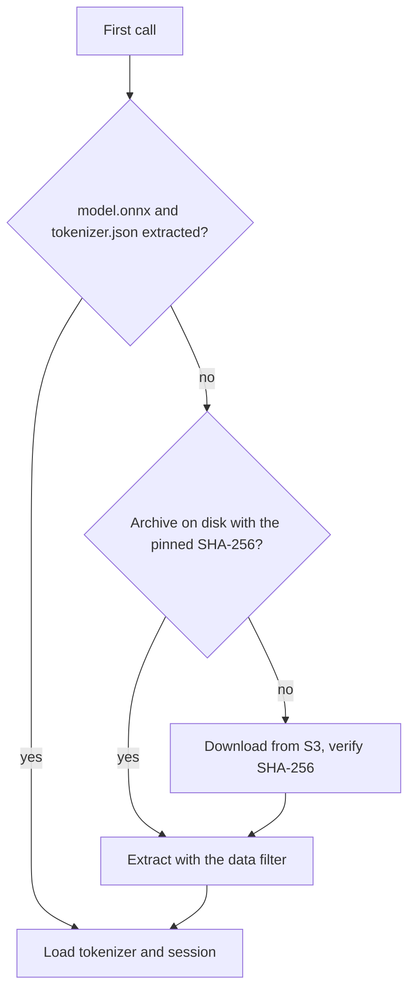

# ARGUS-238 — embed with onnxruntime directly and drop chromadb

## Overview

`BgeSmallEnEmbeddingModel` stops subclassing chromadb's `ONNXMiniLM_L6_V2`
and runs the same forward pass itself: `tokenizers`, an `onnxruntime`
session, masked mean pooling and L2 normalization, with the same settings,
so a message yields the same bits as before. A local `cosine` replaces
chromadb's in the V2 worker and the eval dedup. The V1 processor goes. The
`ai` and `ai-eval` extras swap chromadb for `onnxruntime`, `tokenizers` and
`numpy`.

## Constraints

- Every vector stored in ScyllaDB stays comparable with a new one under the
  0.05 cosine threshold. The new embedder reproduces chromadb's output bit
  for bit. Close is not enough.
- The deployed host keeps the model it already extracted under
  `/var/lib/argus/.cache/chroma`. A new path would mean a second 75 MB
  download, and a doc change in scylladb/qatools.
- Callers and test doubles keep their shape: `model(texts)` returns one
  vector per text. `EventEmbedder`, the V2 worker, the stub in
  `argus/backend/tests/sct_events/conftest.py` and the patches in
  `argusAI/tests/` call it that way.

## Design

chromadb adds nothing to the forward pass. `ONNXMiniLM_L6_V2._forward`
calls `tokenizers` and `onnxruntime` and pools in numpy. A reimplementation
run on 45 messages returned identical bytes. The messages covered short
lines, SCT event lines, an 812-token backtrace and a one-character message,
run as one batch and in chunks of 32. The settings that keep the bytes
identical:

```python
tokenizer.enable_truncation(max_length=256)
tokenizer.enable_padding(pad_id=0, pad_token="[PAD]", length=256)

options = ort.SessionOptions()
options.log_severity_level = 3
options.graph_optimization_level = ort.GraphOptimizationLevel.ORT_ENABLE_ALL
session = ort.InferenceSession(model_path, sess_options=options, providers=["CPUExecutionProvider"])

# ids, mask: int64 (batch, 256); token_type_ids all zero
hidden = session.run(None, {"input_ids": ids, "attention_mask": mask, "token_type_ids": zeros})[0]
weights = mask[..., None]                     # int64: the pooling runs in float64
pooled = (hidden * weights).sum(1) / np.clip(weights.sum(1), 1e-9, None)
norm = np.linalg.norm(pooled, axis=1)
norm[norm == 0] = 1e-12
vectors = (pooled / norm[:, None]).astype(np.float32)
```

Pooling in float32 instead drifts by about 1e-8 per component. chromadb
offers every available provider (`Azure`, `CPU`). The Azure provider runs
nothing locally, so `CPU` alone gives the same result.

The model files load on the first call, as they do today:



| Condition | Behavior |
|---|---|
| The download fails, or the SHA-256 differs | Delete the partial file, retry with an exponential backoff, three attempts in all, then raise |
| A text is longer than 256 tokens | Truncated to 256, as today |
| The worker cannot embed an event | Unchanged: V2 logs it and drops the event from the queue |

## Contracts

### Inputs

```
GET https://scylla-qa-public.s3.us-east-1.amazonaws.com/ArgusAI/bge-small-en-v1.5/onnx.tar.gz
    sha256 e7d1743b0c08f55c687cff6af696683398682f9ab4fb3cad1be644ee5553a72d
    used: onnx/model.onnx, onnx/tokenizer.json
cache: ~/.cache/chroma/onnx_models/bge-small-en-v1.5/{onnx.tar.gz,onnx/}
```

### Outputs

The vectors V2 stores in `sct_error_event_embedding.embedding` and
`sct_critical_event_embedding.embedding` keep their form: 384 `float32`
values with an L2 norm of 1. No table changes.

```toml
[project.optional-dependencies]
ai = [
  "anthropic >= 1.4.0",
  "tiktoken >= 0.7.0",
  "numpy >= 2.2",
  "onnxruntime >= 1.23",
  "tokenizers >= 0.22",
]
ai-eval = [
  "anthropic >= 1.4.0",
  "PyYAML ~= 6.0.0",
  "tiktoken >= 0.7.0",
  "numpy >= 2.2",
  "onnxruntime >= 1.23",
  "tokenizers >= 0.22",
]
```

The bundle self-check in `scripts/release/build-bundle.sh` imports
`onnxruntime` and `tokenizers` in place of `chromadb`.

### Module API

`argusAI/utils/embedding.py`. `EventEmbedder` keeps its signatures.

```python
class BgeSmallEnEmbeddingModel:
    MODEL_NAME: str = "bge-small-en-v1.5"
    DOWNLOAD_PATH: Path = Path.home() / ".cache" / "chroma" / "onnx_models" / MODEL_NAME
    EXTRACTED_FOLDER_NAME: str = "onnx"
    ARCHIVE_FILENAME: str = "onnx.tar.gz"
    MODEL_DOWNLOAD_URL: str = "https://scylla-qa-public.s3.us-east-1.amazonaws.com/ArgusAI/bge-small-en-v1.5/onnx.tar.gz"
    _MODEL_SHA256: str = "e7d1743b0c08f55c687cff6af696683398682f9ab4fb3cad1be644ee5553a72d"

    def __call__(self, texts: list[str]) -> list[np.ndarray]: ...  # float32, shape (384,)


def cosine(x: np.ndarray, y: np.ndarray) -> float: ...  # 1 - x·y / (‖x‖·‖y‖ + 1e-30)
```

`cosine` keeps chromadb's formula, so the 0.05 threshold keeps its meaning.

## Risks

| Risk | Response |
|---|---|
| The lock refresh moves `onnxruntime` or `tokenizers` and changes the numerics | Refresh the lock without an upgrade, and check that Python 3.11 and newer keep 1.29.0 and 0.22.2 |
| Code imports a package that only chromadb brought in | None does: pydantic, httpx and uvicorn come from `web-backend`, and numpy becomes a declared dependency. The bundle self-check and the `ai` CI job import the worker |
| A host that has no model cannot reach S3 at its first start | Unchanged from today. The retries cover a transient failure |

## Decisions

- No golden vectors in the repository. chromadb calls `tokenizers` and
  `onnxruntime` directly, so a one-off comparison with chromadb on the
  baseline events, run before the dependency leaves the lock and recorded
  in this directory, is the parity evidence. (spec)
- The pooling stays mean pooling in float64. BGE's reference pooling is
  CLS, but a switch would invalidate every stored vector. (spec)
- The cache path keeps its `chroma` segment. (spec)
- The model still loads on the first call, not at construction. Tests
  construct the class without a model on disk. (spec)
- The download uses `requests`, a core dependency, and retries a network
  failure as well as a SHA-256 mismatch. chromadb retried only the
  mismatch. (spec)
- `numpy` becomes a declared dependency of both extras, because argusAI
  imports it directly. Before this change it arrived only through
  chromadb. (spec)
- The host step for the V1 unit belongs to `roles/argus` in
  scylladb/qatools: `argus_legacy_ai_units` stops, disables and removes
  `argusai_event_similarity_processor.service`. This repository carries no
  host step. At deploy, check that argus-prod has no such unit. (spec)
- The `onnxruntime` floor is 1.23. `requires-python` is `>=3.10`, and
  1.24 publishes no cp310 wheel, so the 3.10 split resolves to 1.23.2.
  Python 3.11 and newer keep 1.29.0. (build)
- Komachi pre-approved the intent, the spec and the plan. The code waits
  for Komachi's review before it is committed. (spec)
