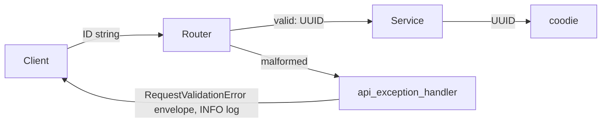

# ARGUS-240 — Type the ID parameters of API routes as UUID

## Overview

FastAPI parses every entity ID of an API route into a `UUID`, in the
router signature or in the request model. A malformed ID stops at the
router with a `RequestValidationError`, and `api_exception_handler` logs it
as a client error. The services take `UUID`, drop their `UUID()` calls and
their `isinstance` guards, and hand the value to coodie unchanged. The
typing fixes the flows that fail today on a string in a UUID column, and
the response keeps the string keys its consumers read.

## Constraints

- A valid request keeps its wire format. Clients send IDs as UUID strings,
  and a JSON object keyed by an ID keeps string keys.
- The frontend sends an unset optional ID as an empty string
  (`afterId=`, `releaseId=`, `new_group_id: ""`). These keep working.
- The run assignee selector sends `"none-none-none"` for no assignee. The
  wire value stays.
- A plan reference accepts a plan UUID or a plan key (`release#N`).
- A service that calls `UUID(x)` with no guard fails on a `UUID`. Each
  router and the services it calls change together.

## Design



The router declares each ID as one of these types:

| Input | Type |
|---|---|
| A required ID | `UUID` |
| An optional ID that the frontend may send as `""` | `Annotated[UUID \| None, NoneIfEmpty]` |
| A list of IDs | `list[UUID]` |
| A map keyed by ID | `dict[UUID, UUID]` |
| The assignee | `Annotated[UUID \| None, BeforeValidator(<sentinel → None>)]` |
| A plan reference | `str` (unchanged) |

Where an ID becomes a key of a JSON object in a response, the service
writes `str(id)`. The JSON encoder rejects a `UUID` key.

| Condition | Behavior |
|---|---|
| A malformed ID in the path, the query or the body | The `RequestValidationError` envelope, HTTP 200. INFO log, no exception metric. |
| An optional ID sent as `""` | `None`, as today. |
| A well-formed ID of a missing row | Unchanged: the service raises its `DocumentNotFound` or its `APIException`. |
| A plan key in a plan route | Unchanged: `_resolve_plan` looks it up. |

The flows that fail today and the typing that fixes them:

| Flow | Today | After |
|---|---|---|
| SCT Gemini submit (status not `PASSED`), performance submit (regression) | The run event gets the string run ID and the save fails. | The route gives a `UUID`. |
| Run comment submit and update with mentions | The string mentions reach a `list<uuid>` column, or `m.id` fails on a string. | `mentions: list[UUID]`. The receivers are the mentioned IDs plus the `@name` matches. |
| Plan update with an owner | The string owner reaches a UUID column. | `owner: UUID \| None`. `ends_at` becomes `datetime \| None`. |
| Plan copy with replacements | The lookup by `UUID` misses the string keys, and the mapped entities are dropped. | `replacements: dict[UUID, UUID]`. |
| Runs details widget, a run that fails to load | The error entry has a `UUID` key, and the response fails. | The key is `str(run_id)`. |

## Contracts

### Outputs

The routes that change. Each parameter below is a `UUID` unless the line
says otherwise.

```
testrun_api   GET  /api/v1/run/{run_id}/type
              GET  /api/v1/jenkins/clone/targets?testId
              GET  /api/v1/jenkins/clone/groups?targetId
              POST /api/v1/jenkins/clone/create            body: target, group
              POST /api/v1/test/{t}/run/{r}/comments/submit, …/comment/{c}/update
                                                           body: mentions: list[UUID]
              POST /api/v1/test/{t}/run/{r}/assignee/set   body: assignee: UUID | "none-none-none"
client_api    GET  /api/v1/client/testrun/{run_id}/info
              /api/v1/client/testrun/{run_type}/{run_id}/…  get, heartbeat, get_status, set_status,
              update_product_version, logs/submit, finalize, submit_results
              /api/v1/client/{run_id}/config/submit, /config/all
              POST /api/v1/client/testrun/pytest/result/submit   body: run_id
sct plugin    /api/v1/client/sct/{run_id}/…                every route
              POST /api/v1/client/sct/similar_runs_info    body: run_ids: list[UUID]
ssh_api       GET  /api/v1/client/ssh/tunnel/keys?tunnel_id   optional, "" → None
admin_api     POST /admin/api/v1/release/set_perpetual|set_state|set_dormant   body: release_id
              POST /admin/api/v1/release/edit              body: id
              POST /admin/api/v1/release/delete            body: releaseId
              POST /admin/api/v1/group/create|update|delete  body: release_id, group_id,
                                                           new_group_id (optional, "" → None)
              POST /admin/api/v1/test/create|update|delete|batch_move
                                                           body: group_id, release_id, test_id,
                                                           new_group_id, tests: list[UUID]
              POST /admin/api/v1/user/{user_id}/delete, /admin/toggle
              GET  /admin/api/v1/proxy-tunnel/config?tunnel_id   optional, "" → None
api           POST /api/v1/release/schedules/comment/update  body: releaseId, groupId, testId
notifications GET  /api/v1/notifications/summary?afterId    optional, "" → None
planner_api   GET  /api/v1/planning/search?releaseId        optional, "" → None
              GET  /api/v1/planning/group/{group_id}/explode
              GET  /api/v1/planning/release/{release_id}/all
              POST /api/v1/planning/plan/create, /plan/update, /plan/copy
              POST /api/v1/planning/plan/{plan_id}/owner/set   body: newOwner
view_api      POST /api/v1/views/update                    body: viewId, updateData.plan_id
              POST /api/v1/views/delete                    body: viewId
              GET  /api/v1/views/stats?viewId
              GET  /api/v1/views/{view_id}/versions|images|resolve|resolve/tests|pytest/results
              GET  /api/v1/views/widgets/pytest/view/{view_id}/results
              POST /api/v1/views/widgets/runs_details      body: run_ids: list[UUID]
              POST /api/v1/views/widgets/summary/runs_results   body keys and run_id
```

The planner bodies stay frozen dataclasses. The routes take them as the
body in place of an untyped dictionary, so FastAPI validates them. `id`
and `plan.id` stay plan references, and the options keys stay strings.

```python
class CreatePlanPayload:
    name: str
    description: str
    owner: UUID
    participants: list[UUID]
    target_version: str | None
    release_id: UUID
    tests: list[UUID]
    groups: list[UUID]
    assignments: dict[UUID, UUID]
    options: PlanOptions = {}
    view_id: UUID | None = None
    created_from: UUID | None = None

class PlanDiffPayload:
    id: str
    owner: UUID | None = None
    ends_at: datetime | None = None
    view_id: UUID | None = None
    tests_add: list[UUID] = []           # and tests_remove, groups_*, participants_*
    assignee_mapping_set: dict[UUID, UUID] = {}
    assignee_mapping_remove: list[UUID] = []
    options_set: PlanOptions = {}
    options_remove: list[str] = []
    # name, description, target_version, completed: unchanged

class CopyPlanPayload:
    replacements: dict[UUID, UUID]
    targetReleaseId: UUID
    plan: TempPlanPayload                # owner: UUID, participants: list[UUID]
```

The other typed bodies:

```python
class ViewUpdateRequest(TypedDict):
    name: str
    description: str | None
    display_name: str | None
    items: list[str]                     # "release:<id>", "group:<id>", "test:<id>"
    widget_settings: str
    plan_id: NotRequired[UUID | None]

class PytestSubmitData(TypedDict):
    name: str
    timestamp: float
    session_timestamp: float
    test_type: str
    run_id: UUID
    status: str                          # the reporter also sends "internal-error"
    message: NotRequired[str | None]
    duration: NotRequired[float | None]
    markers: NotRequired[list[str]]
    user_fields: NotRequired[dict[str, Any]]

class ScheduleCommentUpdateRequest(BaseModel):
    releaseId: UUID
    groupId: UUID
    testId: UUID
    newComment: str

class VersionedRun(BaseModel):          # /summary/runs_results: dict[UUID, dict[str, VersionedRun]]
    run_id: UUID
```

The error envelope for a malformed ID. The shape exists today for other
validation errors.

```json
{"status": "error",
 "response": {"trace_id": "…", "exception": "RequestValidationError",
              "message": "…", "arguments": [[{"type": "uuid_parsing", "loc": ["query", "targetId"], …}]]}}
```

### Module API

The rule for every service method behind these routes: an ID parameter is
`UUID`, and the body does not call `UUID()` on it. For example:

```python
async def get_groups_for_release(self, release_id: UUID) -> list[ArgusGroup]: ...
async def post_run_comment(self, test_id: UUID, run_id: UUID, message: str, reactions: dict,
                           mentions: list[UUID], user: User): ...
async def heartbeat(self, run_type: str, run_id: UUID) -> int: ...
async def delete_group(self, group_id: UUID, delete_tests: bool = True,
                       new_group_id: UUID | None = None) -> bool: ...
```

These keep their conversion, because their input is a string by nature:
`_resolve_plan` (a plan UUID or key), `parse_view_entity_list`
(`"test:<id>"`), `load_user` and `stop_user_impersonation` (the session),
and the `RunConfigParam.run_id` text column.

## Risks

| Risk | Response |
|---|---|
| A caller outside the routers passes a string to a retyped service method: a test, a migration script, argusAI. | The plan greps every caller, including `scripts/` and `argusAI/`. Tests pass a `UUID`. |
| A route that used to accept a bad ID now rejects it. | The bad ID failed before with a `ValueError`. Only the exception name in the envelope changes. The clone test that sends `"release-1"` changes to real IDs. |
| `UUID` parsing lowercases an uppercase ID, so a response keyed by `str(id)` no longer echoes the client's spelling. | The frontend sends only IDs it read from the server, which are lowercase. |
| A dashboard or an alert counts validation errors in the exception metric. | The metric then counted client mistakes as faults. The INFO log keeps the trace ID. |

## Decisions

- The failing flows that the sweep found are fixed in this task, each with
  a regression test. The typing fixes most of them. (spec)
- The per-plugin run submission payloads and the email report payloads stay
  untyped dictionaries. Their shape differs per plugin, and the plugin keeps
  its own conversion. (spec)
- `api_exception_handler` logs a `RequestValidationError` like an
  `APIException`, at INFO with no exception metric. This covers every
  validation error. (spec)
- The assignee keeps the `"none-none-none"` wire value. A validator maps it
  to `None`, so the frontend does not change. (spec)
- Plan references stay strings, because a plan key is valid there
  (ARGUS-147). (spec)
- Server-rendered pages keep their hand parsing, which flashes an error and
  redirects. The impersonation form is not an API route and stays as is. (spec)
- The legacy schedule stubs read no IDs and stay untyped. (spec)
- The performance regression check read the run by subscript, which a
  coodie document does not support, so every submission with an earlier
  run failed before the event write. It reads the attribute now, so the
  regression path and its run ID fix are reachable. (build)
