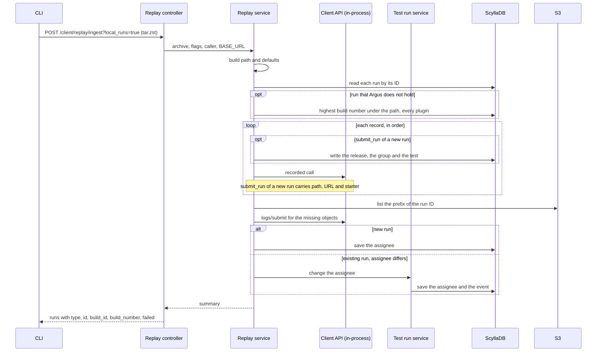

# ARGUS-252 — Replay a local run into a numbered path owned by the caller

## Overview

A replay of one local run files the run under
`local-runs/<caller username>/<test>`, with the next build number of that
test. The run keeps its recorded run ID. The server picks the path and the
number. The user may name `<test>` with `test_name`. The request asks for
this with `local_runs`. The CLI sends
`local_runs` unless the user gives `--keep-run`. A request without
`local_runs` replays each run as recorded. Only a run that Argus does not hold yet gets the path,
the number, and the caller as its starter. The summary lists each run with
its build. The CLI prints a link per run.

## Constraints

- The archive and the recorded S3 objects stay as they are. The run keeps
  the logs that live under its run ID in S3.
- A Jenkins run, and any request without `local_runs`, replays as
  recorded, so an outage recovery restores the original runs.
- The user cannot choose a full build path or a build number. A chosen path
  can name a Jenkins job, and the next Jenkins build then takes the same
  number. The user can name the `<test>` under `local-runs/<caller>/`.
- The local runs of a user are easy to find: one release, one group per user,
  one test per SCT test.
- No schema change.

## Design

- **CLI** sends the flags, prints the summary and one line per run.
- **Replay controller** passes the flags, the caller, and `BASE_URL`.
- **Replay service** picks the build path, resolves the defaults, finds the
  runs that Argus does not hold, numbers them, rewrites their `submit_run`,
  dispatches the records through the in-process client, back-fills logs,
  and assigns the owner.
- **Test run service** changes the assignee of a run that existed before the
  replay, and writes the assignee-change event.



| Request | Archive | Build path |
|---|---|---|
| `local_runs` | One run, `submit_run` with no build URL | `local-runs/<caller>/<test>` |
| Any other | Any | None: runs keep their recorded paths |

`<test>` is `test_name` when the request sets it. Else it is the first SCT
config file without its directory and extension, such as
`longevity-100gb-4h`, else the last name of the recorded path, else
`local-run`. A `test_name` without a build path, or with no character that a
path accepts, is a `DataValidationError` before any dispatch. Names keep `A-Z a-z 0-9 . _ -`. Any other character becomes
`-`, and a name loses its leading and trailing dots and dashes.

| Default when absent | Build path | No build path |
|---|---|---|
| `as_me` | `true` | `false` |
| `create_missing_tests` | `true` when a run is new | `false` |

The `local-runs` path creates its release, group and test, so it works on an
instance that has none. The service resolves the defaults, because only the
archive tells whether a run is local.

**New runs.** Before dispatch, the service reads each run by its ID. A run
that Argus holds replays as recorded, because SCT `submit_run` keeps an
existing run and ignores a new path. Its recorded `job_name` is
`local_run`, which names no test, so its `submit_run` gets neither the
test auto-create nor the missing-test check. A run that Argus does not hold
is a new run.

**Numbers.** One sequence per path across every plugin, because
`/test/<path>/<n>` resolves one run. A new run takes the next number above
the highest one that a run holds under the path.

**Submit.** The `submit_run` of a new run gets the path and the build URL
under its plugin's keys:

| Plugin | Path key | URL key |
|---|---|---|
| SCT, driver-matrix | `job_name` | `job_url` |
| generic | `build_id` | `build_url` |
| sirenada | `build_id` | `build_job_url` |

The build URL is `<BASE_URL>/test/<path>/<n>/`, never a URL from the
request's `Host` header. Every plugin and view reads the build number from
it, and it opens the run. The report email and the GitHub issue templates
show it as a link, so it must be absolute. A replay into the path fails
before dispatch when `BASE_URL` is not set. The legacy driver-matrix
`submit_run` reads the build number from the URL, as the current one does.
A test entity that a new run creates takes no build URL.

**Writes.** The build number and the new run's `started_by` land with
`submit_run`. The assignee goes last, after the log back-fill, because
`update_product_version` can set it from the schedule. A run that existed
before the replay gets only its assignee, through the test run service, and
only when it differs from the owner.

**Logs.** The back-fill lists the S3 prefix of every run that the archive
names. A local run puts nothing there until the engineer runs
`hydra collect-logs --test-id <run id> --logdir <run directory>`. With Argus
off, `collect-logs` uploads to S3 and records no `logs/submit`, so the
back-fill is the step that links the logs. A replay after `collect-logs`, or
a second replay of the same log, attaches the uploaded logs.

| Condition | Behavior |
|---|---|
| Unknown run type, build path without `BASE_URL` | `DataValidationError` or `ReplayServiceError` before any dispatch |
| `submit_run` of a run fails | No assignee for it. The summary holds that error and marks the run `failed`. The CLI prints no link for it |
| A save of the owner fails | A `stamp_run` error for that run. The replay continues |
| `dry_run` | Every check and the numbering. No dispatch, no save |

## Contracts

### Outputs

```
POST /api/v1/client/replay/ingest
  ?dry_run=<bool>&backfill_logs=<bool>          # existing
  &create_missing_tests=<bool>                  # default: see the table above
  &as_me=<bool>                                 # new, default: see the table above
  &local_runs=<bool>                            # new, default false; the CLI sends true
  &test_name=<string>                           # new, optional; the <test> of a local run
```

```json
{"status": "ok", "response": {
  "total": 83, "processed": 83, "succeeded": 83, "failed": 0,
  "skipped_no_replay": 0, "backfilled_logs": 0,
  "errors": [{"ts": 0, "endpoint": "stamp_run", "error": "run <id>: …"}],
  "runs": [{"type": "scylla-cluster-tests", "id": "<run id>",
            "build_id": "<path>", "build_number": 1, "failed": false}]}}
```

`build_id` and `build_number` are `null` for a run that got no build path.
`failed` is `true` for a run whose `submit_run` failed.

```
argus run replay (--file <path>… | --dir <dir>) [--keep-run | --test <name>]
                 [--as-me[=false]] [--create-missing-tests[=false]] …
Run <id> (<path>#<n>): <base>/tests/<type>/<id>
Run <id> (<path>#<n>) failed: see the errors below
Run <id> would replay as (<path>#<n>)          # --dry-run
```

## Risks

| Risk | Response |
|---|---|
| Two replays of one test by one user at the same time take the same number | Accepted. The path is per user and per test. Each run still has its own ID and link |
| A second replay of the same log repeats records that append | Accepted. SCT keeps its run, and sirenada appends its results again. The summary shows each record |
| A local run reached Argus live as `local_run` | It stays where it is. Moving a run is out of scope |

## Decisions

- The server applies the overrides. Only it knows the caller. (spec)
- The run keeps its recorded run ID. The S3 back-fill then finds its logs,
  and no record needs a rewrite of the ID. (review)
- Only a run that Argus does not hold gets a path and a number. SCT
  `submit_run` keeps an existing run, so a new path would not reach it.
  (review)
- The server picks the build path and the number. A user path can name a
  Jenkins job, whose next build would take the same number. (review)
- The user may name the `<test>` with `--test`. A local run of a known test
  can use another config, or belong to a feature or a pull request. The name
  stays under `local-runs/<caller>/`, so it cannot name a Jenkins job.
  (review)
- `create_missing_tests` defaults to on only when the replay files a new run,
  and a run that Argus holds gets no test check. A second replay of a local
  run would else create `untracked/untracked/local_run`. (review)
- The back-fill lists the prefix of every run that the summary lists, so a
  local run without a recorded `logs/submit` gets its logs. (review)
- No reservation of build numbers. The path is per user and per test, so
  only one user who replays one test twice at once can collide. (review)
- `as_me` is separate from `local_runs`, so a user can own a replay without
  moving it. (build)
- The CLI sends a flag only when the user sets it. (build)
- One local run goes to `local-runs/<caller>/<test>`: a local run records
  `local_run`, which files it nowhere useful. (review)
- The test name is the first SCT config file, the same for every run of a
  test, so its builds count up. (build)
- The CLI asks for the `local-runs` path with `local_runs`, so an older
  client keeps its replay. `--keep-run` turns it off. (review)
- The build URL is the run's own absolute Argus link from `BASE_URL`, never
  from the `Host` header. Views parse the number from it, and emails and
  GitHub issues link to it. (review)
- A run that existed before the replay changes only its assignee, through
  the service that writes the event. Its starter is history. (review)
- `submit_run` gets the path under each plugin's keys. Generic and sirenada
  read `build_id`. (review)
