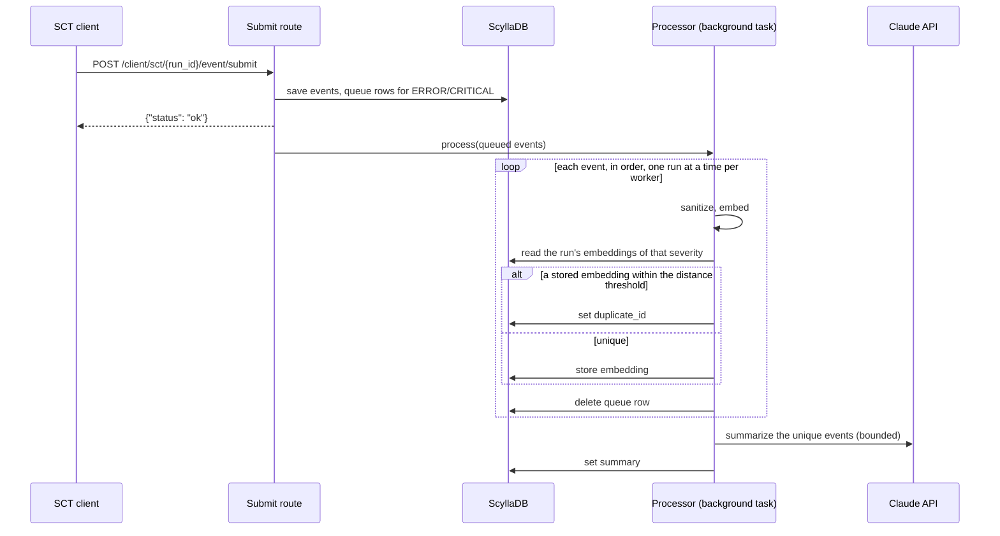
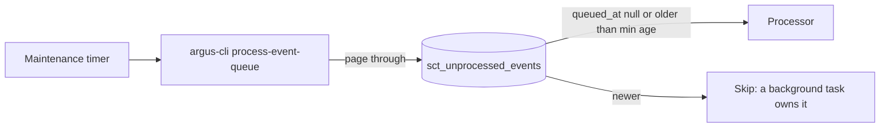

# ARGUS-257 — Process SCT events inside the backend

## Overview

The SCT plugin takes over the ArgusAI event similarity processor. The event
submit route stores the events and the queue rows as today, answers, and then
runs a FastAPI background task in the same worker. For each ERROR or CRITICAL
event, the task sanitizes and embeds the message, marks a duplicate within the
run or stores the embedding, removes the queue row, and starts a summary of a
unique event. The queue table becomes a recovery log: a CLI sweep processes
rows that no background task finished. All of `argusAI/` moves into
`argus/backend/plugins/sct/events/`, and the separate service goes away.

## Constraints

- Four gunicorn workers share a host. Each one may load the model, and two may
  download it at once on a cold host.
- Inference is CPU-bound and must not run on the event loop of a worker that
  serves requests.
- One process runs the sweep. The web workers share no lock and no leader.
- The embedding tables and `SCTUnprocessedEvent` keep their module, because
  migration scripts that already ran import them.
- No new service and no new port. The summary metrics reach the existing
  backend `/metrics`.
- The database reads and writes go through coodie, raw CQL only where coodie
  cannot express the query.

## Design

Components, all under `argus/backend/plugins/sct/events/`:

- **Sanitizer**: strips run-specific noise from a message. Unchanged rules.
- **Embedder**: BGE-small-en through onnxruntime, 384 dimensions, unchanged
  model, archive and SHA-256. One model per process, loaded on first use,
  inference on a single dedicated thread. The download and the extraction
  write to a temporary path and rename it into place.
- **Processor**: the per-event pipeline below. One instance per process.
- **Summary dispatcher**: bounded, best-effort Claude summaries of unique
  events, on the event loop with the blocking API call in a thread.
- **Summarizer, prompts, metrics**: moved as they are.
- **Eval harness**: the offline model and prompt evaluation, moved as it is.

### Ingestion



### Recovery sweep



The background task has a head start of the minimum age, ten minutes by
default. Rows that predate the `queued_at` column count as stale, so the first
sweep after the deploy drains the queue the old service left behind.

### Duplicate rule

Unchanged from the old processor: an event is a duplicate when an embedding
already stored for the same run and severity lies within cosine distance
0.05, the event's own timestamp excluded. A duplicate gets `duplicate_id` set
to the `event_id` of the first match in partition order, newest first as
before, and no embedding of its own. A
unique event stores its embedding and gets a summary.

### Failure behavior

| Condition | Behavior |
|---|---|
| Any failure in the background task | Logged; the client already has its answer |
| The message is empty, or empty after sanitizing | Logged, queue row deleted, no embedding |
| The event row is missing | Logged, queue row deleted |
| The model cannot load or download, or a database call fails | Logged, queue row kept for the sweep |
| The worker dies before the task ends | Queue row kept for the sweep |
| Summarization disabled or no API key | No summary; the rest runs |
| The summary backlog is full | The summary is dropped and counted |
| The Claude call fails or times out | The summary is skipped and counted; the queue row is already gone |

## Contracts

### Inputs

```
POST /api/v1/client/sct/{run_id}/event/submit    # unchanged request and response
argus_web.yaml:
  EVENT_SUMMARIZATION_ENABLED, ANTHROPIC_API_KEY, ANTHROPIC_BASE_URL,
  ANTHROPIC_SUMMARY_MODEL, ANTHROPIC_SUMMARY_EFFORT,
  EVENT_SUMMARIZATION_MAX_CONCURRENCY, EVENT_SUMMARIZATION_MAX_BACKLOG,
  EVENT_SUMMARIZATION_MIN_TOKENS, EVENT_SUMMARIZATION_PROMPT_VERSION,
  EVENT_SUMMARIZATION_PROMPT
```

The backend reads these keys at worker start, as the service did.
`EVENT_SUMMARIZATION_METRICS_PORT` goes away.

### Outputs

The queue table gains one column. `sync-models` applies it.

```sql
ALTER TABLE sct_unprocessed_events ADD queued_at timestamp;
```

The writes the old service made, unchanged in shape:

```
sct_error_event_embedding / sct_critical_event_embedding   (run_id, ts, embedding)
sct_event.duplicate_id   sct_event.summary
```

The command for the maintenance timer:

```
argus-cli process-event-queue [--min-age SECONDS]   # default 600; exit 0 when the pass ends
```

The `argus_event_summarization_*` series keep their names and labels and move
to the backend `/metrics`.

The release bundle loses `bin/argus-ai-worker`. The deployment in
scylladb/qatools `roles/argus` drops the ArgusAI unit and adds a timer for the
command above.

### Module API

```python
# argus/backend/plugins/sct/events/processor.py
@dataclass(frozen=True, slots=True)
class QueuedEvent:
    run_id: UUID
    severity: str
    ts: datetime


class EventProcessor:
    async def process(self, events: list[QueuedEvent]) -> None: ...
    async def sweep(self, min_age: timedelta) -> int: ...   # rows processed


def get_event_processor() -> EventProcessor: ...   # one per process


# argus/backend/plugins/sct/events/embedding.py
class EventEmbedder:
    def embed(self, message: str) -> np.ndarray: ...
    def embed_many(self, messages: list[str]) -> list[np.ndarray]: ...


# argus/backend/plugins/sct/service.py
class SCTService:
    async def submit_events(cls, run_id: UUID, raw_events: list[RawEventPayload]) -> list[QueuedEvent]: ...
    async def submit_event(
        cls, run_id: UUID, raw_event: RawEventPayload
    ) -> tuple[CoredumpLink | None, QueuedEvent | None]: ...
```

The eval harness runs as `python -m argus.backend.plugins.sct.events.eval`.

## Risks

| Risk | Response |
|---|---|
| Four workers each hold an onnxruntime session, about 200 MiB each | Lazy load, capped intra-op threads; check worker memory on staging before production |
| Two gunicorn workers handle near-identical events of one run at once, and both store them as unique, so the second misses its duplicate mark | A lock per run keeps one run serial inside a worker, and the events of one submission go through one worker in order. The client gets its answer before the processing, so its next submission can land on another worker while the first is still processing; a repeat split across those two submissions can miss its mark. Each embedding takes about 100 ms. Accepted |
| A summary in flight is lost on a worker restart | The summary is best effort, as before |
| The `onnxruntime` and `anthropic` imports slow every worker start | Measured at build; accepted when it stays under a second |
| The deploy removes the unit before the timer exists | Deploy the qatools change in the same window; the first sweep drains what the old service left |

## Deferred work

- Embeddings and summaries for events stored before the change that never
  entered the queue.
- The removal of the legacy `ErrorEventEmbeddings` and
  `CriticalEventEmbeddings` models.

## Decisions

- The summary path moves with the processor, because the processor starts it
  for each unique event. (spec)
- The eval harness moves too, so `argusAI/` is gone. (spec)
- The package is `argus/backend/plugins/sct/events/`. (spec)
- `sct_unprocessed_events` stays as a recovery log, written at submit and
  deleted once the event is processed. (spec)
- A CLI command on a timer runs the sweep, so the web workers need no
  coordination. (spec)
- The raw CQL of the moved code and of the SCT plugin's event and similarity
  reads moves to coodie. (spec)
- The sanitizer stops writing its message log to the working directory. (spec)
- The sanitizer and the embedder drop their `run_id` argument, which only fed
  that log. (build)
- The moved package falls under the `exclude = ["argus/"]` of Ruff like the
  rest of the backend. (build)
- The gunicorn worker count stays at four and the race across workers stays
  an accepted risk: the count sets the processes of the whole web
  application, not of the event processing alone. (build)
