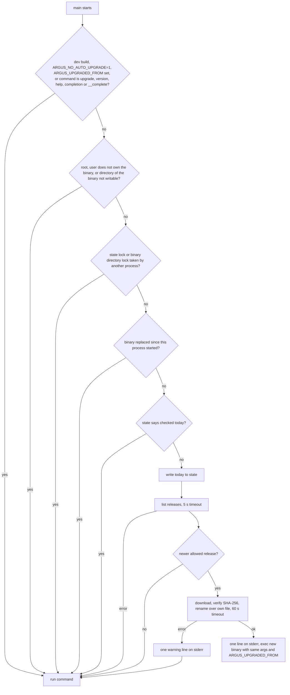
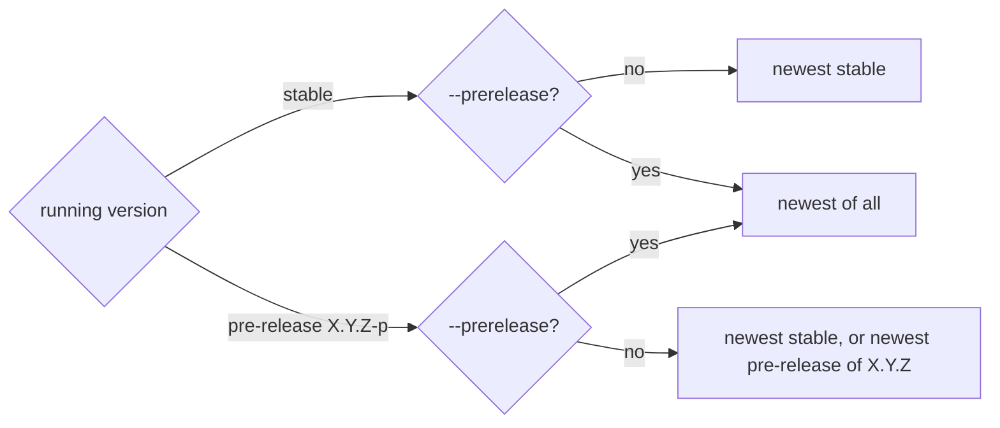

# ARGUS-259 — argus CLI self-update

## Overview

On the first command of each local calendar day, the CLI asks GitHub for the
`cli/v*` releases of `scylladb/argus`. It selects the newest release that the
semantic-versioning rules allow. When that release is newer than the running
binary, the CLI downloads the archive, checks its SHA-256 sum, and renames
the new binary over its own file. Then it replaces its process with the new
binary through `exec`, with the same arguments. The command of the user runs
on the new version. `argus upgrade` runs the same update on demand, and
`--prerelease` lets it install pre-releases. A `dev` build never updates.

## Constraints

- The daily check runs at most once per user and per day, also when it
  fails. It sends one request when the first page of the release list holds
  a stable CLI release for the platform. It reads at most 5 pages, and it
  sends a page again without the token when GitHub answers 401.
- The daily check runs only for the user that owns the binary, never as
  root, and only when the directory of the binary is writable. It checks
  this before it sends a request.
- The check and the download add at most 5 s and 60 s to the triggering
  command. Past that, the command runs on the old binary.
- `argus upgrade` stops after 30 s for the release list and 5 min for the
  download and the install.
- An update writes no byte to stdout. JSON output stays valid for scripts
  and agents.
- Two CLI processes that start at the same time do one update, not two.
  Every update locks the directory of the binary, so one update at a time
  replaces the binary, also across users.
- A signal during the daily check stops the command before it starts, with
  exit code 130.
- Every request to Argus sends `User-Agent: argus-cli/<version> (<os>/<arch>)`.
- No new dependency except `golang.org/x/mod/semver`.

## Design

A new package `internal/selfupdate` holds the release lookup, the selection
rules, the install, and the daily state. `main` calls the daily check before
cobra runs. The `upgrade` subcommand calls the same package, and it skips the
setup of the root command, as `version` does.



Selection rules. A candidate is a release whose tag starts with `cli/v`,
that is not a draft, and that is newer than the running version by semantic
versioning. A candidate is a pre-release when its version has a pre-release
part or when GitHub marks it as a pre-release.



The process records the file of its binary when it starts. An update locks
the directory of the binary with `flock`. The daily check skips when the lock
is taken, and `argus upgrade` waits for it until its context ends. When an
update holds the lock and the recorded file is no longer at the path,
another update replaced the binary. `argus upgrade` then stops, and the
daily check skips.

The install resolves the path of the running binary through its symlinks.
It writes the new binary to a temporary file in the same directory, copies
the file mode of the old binary, and renames the file over the old path. The
rename is atomic on one filesystem. The running process keeps the old inode
until `exec`.

| Condition | Behavior |
|---|---|
| GitHub is down, times out, or returns 403 for the rate limit | The command runs on the old binary. The next check is the next day. |
| GitHub returns 401 for `GITHUB_TOKEN` or `GH_TOKEN` | The request goes again without the token. |
| Another update replaced the binary after this process started | The daily check skips. `argus upgrade` fails with `another update replaced the binary`. |
| The checksum is missing or does not match | The new file is deleted. One warning on stderr, without `argus upgrade`. The command runs on the old binary. |
| The archive or its binary is larger than 256 MiB | The new file is deleted. One warning on stderr, without `argus upgrade`. The command runs on the old binary. |
| Root or a user that does not own the binary runs a command | The daily check skips, with no request. `argus upgrade` still works. |
| The directory of the binary is not writable, for example a read-only mount | The daily check skips, with no request. `argus upgrade` fails before the release list. |
| `exec` fails after the rename | The new binary is on disk. One warning on stderr. The command runs in the old process. |
| `argus upgrade` hits any of the above | The command fails with the error and exit code 1. |
| `argus upgrade` on a `dev` build | The command fails with `dev builds do not upgrade`. |
| The running version is already the newest allowed | Nothing changes. `argus upgrade` reports `upgraded: false`. |

## Contracts

### Inputs

```
GET https://api.github.com/repos/scylladb/argus/releases?per_page=100&page=<n>
    Authorization: Bearer $GITHUB_TOKEN or $GH_TOKEN, when one is set
    fields: tag_name, draft, prerelease, assets[].name, assets[].browser_download_url
assets:  argus_<version>_<linux|macOS>_<amd64|arm64>.tar.gz
         argus_<version>_checksums.txt        # "<sha256>  <archive name>" per line
```

### Outputs

```
argus upgrade [--prerelease]
```

```json
{"from": "0.5.0", "to": "0.6.0", "upgraded": true, "path": "/usr/local/bin/argus"}
```

`--text` prints `argus upgraded 0.5.0 -> 0.6.0` or `argus 0.6.0 is the newest
release`.

The daily update prints one line on stderr:

```
argus: upgraded 0.5.0 -> 0.6.0
```

Every request to Argus:

```
User-Agent: argus-cli/<version> (<os>/<arch>)    # argus-cli/0.6.0 (linux/amd64)
```

Environment:

```
ARGUS_NO_AUTO_UPGRADE=1        # turns the daily check off; argus upgrade still works
ARGUS_UPGRADED_FROM=<version>  # set by the CLI on exec; the new process skips the daily check
```

Release tags: `cli/vX.Y.Z`, or `cli/vX.Y.Z-<id>.N` for a pre-release, such
as `cli/v0.6.0-rc.1`. The release workflow refuses a pre-release identifier
that mixes letters and digits, such as `rc1`.

State file `$XDG_CACHE_HOME/argus-cli/upgrade.json`, with the lock file
`upgrade.lock` next to it:

```json
{"last_check": "2026-11-12"}
```

`last_check` is the local calendar date of the last check. A missing or
unreadable file counts as no check.

### Module API

```go
package selfupdate

type Release struct {
    Version     string // "0.6.0-rc.1", no "v" and no "cli/" prefix
    Prerelease  bool
    ArchiveURL  string
    ChecksumURL string
}

type Result struct {
    From     string
    To       string
    Upgraded bool
    Path     string
}

func New(current string, opts ...Option) *Updater
func (u *Updater) Upgrade(ctx context.Context, allowPrerelease bool) (Result, error)
func (u *Updater) Daily(ctx context.Context, stderr io.Writer) (Result, error)
func Select(current string, releases []Release, allowPrerelease bool) (Release, bool)
```

## Risks

| Risk | Response |
|---|---|
| A broken release reaches every user within one day | The release workflow publishes only tags on `master`. A user goes back with a manual install of the old archive and `ARGUS_NO_AUTO_UPGRADE=1`. |
| A CI job with a fresh `$XDG_CACHE_HOME` checks GitHub on every run | One request per job. A job with `GITHUB_TOKEN` sends it with authentication, under the higher rate limit. |
| A binary installed by root in `/usr/local/bin` never updates | The owner runs `sudo argus upgrade`. |
| A tampered archive | The SHA-256 sum comes from the same release. This guards against corrupt downloads, not against a compromised release. |

## Deferred work

- An Argus response header with the minimum CLI version. The selection rules
  and `Upgrade` stay usable from a second trigger.

## Decisions

- The daily update replaces the binary and then runs the command on the new
  binary through `exec`. (spec)
- The manual update is the subcommand `argus upgrade [--prerelease]`. (spec)
- `ARGUS_NO_AUTO_UPGRADE=1` turns off the daily check only. The update is on
  by default everywhere, CI included. (spec)
- A `dev` build never updates itself. (spec)
- On a stable build, only `--prerelease` installs a pre-release. On a
  pre-release build, the update also installs a newer pre-release of the same
  version. (spec)
- The check writes the date before the request, so a failed check waits for
  the next day.
- `argus version` skips the daily check. qatools reads the installed version
  with `argus version` in an Ansible check-mode run, and that run must not
  replace a pinned binary.
- A release that GitHub marks as a pre-release counts as a pre-release, also
  when its tag has no pre-release part. GitHub is where a maintainer holds a
  release back.
- The release list reads the next page only while the pages before it hold
  no stable CLI release for the platform, up to 5 pages. GitHub lists the
  newest release first, so every pre-release newer than that stable release
  is on an earlier page, and `Select` sees each release it can choose. A page
  with only a pre-release does not stop the search. Backend releases share
  the list, and one page is the common case.
- A 401 for the token repeats the request without it. An expired token in
  the environment must not stop every update.
- Every update locks the directory of the binary and stops when another
  update replaced the binary since the process started. Two updates that
  select different releases must not leave a binary that neither reports.
  The state lock is per user, and two users can share one binary.
- `help`, `-h` and `--help` skip the daily check. Help changes nothing, and
  it must start at once.
- Pre-release tags put the number in its own identifier, `rc.10`. Semantic
  versioning compares `rc10` and `rc9` as text, so `rc10` sorts first.
- The install reads at most 256 MiB of archive. It writes the binary before
  the checksum is known, so the limit bounds the disk that a bad archive
  takes.
- GitHub releases stay the source of the update. An Argus response header
  with the newest version needs Argus to store and serve every build, and
  that costs more to maintain than the GitHub check.
- The daily check skips for root and for a user that does not own the
  binary. An admin who runs `sudo argus ...` on a host must not replace the
  version that qatools pinned.
- The daily check skips, before any request, when the directory of the
  binary is not writable. Hosts with `ProtectSystem=strict` would fail the
  install every day, and `argus upgrade` fails there too.
- The CLI names its version and platform in the `User-Agent` header. The
  access logs of Argus then show the CLI traffic and the versions in use,
  and Argus can later refuse a CLI that is too old.
- `golang.org/x/mod/semver` compares the versions. It is the Go team's
  implementation of semantic versioning.
