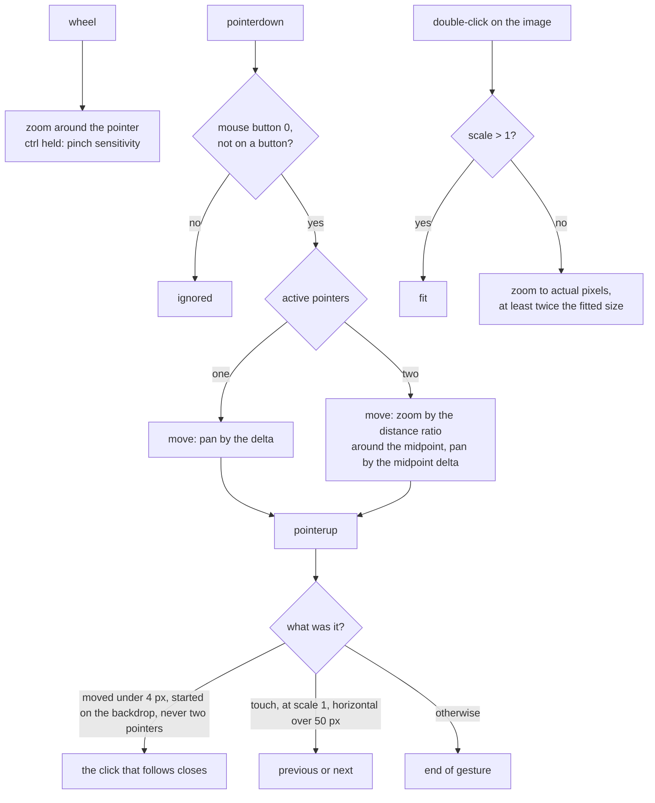

# ARGUS-260 — Screenshots are too wide after clicking

## Overview

The viewer renders the screenshot with a class that no stylesheet defines,
so the image keeps its natural size and overflows a smaller window. The
viewer becomes an image viewer: the screenshot opens fitted to the window,
the wheel and a pinch zoom it around the pointer, a drag pans it, and the
keyboard, two buttons and a swipe move between the screenshots of the run.
A zoom-and-pan helper module holds the view maths and the gesture handling,
and the viewer keeps its name and its binding contract, so the results-table
callers work unchanged. The gallery thumbnails move to a responsive grid.

## Constraints

- No new dependency. The gestures come from pointer events and the wheel
  event, which every supported browser provides.
- Bootstrap utilities first. A custom rule only where Bootstrap has no
  utility: the backdrop, the gesture surface, the image fit and the cursor.
- One viewer component serves the gallery and the results tables, through
  the `bind:selectedScreenshot` contract the callers use today.
- Two viewers may be mounted on one page, since the run page keeps every
  tab mounted. Only the open one reacts to the keyboard.
- The page behind the viewer does not scroll while the viewer is open.
- Works in the Vitest jsdom suite: the gesture handling is testable from
  dispatched events without a layout engine.

## Design

Components:

- **Gallery**, the Screenshots tab. Builds the proxied URL of each
  screenshot once, renders a square button per screenshot in a Bootstrap
  grid, and hands the viewer the selected URL and the whole list.
- **Viewer**, `ScreenshotModal`. A dialog over the page with a toolbar, a
  gesture surface and the image. Owns the current view (scale and offset),
  the index in the list, the key handling, the focus and the scroll lock.
- **Zoom-and-pan helper**, a module next to the viewer. Pure functions on a
  view plus one Svelte action that turns wheel and pointer events into view
  changes and gesture callbacks.
- **Results table cell** and **summary widget**, unchanged callers that
  pass a single URL.
- **Screenshot proxy**, the unchanged backend route that answers a
  screenshot URL with a redirect to S3.

### The view

```ts
type View = { scale: number; x: number; y: number };
// scale 1 = the fitted size the stylesheet gives the image (max-width and
// max-height 100% of the gesture surface); x, y = the offset of the image
// centre from the surface centre, in pixels.
// Rendered as: transform: translate(x px, y px) scale(scale), centre origin.
```

Rules the helper enforces on every change:

- `1 <= scale <= max(4, naturalWidth / fittedWidth)`, so a small capture
  zooms to four times its fitted size and a tall full-page capture reaches
  its actual pixels.
- `|x| <= max(0, (fittedWidth * scale - surfaceWidth) / 2)`, and the same
  for `y`, so the image never leaves the surface empty and a fitted image
  stays centred.
- A zoom by a factor at a pointer position keeps the image point under the
  pointer fixed: the scale is clamped first, then the offset follows the
  clamped ratio, then the offset is clamped.
- A surface or an image without layout yet leaves the view unchanged.

### Gestures



A `pointercancel` ends the gesture and is never a tap or a swipe. A tap on
the backdrop closes the viewer on the `click` that follows it, not on the
`pointerup`: a touch screen synthesizes that click after the pointer
sequence and hit-tests it afresh, so a viewer that had already closed would
let it land on the thumbnail beneath and re-open. The release and the
cancel of a pointer are heard on the window, so a mouse released outside
the surface ends its gesture too. When one of two pointers lifts, the
survivor continues as a pan from its current position. The wheel event is handled as non-passive and its default is
prevented, so the page never scrolls behind the viewer. Safari's gesture
events are prevented as well, so a trackpad pinch zooms the image and not
the page. A window resize re-clamps the view.

### Keys, while open

| Key | Behavior |
|---|---|
| `Escape` | Close, and return the focus to the element that opened the viewer |
| `ArrowLeft`, `ArrowRight` | Previous, next screenshot of the list; the view resets to fit |
| `+`, `=` | Zoom in around the centre |
| `-` | Zoom out around the centre |
| `0` | Fit |
| `1` | Actual pixels |

A handled key is prevented from reaching the page. A key with Alt, Ctrl or
Meta is left to the browser. A closed viewer handles no key.

### Toolbar and navigation

The toolbar holds the counter `n / total` when the list has more than one
entry, then buttons for zoom out, zoom in, fit, actual pixels and close,
each a real button with a name, and a link that opens the original in a new
tab. Previous and next buttons sit on the sides of the gesture surface, are
disabled at the ends, and are absent for a single URL.

### Focus and scroll

On open the viewer remembers the focused element, takes the focus itself and
locks the page scroll. On close it releases the lock and returns the focus
to that element when it is still in the document.

### Failure behavior

| Condition | Behavior |
|---|---|
| The image fails to load | A short message and the open-original link take the image's place; a move to another screenshot clears it |
| The selected URL is not in the list, or the list is empty | A single-image viewer: no counter, no arrows, no swipe |
| The surface or the image has no layout yet | Gestures and keys leave the view unchanged |
| Two viewers are mounted on one page | The open one handles the keys; the closed one ignores them |
| A `pointercancel` arrives mid-gesture | The gesture ends with no tap and no swipe |
| The window is resized while zoomed | The view is re-clamped so the image keeps covering the surface |

## Contracts

### Inputs

```
GET /api/v1/tests/{plugin_name}/{run_id}/screenshot/{image_name}   # 302 to S3; the image the viewer shows
testRun.screenshots: string[]                                        # the S3 links of the run, as the run page already holds them
```

### Module API

The zoom-and-pan helper, called by the viewer:

```ts
export type View = { scale: number; x: number; y: number };
export type Bounds = {
    stageWidth: number; stageHeight: number;
    imageWidth: number; imageHeight: number;
    maxScale: number;
};
export const FIT: Readonly<View>;
export function measure(stage: HTMLElement, image: HTMLImageElement): Bounds;
export function clampView(view: View, bounds: Bounds): View;
export function zoomAt(view: View, factor: number, point: { x: number; y: number }, bounds: Bounds): View;
export function panBy(view: View, dx: number, dy: number, bounds: Bounds): View;
export type ZoomPanParams = {
    view: () => View;
    setView: (view: View) => void;
    image: () => HTMLImageElement | undefined;
    onTap: () => void;
    onSwipe: (direction: "prev" | "next") => void;
};
export function zoomPan(node: HTMLElement, params: ZoomPanParams): { destroy(): void };
```

`point` is relative to the centre of the surface. The action reads its
params once and reaches the current view through the getters, so a `$state`
proxy never sits in the params.

The viewer, used by the gallery and the results tables:

```ts
interface Props {
    selectedScreenshot: string;    // bindable; "" means closed
    screenshots?: string[];        // the list to move through; default []
}
```

## Risks

| Risk | Response |
|---|---|
| A wheel over the viewer zooms where a user expected to scroll | The choice of the task; `0`, the fit button and Escape are one key away |
| A browser without pointer capture loses a drag that leaves the surface | The call is optional; the release is heard on the window, so the gesture ends cleanly |
| Thumbnails become real images instead of backgrounds | They load lazily and decode asynchronously, so the tab opens as fast as today |
| A tall capture at actual pixels pans a long way | The pan stays bounded, and `0` returns to fit |

## Deferred work

- A real download of a screenshot, through a content-disposition on the
  presigned URL. The proxy route has no download mode today.
- Moving through the screenshots of several results tables from one viewer.
- A viewer for the summary widget, whose results tables bind a selection
  that no viewer renders.
- A focus trap inside the viewer.

## Decisions

- The task takes the spec path although the issue is a Bug: the fix adds a
  module and a prop to the viewer's contract. (spec)
- The viewer keeps its name and its `bind:selectedScreenshot` contract, so
  the results-table callers need no change. (spec)
- A plain wheel zooms; a scroll is not needed since the image fits. (spec)
- A double-click toggles between the fitted size and the actual pixels, or
  twice the fitted size when the capture is small. (spec)
- A click on the backdrop closes the viewer. (spec)
- The `1` key shows the actual pixels. (spec)
- A one-finger swipe at the fitted size moves between screenshots on a
  touch screen; a mouse drag at the fitted size does nothing. (spec)
- The download icon becomes an open-original link: no version of the proxy
  route ever read the download query. (spec)
- No zoom percentage readout and no Home or End keys. (spec)
