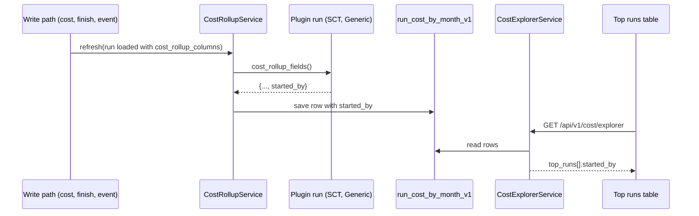

# ARGUS-261 — Show who started each run in the Cost Explorer

## Overview

The cost rollup row, `run_cost_by_month_v1`, gains a `started_by` column. A
plugin whose runs record who launched them, SCT and Generic, hands the value to
the rollup through the hook that already carries its plugin-specific fields.
The Cost Explorer API returns it on each entry of `top_runs`, and the "Top runs
by cost" table shows it in a sortable "Started by" column, with `—` when the
run recorded nobody. Re-running the existing cost rollup backfill fills the
rows written before the change.

## Constraints

- The explorer reads only the rollup. It must not read the run tables of the
  plugins on each request.
- The column is additive: `sync-models` adds it, and old rows read it as `null`
  until the backfill rewrites them.

## Design

The rollup refresh, run on each cost submission, run finish and spot
termination, already asks the run for `cost_rollup_fields()`, and the run is
loaded with `cost_rollup_columns()`. SCT and Generic add `started_by` to both.
The base plugin adds nothing, so Driver Matrix and Sirenada rows keep `null`.



| Condition | Behavior |
|---|---|
| The plugin records no `started_by` | The row stores `null`; the cell shows `—` |
| The run recorded an empty `started_by` | Stored as is; the cell shows `—` |
| A row predates the change | `null` until the backfill or the next refresh rewrites it |

## Contracts

### Outputs

```sql
ALTER TABLE run_cost_by_month_v1 ADD started_by text;
```

`GET /api/v1/cost/explorer` and `GET /api/v1/views/widgets/costs`: each entry
of `top_runs` gains one field.

```json
{"run_id": "...", "build_id": "...", "build_number": 12, "plugin_name": "scylla-cluster-tests",
 "...": "...", "spot_terminated": false, "started_by": "jenkins-user"}
```

`started_by` is a string, or `null` when the run recorded nobody. It is the raw
value the run submitted, not an Argus user id.

```ts
export interface TopRun {
    // existing fields
    started_by: string | null;
}
```

### Module API

No signature changes. `cost_rollup_columns()` and `cost_rollup_fields()` of
`SCTTestRun` and `GenericRun` widen their results by `started_by`.

## Risks

| Risk | Response |
|---|---|
| Rows written before the deploy show `—` | Re-run `scripts/migration/migration_2026-10-29_backfill_run_cost_rollup.py` after `sync-models`; it rebuilds every row and is safe to repeat |

## Deferred work

Filtering or breaking down spend by user can read the same rollup column.

## Decisions

- The value lives on the rollup row, so the explorer stays a single-table read
  and a later filter by user needs no join. (spec)
- The plugin hook supplies the value, so the rollup service stays unaware of
  which plugins record a launcher. (spec)
- The existing backfill is re-run unchanged, as its docstring allows, instead
  of a new script. (spec)
- The column shows the raw submitted name, as the run page does, with no
  lookup into Argus users. (spec)
