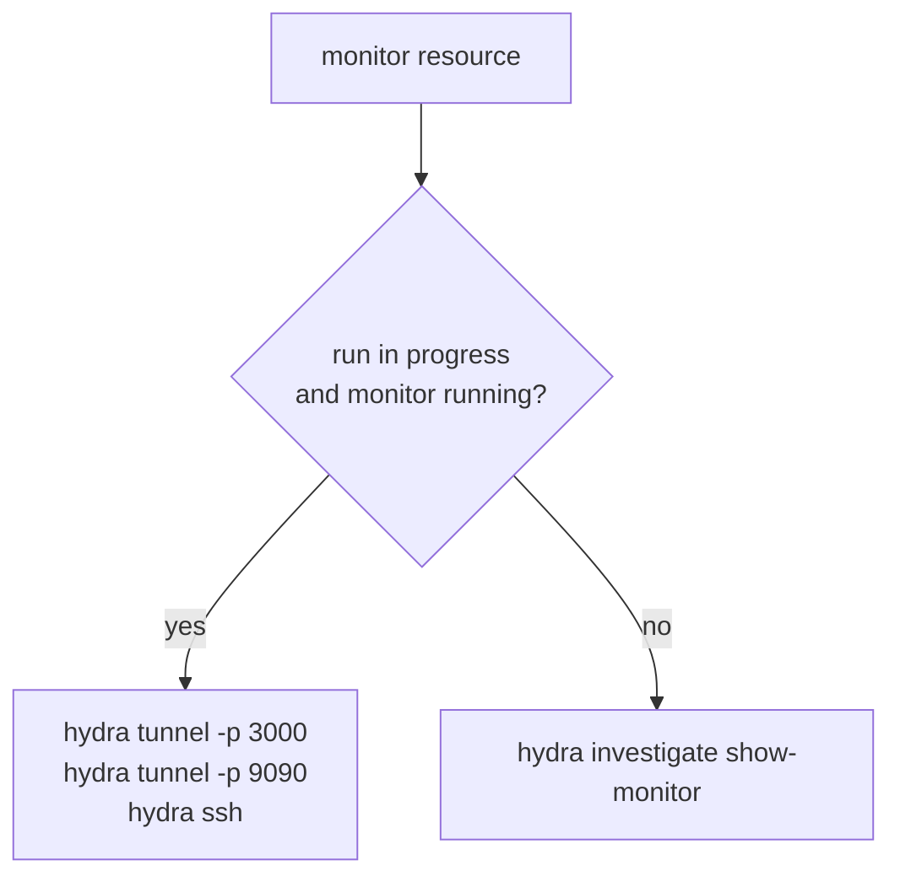

# ARGUS-263 — Show the hydra tunnel command for the monitor of an SCT run

## Overview

A pure function builds the hydra commands for a monitor resource from the
run id, the resource name, the resource state and the run status. A small
**Connect** popover renders those commands, each with a copy button. The
Resources tab shows the popover on each monitor row. The run header shows it
next to the Grafana link, and shows the Grafana link only when the monitor
has a public IP. The change is frontend-only: the run page already loads
every field it needs.

## Constraints

- No backend and no SCT change. The commands come from data the run page
  already has.
- The copy action follows the existing pattern: `navigator.clipboard` and a
  `sendMessage("success", ...)` toast.
- The popover uses the Bootstrap dropdown that the run header already uses,
  with no new dependency.

## Design



A resource is a monitor when its `resource_type` is `monitor`, or, for a run
that predates `resource_type`, when its name holds `-monitor-node-`.

The run header picks the first running monitor, else the first monitor.

| Condition | Run header | Resources tab |
|---|---|---|
| Running monitor with a public IP | *Open Grafana* link and *Connect* | *Connect* with the tunnel commands |
| Running monitor without a public IP | *Grafana via tunnel*, which opens the popover | *Connect* with the tunnel commands |
| Terminated monitor, or a finished run | *Connect* with `show-monitor` | *Connect* with `show-monitor` |
| No monitor resource | Nothing new | Nothing new |
| No clipboard API | The command stays visible and selectable in the popover | Same |

## Contracts

### Inputs

The run document that the run page already holds:

```
test_run.id
test_run.status                   # InProgressStatuses decides "finished"
test_run.allocated_resources[]    # name, state, resource_type, instance_info.public_ip
```

### Outputs

The command strings, exactly:

```
hydra tunnel -t <test_id> -p 3000 <monitor-name>
hydra tunnel -t <test_id> -p 9090 <monitor-name>
hydra ssh -t <test_id> <monitor-name>
hydra investigate show-monitor <test_id>
```

### Module API

`frontend/Common/RunUtils.js`:

```js
/** @returns {boolean} */
export const isMonitorResource = function (resource) {};

/** @returns {{ label: string, command: string }[]} */
export const buildMonitorCommands = function (testId, monitor, runFinished) {};
```

## Risks

| Risk | Response |
|---|---|
| `hydra tunnel` flags change in SCT | The strings live in one function and one test |

## Decisions

- The command set follows the ARGUS-263 proposal as the user gave it. (spec)
- A running monitor without a public IP gets a *Grafana via tunnel* button
  in place of the link, so the user sees why the link is gone. (spec)
- A monitor name of an older run counts through `-monitor-node-`, the rule
  the run header uses today. (spec)
