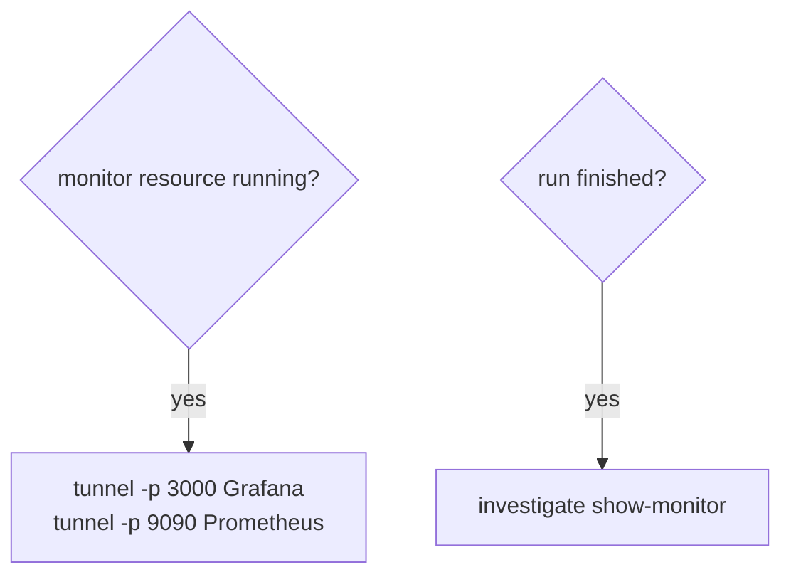

# ARGUS-263 — Show the hydra tunnel command for the monitor of an SCT run

## Overview

A pure function builds the SCT commands that reach the monitor of a run from
the run id, the running monitor resource and the run status. Each command
comes twice: through `hydra` (SCT in docker) and through `uv run sct.py` (an
SCT checkout without docker). A popover on the run card renders them, each
with a copy button, in the place of the *Hydra Show Monitor* button. The
Grafana link stays only when the monitor has a public IP. The change is
frontend-only: the run page already loads every field it needs.

## Constraints

- No backend and no SCT change. The commands come from data the run page
  already has.
- The flags match `sct_ssh.py` in SCT: `tunnel -t <test_id> -p <port>
  <node_name>`.
- The copy action follows the existing pattern: `navigator.clipboard` and a
  `sendMessage("success", ...)` toast.
- The popover is a Bootstrap dropdown inside the run card's button group,
  with no new dependency.

## Design



The two rules add up: a monitor still up after its run finished gets both the
tunnel and the restore.

A resource is a monitor when its `resource_type` is `monitor`, or, for a run
that predates `resource_type`, when its name holds `-monitor-node-`.

| Condition | Run card |
|---|---|
| Running monitor without a public IP | *Grafana via tunnel*: Grafana, Prometheus |
| Running monitor with a public IP | *Open Grafana* link, and *Hydra Tunnel*: Grafana, Prometheus |
| Finished run, monitor terminated | *Hydra Show Monitor*: Restore monitor |
| Finished run, monitor still running | *Grafana via tunnel*: Grafana, Prometheus, Restore monitor |
| Run in progress, no running monitor | No button |
| No clipboard API | The commands stay visible and selectable |

The Resources tab gets a *Connect* column after *State*: an *SSH* popover on
every running instance, with `ssh -t <test_id> <node-name>` in both forms. A
stopped instance gets an empty cell. The mobile *Actions* menu keeps its
*Hydra Show Monitor* item.

## Contracts

### Inputs

The run document that the run page already holds:

```
test_run.id
test_run.status                   # InProgressStatuses decides "finished"
test_run.allocated_resources[]    # name, state, resource_type, instance_info.public_ip
```

### Outputs

The command strings, each with the `hydra` and the `uv run sct.py` prefix:

```
<runner> tunnel -t <test_id> -p 3000 <monitor-name>
<runner> tunnel -t <test_id> -p 9090 <monitor-name>
<runner> investigate show-monitor <test_id>
<runner> ssh -t <test_id> <node-name>
```

### Module API

`frontend/Common/RunUtils.js`:

```js
/** @returns {boolean} */
export const isMonitorResource = function (resource) {};

/** @returns {{ label: string, commands: string[] }[]} */
export const buildMonitorCommands = function (testId, runningMonitor, runFinished) {};

/** @returns {{ label: string, commands: string[] }[]} */
export const buildSshCommands = function (testId, node) {};
```

## Risks

| Risk | Response |
|---|---|
| `hydra tunnel` flags change in SCT | The strings live in one function and one test |

## Decisions

- The command set follows the ARGUS-263 proposal as the user gave it. (spec)
- A running monitor without a public IP gets a *Grafana via tunnel* button
  in place of the link, so the user sees why the link is gone. (spec)
- A monitor name of an older run counts through `-monitor-node-`, the rule
  the run header uses today. (spec)
- The restore command follows the run status, for when the logs are
  collected. The tunnel follows the resource state, for while the node is
  up. (review)
- The popover replaces *Hydra Show Monitor* on the run card. No `ssh`
  command there: the tunnel covers the monitor. (review)
- The `ssh` command goes to the Resources tab, in its own *Connect* column
  per running instance, not in the name cell. (review)
- Every command also comes as `uv run sct.py`, for people who do not run SCT
  in docker. (review)
