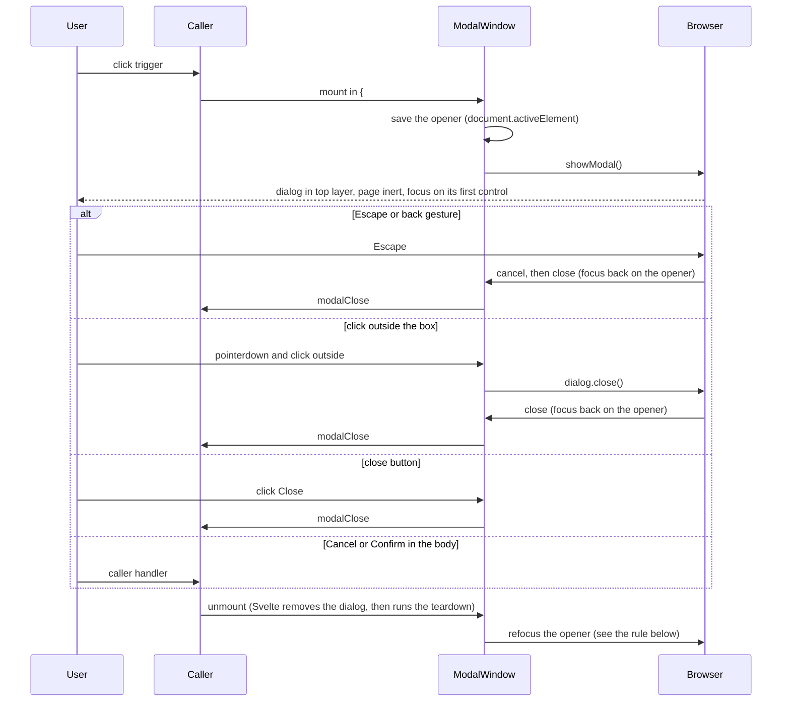
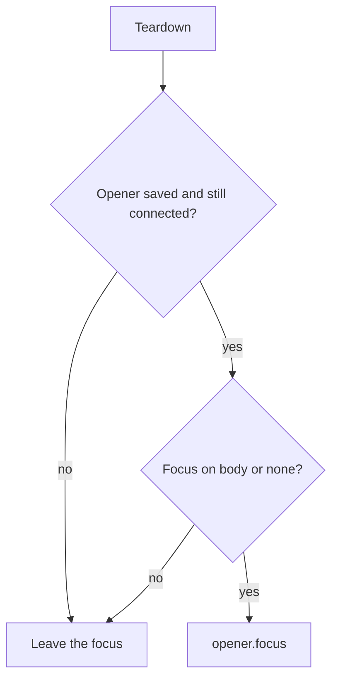
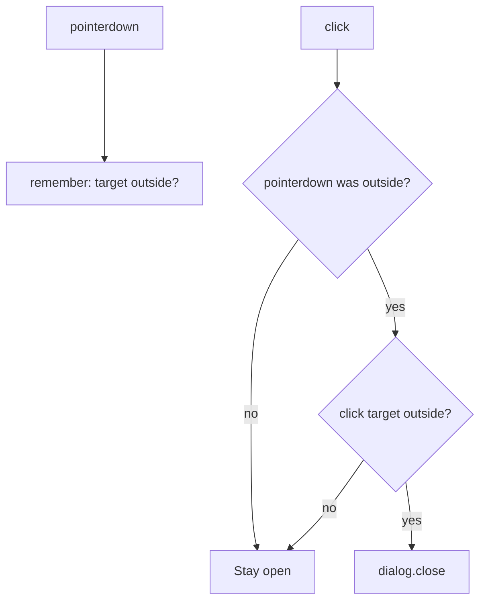

# ARGUS-274 — Build ModalWindow on the native dialog element

**Parent**: ARGUS-273 · no `argus:tasks/ARGUS-273/spec.md` yet; the story
text in Jira is the parent context.

## Overview

ModalWindow renders a `<dialog>` and calls `showModal()` when it mounts. The
browser then provides the top layer, the inert page, the focus containment
and Escape. The dialog is a transparent scroller that fills the viewport and
holds today's white box. `::backdrop` dims the page behind it. Escape closes
the dialog natively, and a click outside the box closes it through the same
`close()`. The `close` event becomes `modalClose`. Callers
unmount the modal on `modalClose`. Svelte removes the dialog from the DOM
before teardown, so ModalWindow saves the opener at open and refocuses it at
teardown. Two body-level layers must show above an open modal, so they move
into the top layer with it: the error toasts become a manual popover, and the
results graph tooltip mounts inside the dialog.

## Constraints

- No caller changes. The props `widthClass`, `title` and `body` and the
  `on:modalClose` event stay as they are.
- Every caller mounts ModalWindow inside `{#if}` and unmounts it on
  `modalClose`. Svelte 5.55 `destroy_effect` removes the branch DOM before it
  runs the effect teardowns. A `close()` at teardown therefore runs on a
  detached dialog, and the browser's own focus return never happens.
- The frontend targets Baseline Widely available. `<dialog>`, `showModal()`,
  `::backdrop` and `:modal` are in that target. Popover (Newly available
  2025-01-27) and `overscroll-behavior` on a scroll container that does not
  overflow are not, so each is progressive enhancement. `closedby` has
  limited availability, with no Safari, so light dismiss cannot rest on it.
- Svelte maps `<dialog>` to the non-interactive role `dialog`. A `click` or
  `pointerdown` attribute on it raises two of the six suppressed codes.
- jsdom 29 ships an empty `HTMLDialogElement`: no `showModal`, no `close`, no
  top layer, no inert page and no `cancel` on Escape. Its default stylesheet
  hides `dialog:not([open])`. Six suites render a component that holds a
  ModalWindow.
- `vite.config.ts` and the `suppressedSvelteCodes` list belong to ARGUS-275
  and ARGUS-276. This task checks the six codes against a list it empties
  locally for one build, and never commits that edit.

## Design

| Component | Role |
|---|---|
| Caller (17 files) | Mounts ModalWindow in `{#if open}` and sets `open = false` on `modalClose` |
| ModalWindow | Renders the `<dialog>`, opens it modal, maps `close` to `modalClose`, restores the focus |
| `lightDismiss` action | Closes the dialog on a click whose press and release both land outside the box |
| Browser | Top layer, inert page, focus containment, Escape to `cancel` then `close` |
| AlertWidget toast stack | Becomes `popover="manual"`, raised on each new message above any open modal |
| ResultsGraph tooltip | Mounts in the dialog that holds the chart, else in `document.body` as today |



The focus rule at teardown:



The focus sits on `body` after Svelte removes a dialog that held it. A native
close already returned the focus, and a caller may have moved it on purpose.
In both cases the rule leaves the focus where it is.

Layout and scroll, in the component's scoped style. No `z-index`, and no
`overflow` change on `html` or `body`:

```css
dialog.modal-window {
    position: fixed; inset: 0; width: 100%; height: 100%;
    max-width: none; max-height: none; margin: 0; padding: 0; border: 0;
    background: transparent; overflow-y: auto; overscroll-behavior: contain;
}
dialog.modal-window::backdrop {
    background-color: rgba(0, 0, 0, 0.55); overflow: hidden; overscroll-behavior: contain;
}
```

The light-dismiss rule. "Outside" means that the event target is the dialog
itself or the transparent frame around the box. A target inside the box is
inside, and so is an element that the chart appends to the dialog, such as
the graph tooltip:



The rule needs both events. A drag from the box to the outside, such as a
text selection in an input, fires `pointerdown` on the box and `click` on the
dialog. The action attaches its listeners in script, so the template carries
no handler on the dialog. Escape is the keyboard path to the same close.

A nested modal is a `<dialog>` inside the outer dialog's body. `showModal()`
stacks it above the outer one, and Escape closes only the inner one.

Browser behavior that the design relies on. A static probe page measured it
in headless Chrome 157:

| Probe | Result |
|---|---|
| Focus after `showModal()`, no `autofocus` | The close button, the first focusable element |
| `trigger.focus()` while the modal is open | Refused; the focus stays in the dialog |
| Open dialog removed from the DOM | The focus falls to `body` |
| `close()` and then removal | The focus returns to the trigger |
| Escape twice with `cancel` prevented | 1st: `cancelable=true`; 2nd: `cancelable=false`, and the dialog closes |
| Escape with a modal nested in a modal | Only the inner one gets `cancel` and `close` |
| Fixed layer at `z-index: 999999`, body tooltip at `10000` | Both drawn under the backdrop; the hit test returns the dialog |
| Element appended inside the dialog | Drawn above the backdrop and hit-testable |
| `popover="manual"` shown after the modal | Drawn above the backdrop, but inert |
| Dialog in a `display: none` ancestor | Open and modal, 0 px wide, page inert |
| Backdrop click, no `closedby` | The dialog stays open |
| Press, then drag, on the dialog's own scrollbar | No `pointerdown` and no `click` reach the page |
| Drag from the box to the outside | `pointerdown` on the box, `click` on the dialog |

Failure behavior:

| Condition | Behavior |
|---|---|
| The opener is gone at teardown, for example a deleted row | The focus stays on `body`; nothing throws |
| A second Escape gives a `cancel` that cannot be cancelled | No effect: ModalWindow never cancels `cancel` |
| An action in a modal fails, and the modal stays open | Its toast shows above the backdrop, readable; it can be dismissed after the modal closes |
| The browser lacks Popover | The toast stays under the backdrop until the modal closes |
| An Escape keydown cancelled by a control in the modal, such as an open svelte-select list | Only the control reacts; the modal stays open. The live check confirms it |

The a11y check on today's ModalWindow: a dev build with an empty
`suppressedSvelteCodes` printed 38 warnings with the six codes in other
components. None came from `Common/ModalWindow.svelte`. The new component
must keep that count at zero. The only handler in the dialog's markup is
`close`, and the action adds `pointerdown` and `click` in script.

## Contracts

### Module API

The props and the event are unchanged:

```ts
interface Props {
    widthClass?: string;   // default "w-50"; "w-100" below 768 px
    title?: Snippet;       // rendered in the h5 that names the dialog
    body?: Snippet;
}
// on:modalClose — CustomEvent<null> from createEventDispatcher
```

### Outputs

The rendered element. Callers and tests reach it by role:

```html
<dialog class="modal-window" aria-labelledby="{id}-title">   <!-- no aria-labelledby without a title -->
  <div class="d-flex align-items-center justify-content-center p-4">
    <div class="rounded bg-white p-4 w-50">
      <div class="mb-2 d-flex border-bottom pb-2">
        <h5 id="{id}-title">…title…</h5>
        <div class="ms-auto"><button class="btn btn-close" aria-label="Close" title="Close"></button></div>
      </div>
      <div>…body…</div>
    </div>
  </div>
</dialog>
```

When `modalClose` fires, once per close:

| User action | Before | After |
|---|---|---|
| Close button | `modalClose` | `modalClose` |
| Escape | `modalClose` from every open ModalWindow | `modalClose` from the topmost one, on its `close` event |
| Back gesture on mobile | nothing | as Escape |
| Click outside the white box | nothing | `modalClose`, on its `close` event |
| Drag from inside the box to outside | nothing | nothing |

## Risks

| Risk | Response |
|---|---|
| Another body-level layer must show above a modal | A search found two: `#argusErrors` and `#chartjs-tooltip`, and the design covers both. Review checks new ones |
| A keyed `{#each}` moves an open dialog, and the dialog drops out of the top layer | No caller sits in a keyed `{#each}` today |
| A dialog opens inside a `display: none` ancestor, so an invisible modal makes the page inert | No caller opens from a hidden ancestor. Escape still closes it |
| The mobile Sidebar offcanvas runs Bootstrap's focus trap under the modal | Under the dialog the offcanvas is inert. A live check at 400 px confirms typing in the delete confirmation |
| The focus lands on the close button, so Enter right after open closes the modal | Accepted: see Decisions |
| A stray click outside the box drops a half-filled form | Accepted: see Decisions. A drag that starts in the box never closes it |
| Another browser dispatches pointer events for a press on the dialog's scrollbar, and the press closes the modal | Chrome dispatches none. The live check covers Chrome only |
| `ResultsGraph.svelte` also carries ARGUS-276 a11y warnings | This task touches only the tooltip handler. Whichever lands second rebases |
| The ConfirmDeleteModal suite fires Escape as a window `keydown` | Its Escape case moves to the dialog's `close` event; the caller code does not change |

## Deferred work

- The other hand-made overlays (Jenkins build and clone, screenshot, the
  error console bucket, the `ResultsGraph` enlarge view) can move to the same
  `<dialog>` later. ModalWindow takes no props for them now.

## Decisions

- The dialog is a full-viewport transparent scroller holding today's box. The
  box keeps its top placement, a tall body (the graph modal is 800 px) scrolls
  as one page, and svelte-select lists, absolutely positioned, are not clipped
  at the box edge. (spec)
- A click outside the box closes the modal, as light dismiss. Several modals
  hold forms, and a stray click drops them; that cost is accepted. (review)
- Light dismiss is a pointer handler in an action and does not use
  `closedby`. `closedby` is not Baseline Widely available, and the
  full-viewport dialog leaves no backdrop for it to hit. (review)
- Light dismiss calls `dialog.close()`, so it shares the `close` path of
  Escape, including the browser's focus return. (review)
- ModalWindow never cancels `cancel`, and `close` is its one Escape signal,
  because Chrome makes a repeated `cancel` non-cancelable. (spec)
- The close button keeps dispatching `modalClose` itself, as today. (spec)
- The toast popover is feature-detected, because Popover is only Newly
  available. (spec)
- The callers' markup stays as it is, so the user manager's admin-toggle
  modal, which has no title, stays unnamed. (spec)
- The work proceeds without a parent spec for ARGUS-273, as obvious work. (review)
- The AlertWidget toast popover and the ResultsGraph tooltip host join this
  task, because without them a modal hides its own errors and graph links. (review)
- The initial focus stays the browser default, the close button, with no
  `autofocus` added by ModalWindow. Enter right after open closes the modal,
  and that is accepted. (review)
