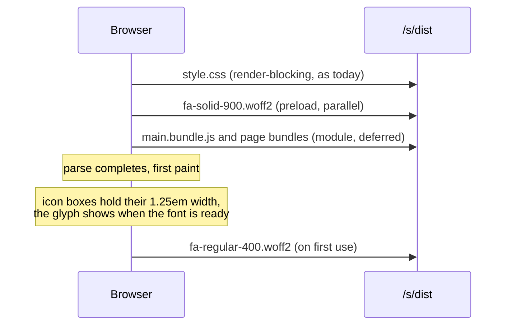

# ARGUS-275 — Load Font Awesome without stopping the HTML parse

**Parent**: ARGUS-273 · no parent spec; the Jira story ARGUS-273 states the parent scope

## Overview

Argus drops the Font Awesome SVG JavaScript and draws its `<i class="fas|far
fa-...">` icons with the Font Awesome CSS and webfont build. The solid and
regular `@font-face` rules join the core rules that `style.css` already
carries. The brands set goes, because no page uses it. The `fontAwesome`
bundle and its `<script>` in `<head>` go, so no script for icons stops the
parse. The base template preloads the solid font, which every page needs for
the nav bar. The icon markup does not change.

## Constraints

- The `<i>` markup in Svelte components stays as it is. ARGUS-276 edits those
  elements, and this task must not conflict with it.
- No new dependency. `@fortawesome/fontawesome-free` 7.0.0 already ships the
  webfonts and the SCSS.
- The frontend targets Baseline Widely available. A newer feature needs a
  fallback. The icons waive this target; see `Decisions`.
- uvicorn and the release bundle serve `public/dist` at `/s/dist/`. A URL
  that Vite writes into `style.css` must resolve there.
- The pull request shows the size and the first paint before and after, with
  the method below.

## Design

### Icon inventory

`svelte-fa` draws about 133 Svelte files of icons from the
`@fortawesome/free-*-svg-icons` objects. It renders its own `<svg
aria-hidden="true">` and needs neither the bundle nor the webfont. The bundle
serves only these elements:

| Where | Set | Icons |
|---|---|---|
| `templates/partials/nav_bar.html.j2` | solid | tasks, business-time, coins, archive, wrench, users, book, user, sign-out-alt, sign-in-alt, circle-half-stroke |
| `templates/partials/nav_bar.html.j2` | regular | object-group, bell |
| `templates/base.html.j2`, theme script | solid | sun, moon, circle-half-stroke (set at runtime through `className`) |
| `templates/releases.html.j2` | solid | tachometer-alt, calendar-alt |
| 7 Svelte components | solid | redo, heartbeat, info-circle, eye, comments, code-branch, exclamation-triangle, coins, sort-up, sort-down, chevron-down, chevron-right |
| `TestRun/ResultsGraph.svelte`, chart tooltip HTML string | solid | external-link-alt |

No icon uses the brands set. One `svelte-fa` icon in `SummaryWidget.svelte`
carries the `fa-spin` class, which the core CSS defines. The core CSS holds a
rule for every name above.

### Load order



Today the browser downloads and runs `fontAwesome.bundle.js` (1.5 MB) before
it parses `<body>`. The script then swaps each `<i>` for an `<svg>` when the
DOM is ready.

### Options

| | A: trim the sets, `defer` the script | B: `svelte-fa` everywhere | C: CSS and webfont (chosen) |
|---|---|---|---|
| Parse blocked | No | No | No |
| Bytes per page | 990 KB raw, 312 KB gzip of JS on every page | 0 for icons | about 1 KB of CSS; 113 KB solid and 19 KB regular woff2, fetched once and cached |
| When icons show | After the script runs, as an `<svg>` swap | With the component | At first paint as reserved boxes; the glyph when the font loads |
| `aria-hidden` | The script adds it to each `<svg>` | `svelte-fa` adds it | No attribute; FA 7 CSS writes `content: var(--fa) / ""`, so the glyph adds nothing to the accessible name |
| Class change at runtime | Ignored, as today | Works | Works |
| Files touched | Owned files only | 7 Svelte files that ARGUS-276 edits, plus an SVG helper for Jinja and for the chart tooltip string | Owned files, `frontend/argus.js` and the two templates |

Option A still downloads and runs a 1 MB script on every page, and keeps the
runtime-class failure below. Option B cannot reach the Jinja templates or the
tooltip HTML string without new code, and it collides with ARGUS-276.

### Accessibility

The chosen design drops the `aria-hidden="true"` that the SVG script adds.
Two things replace it:

- The Font Awesome 7 core CSS sets `content: var(--fa); content: var(--fa) /
  "";`. Where the alt-text syntax works, the glyph adds nothing to the
  accessible name. The first declaration is no fallback: a declaration with
  `var()` is valid at parse time, so the second one always wins the cascade.
  A browser without the syntax (Firefox before 128, Safari before 17.4) finds
  it invalid at computed-value time, `content` computes to `none`, and no
  Font Awesome glyph draws. The icon box keeps its width.
- The `<i>` icons in the two Jinja templates get `aria-hidden="true"`. ARGUS-276
  handles the `<i>` icons in Svelte components.

The accessible names must stay as today. Chrome reports the nav links as
`" Workspace"`, `" Releases"`, `" Views"` and so on at master 14e76bed. The
round-2 check reads the same tree after the change.

### Two failures the change removes

The SVG script replaces each `<i>` with a new `<svg>`. Code that keeps a
reference to the `<i>` then changes a detached node. Both cases were seen in
headless Chrome at master 14e76bed:

- The theme toggle sets `className` on `#theme-icon`. After three clicks the
  label reads Light, Dark, Auto, and the icon stays `circle-half-stroke`.
- An `<i class="fas fa-chevron-right">` whose class changes to
  `fa-chevron-down` keeps the right chevron. `GraphsWidget.svelte` and
  `PaginatedTable.svelte` change their icon class this way.

With the webfont, the `<i>` stays in the DOM and a class change redraws it.

### Failure behavior

| Condition | Behavior |
|---|---|
| The woff2 is slow | `font-display: block` keeps the glyph invisible for up to 3 s. The box keeps its width, so the layout does not shift |
| The woff2 fails | After 3 s the fallback font draws the private-use glyph, usually blank. The text labels stay |
| An unknown icon name | Nothing draws, as today |
| A browser without the alt-text syntax | No Font Awesome glyph draws; the box keeps its width and the text labels stay |

## Contracts

### Outputs

`style.css` gains two `@font-face` rules. The URLs are absolute and resolve
under the static mount:

```css
@font-face{font-family:"Font Awesome 7 Free";font-style:normal;font-weight:900;font-display:block;src:url(/s/dist/fa-solid-900.woff2)}
@font-face{font-family:"Font Awesome 7 Free";font-style:normal;font-weight:400;font-display:block;src:url(/s/dist/fa-regular-400.woff2)}
```

`public/dist` gains `fa-solid-900.woff2` and `fa-regular-400.woff2`, named
without a hash like the other assets. It loses `fontAwesome.bundle.js`. The
base template gains:

```html
<link rel="preload" href="/s/dist/fa-solid-900.woff2" as="font" type="font/woff2" crossorigin>
```

The markup contract for templates and components stays: `<i class="fas
fa-NAME">` for solid, `<i class="far fa-NAME">` for regular. `fab` stops
working. The global `window.FontAwesome` and the `svg.svg-inline--fa`
elements go; no code reads them.

Vite's `base` becomes `/s/dist/`. Every URL Vite writes into CSS then carries
the prefix. The build has no dynamic import, so the JS output does not change.

## Measurement

The before numbers come from a production build of master 14e76bed
(`NODE_ENV=production yarn build`), served by
`uvicorn --factory argus_backend:create_app --port 5015` from the worktree,
logged in as admin. A Node script drives headless Chrome 157 over CDP. Each
run opens a fresh tab with the cache disabled, loads the page, waits for the
load event and 1.5 s, and reads the `first-paint` and
`first-contentful-paint` entries, the navigation timing, the buffered
`layout-shift` entries, and `ScriptDuration` and `TaskDuration` from
`Performance.getMetrics`. One warm-up run is dropped; the table shows the
median of 9 runs. The throttled profile adds a 4x CPU slowdown and a 10 Mbit/s
link with 40 ms latency through `Emulation.setCPUThrottlingRate` and
`Network.emulateNetworkConditions`.

| Page, profile | First paint | FCP | DOMContentLoaded | Script time | CLS |
|---|---|---|---|---|---|
| `/releases`, plain | 88 ms | 88 ms | 94 ms | 35 ms | 0 |
| `/releases`, throttled | 1840 ms | 1840 ms | 2113 ms | 144 ms | 0 |
| `/dashboard/scylla-master`, plain | 120 ms | 144 ms | 167 ms | 292 ms | 0.076 |
| `/dashboard/scylla-master`, throttled | 2672 ms | 2696 ms | 3237 ms | 299 ms | 0.076 |

`fontAwesome.bundle.js` is 1,503,956 bytes raw, 515,950 bytes with `gzip -9`.
uvicorn sends it uncompressed. On throttled `/releases` its download ends at
1657 ms, and the first paint follows it. `/releases` holds 178 icons from the
bundle, the most of any main page.

## Risks

| Risk | Response |
|---|---|
| The production web server does not serve `.woff2` with a font type, or does not serve new files under `/s/dist/` | Check the font response on staging after deploy; the vhost lives in scylladb/qatools `roles/argus` |
| `base: "/s/dist/"` changes another CSS URL | The only other one is the Noto font, whose `format("ttf")` hint is invalid, so Chrome skips it before and after. The round-2 check records the font requests |
| A glyph shows late on a slow link | The solid font is preloaded; the boxes keep their width, so no layout shift |

## Deferred work

- The theme icon and label do not follow a stored theme on page load, because
  nothing calls `updateThemeIcon()` then. This change makes the icon follow a
  click; the load case is a separate fix.
- `frontend/fonts/noto.css` uses `format("ttf")`, which no browser accepts, so
  the packaged Noto font never loads.
- The core CSS carries a rule for every Font Awesome icon, about 55 KB raw of
  `style.css`. A subset is possible later.

## Decisions

- The CSS and webfont build replaces the SVG JavaScript. It needs no script,
  touches no Svelte component, and fixes the runtime class changes. (spec)
- The brands set goes; no page uses it. (spec)
- The main entry imports the Font Awesome SCSS, and the `fontAwesome` entry
  goes. With `cssCodeSplit: false` all CSS lands in `style.css` either way,
  and a CSS-only entry fails the Vite 8 build. (spec)
- Vite `base` becomes `/s/dist/`, the path the server mounts. A relative font
  path would resolve to `/fa-solid-900.woff2`. (spec)
- Only the solid font is preloaded. The regular font draws two nav icons and
  is 19 KB. (spec)
- The Jinja template icons get `aria-hidden="true"`. The markup then states
  that the icons are decorative, whatever the stylesheet does, as the icons
  guide asks. The Svelte icons stay with ARGUS-276. (review)
- The Font Awesome icons need Firefox 128+ or Safari 17.4+; Chrome and Edge
  77+ already qualify. The Baseline Widely available target is waived here,
  because Argus is an internal tool used on current browsers. Komachi
  accepted this after review. (review)
