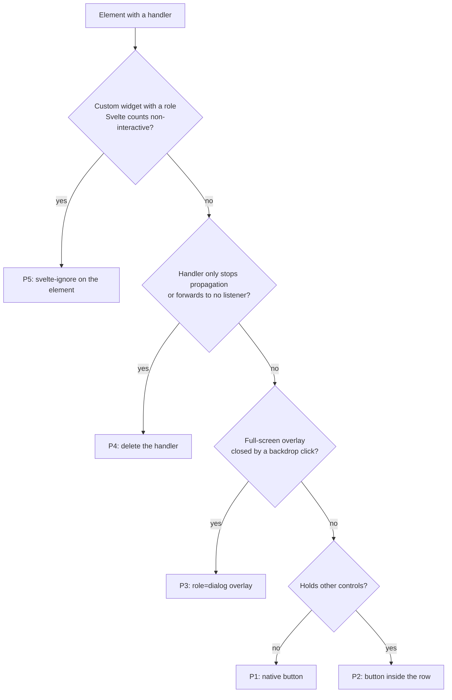

# ARGUS-276 — Turn on the suppressed Svelte accessibility warnings

**Parent**: ARGUS-273 · no `tasks/ARGUS-273/spec.md` exists; the Jira story is the parent design

## Overview

One pull request, six commits, one per warning code. Each commit fixes every
element that reports its code and removes the code from
`suppressedSvelteCodes`, so each commit builds with no warning of a code it
has turned on. Fixes use native elements first: a clickable `<div>`, `<li>`
or `<a>` becomes a `<button>`, an overlay becomes a focusable `role="dialog"`
that closes on Escape, and a handler that only stopped a click from bubbling
is deleted. The last commit leaves the list empty, and `yarn build` prints no
`a11y_*` warning.

## Constraints

- One commit per code; each commit builds with no warning of a code it has removed from the list.
- No edit to `frontend/Common/ModalWindow.svelte` (ARGUS-274).
- No edit to `font-awesome.js`, `font-awesome.scss`, `templates/base.html.j2`, the `fontAwesome` input or any line of `vite.config.ts` outside `suppressedSvelteCodes` (ARGUS-275). An `<i class="fas">` icon moves with its parent and keeps its markup.
- No edit near the `{@html}` markdown rendering of the discussion and view highlights components (ARGUS-278). None of those files reports a warning.
- Bootstrap 5 classes before custom CSS; Baseline Widely available features only.
- The visible layout of each control stays as it is.

## Design

### What the compiler reports

`suppressedSvelteCodes` emptied, then `yarn build` and `svelte-check` on
master `14e76bed` (Svelte 5.55.5). Both report the same 36 warnings on 21
elements in 11 components.

| Code | Warnings |
|---|---|
| `a11y_click_events_have_key_events` | 17 |
| `a11y_no_static_element_interactions` | 10 |
| `a11y_no_noninteractive_element_interactions` | 4 |
| `a11y_no_noninteractive_element_to_interactive_role` | 2 |
| `a11y_interactive_supports_focus` | 2 |
| `a11y_missing_attribute` | 1 |
| Total | 36 |

| Component | click_events | no_static | noninteractive_interactions | to_interactive_role | missing_attribute | supports_focus | Total |
|---|---|---|---|---|---|---|---|
| AdminPanel/AvatarCropper | | | 1 | | | | 1 |
| AdminPanel/ReleaseManager | 1 | | | 1 | | | 2 |
| AdminPanel/ReleaseManagerGroup | 2 | 3 | | | | | 5 |
| AdminPanel/ReleaseManagerTest | | 1 | | | | | 1 |
| Profile/NotificationsReader | 1 | | | 1 | | | 2 |
| Stats/NumberStats | 1 | 1 | | | | | 2 |
| Teams/TeamMember | 2 | | | | | 2 | 4 |
| TestRun/DriverMatrixBreakdown | | 1 | | | | | 1 |
| TestRun/ResultsGraph | 1 | 1 | | | | | 2 |
| TestRun/ResultsGraphs | 7 | 1 | 3 | | 1 | | 12 |
| Views/Widgets/GraphsWidget/GraphsWidget | 2 | 2 | | | | | 4 |

`ModalWindow.svelte` reports none. The build already prints one warning
outside the list, `a11y_no_noninteractive_tabindex` on the AvatarCropper
viewport; this task clears it with the same element.

`a11y_missing_attribute` checks required attributes: `href` on `<a>`, `alt`
on ``, a name on `<area>` and `<object>`, `title` on `<iframe>`,
`lang` on `<html>`. Its one warning is a results-graph tab `<a>` with no
`href`. It does not check icon-only buttons: `a11y_consider_explicit_label`
does, it is not suppressed, and it skips a `<button>` whose only child is a
component such as `<Fa>`. Decorative icons are already hidden: `svelte-fa`
renders `aria-hidden="true"` when no `title` is given, and the Font Awesome
SVG+JS loader adds `aria-hidden="true"` to each `<i>` it replaces.

### Fix patterns



**P1, native button.** A single clickable control becomes
`<button type="button">`. A disclosure carries `aria-expanded`, a filter
toggle `aria-pressed`. A tab without `href` becomes `<button class="nav-link">`.
A collapsible card header keeps its heading and wraps its content in the button.

```svelte
<h5 class="mb-0">
    <button type="button" class="btn w-100 text-start ..." aria-expanded={open} aria-controls="test-{id}" onclick={toggle}>
        <i class="fas fa-chevron-{open ? 'down' : 'right'} me-2"></i><span>{name}</span>
    </button>
</h5>
```

**P2, button inside a row.** A list row that selects an item keeps
`<li>` and its list semantics. The click moves from the `<li>` to a
`<button>` that fills the row's free space and carries `aria-current`.
Controls already in the row stay siblings of that button.

**P3, overlay dialog.** The element that takes the backdrop click becomes
the dialog: `role="dialog"`, `aria-modal="true"`, a name from its title
(`aria-labelledby`) or `aria-label`, `tabindex="-1"`. It takes the focus
when it opens, closes on Escape through `onkeydown`, and closes on a
backdrop click only when the event target is itself. The inner panel has no
handler, so the stop-propagation shield goes.

**P4, delete a dead handler.** A handler that stops a click from reaching
an ancestor that no longer listens, or forwards `click` to a parent that
never subscribes, is deleted.

**P5, per-element ignore.** The AvatarCropper viewport is a drag, wheel and
arrow-key widget with `role="application"`, the ARIA role for such a
widget. Svelte counts `application` as non-interactive. The element gets
`<!-- svelte-ignore a11y_no_noninteractive_element_interactions, a11y_no_noninteractive_tabindex -->`
and keeps its role, `tabindex="0"` and key handling.

### Commit order

| # | Code removed | Elements fixed | Pattern | Also clears |
|---|---|---|---|---|
| 1 | `a11y_missing_attribute` | ResultsGraphs tab links | P1 | 1 click_events, 1 no_static |
| 2 | `a11y_interactive_supports_focus` | TeamMember stat toggles (2) | P1 | 2 click_events |
| 3 | `a11y_no_noninteractive_element_to_interactive_role` | ReleaseManager group rows, NotificationsReader rows; ReleaseManagerGroup editor and delete-modal shields | P2, P4 | 4 click_events, 2 no_static |
| 4 | `a11y_no_noninteractive_element_interactions` | AvatarCropper viewport; ResultsGraphs New View, Add Graph, Remove Graph modals | P5, P3 | 6 click_events, `a11y_no_noninteractive_tabindex` |
| 5 | `a11y_click_events_have_key_events` | NumberStats investigation bar, GraphsWidget headers (2), ResultsGraph enlarged-graph shield | P1, P4 | 4 no_static |
| 6 | `a11y_no_static_element_interactions` | ReleaseManagerGroup and ReleaseManagerTest editor overlays, DriverMatrixBreakdown status toggles | P3, P1 | — |

Commit 3 deletes the group-row click, so the two shields in
ReleaseManagerGroup that kept clicks off that row fall under P4 in the same
commit. Commit 6 also deletes the `svelte-ignore a11y_click_events_have_key_events`
above the DriverMatrixBreakdown toggle it replaces. After commit 6 the list
is `[]`.

### ARGUS-274 and the list

ModalWindow reports no warning, so no code waits for ARGUS-274. When this
branch merges first, ARGUS-274's `<dialog>` rewrite builds against an empty
list and shows any warning it adds; a `<dialog onclick>` reports none. When
ARGUS-274 merges first, this branch rebases on it and reruns the build.

### Existing `svelte-ignore` comments for these codes

| Component | Codes | This task |
|---|---|---|
| TestRun/DriverMatrixBreakdown | click_events | Removed with its fix (commit 6) |
| Views/Widgets/ReleaseSummary/FamilySummary | click_events, no_static | Kept: the header has an inner button for the keyboard |
| Views/Widgets/ReleaseSummary/FamilyIssues | click_events, no_static | Kept: same whole-row pattern |
| ReleaseDashboard/TestDashboardTest | click_events | Kept; deferred |
| TestRun/Sirenada/SirenadaTestBreakdown | to_interactive_role | Kept; suppresses nothing today; deferred |

## Contracts

### Module API

`ReleaseManagerGroup` takes the row selection that `ReleaseManager` used to
attach to the `<li>`:

```ts
interface Props {
    group;                    // $bindable, untyped today, unchanged
    groups;                   // unchanged
    selected?: boolean;       // new: drives aria-current on the name button
    onselect?: () => void;    // new: called by the name button
}
```

## Risks

| Risk | Response |
|---|---|
| A `<button>` brings Bootstrap button padding, border or colour and shifts a layout | Reset with Bootstrap utilities (`p-0`, `border-0`, `text-reset`, `text-start`, `w-100`); compare each element before and after in the live check |
| A row's click area shrinks to the name button | The button takes the row's free space (`flex-fill`); the controls already stopped propagation |
| Moving the focus into an overlay scrolls the page | Focus with `preventScroll: true` |
| ARGUS-275 converts the `<i class="fas">` chevrons of GraphsWidget | Textual conflict only; the second branch to merge rebases |
| A Svelte upgrade adds a new a11y check | The empty list shows it in the build, which is the goal |
| No parent spec for ARGUS-273 | The story's Jira text and the sibling briefs set the boundaries; this spec names them in Constraints |

## Deferred work

- Accessible names for icon-only buttons: 65 `<button>`s in 33 components
  hold only a `<Fa>` icon and no `aria-label` or `title`. No compiler code
  reports them. A follow-up issue under ARGUS-273.
- The release dashboard status blocks (`TestDashboardTest`, `role="button"`
  with `tabindex="-1"`): a keyboard path through a large grid needs its own design.
- The stale `svelte-ignore` in `SirenadaTestBreakdown`.
- The ResultsGraphs and ReleaseManager overlays onto native `<dialog>`, once
  ARGUS-274 sets the pattern.
- `a11y_label_has_associated_control` in `TestRun/Jenkins/CheckParam.svelte`,
  a component no bundle imports.

## Decisions

- One pull request, one commit per code, in the order of the table above. (spec)
- Fix the element rather than suppress the code; the one per-element ignore is the AvatarCropper viewport. (spec)
- The AvatarCropper ignore keeps `role="application"` over a role Svelte counts as interactive. (open)
- Icon-only button names stay out of this task and go to a follow-up issue. (open)
- The overlays keep their Bootstrap markup and gain dialog semantics in place. (spec)
- `a11y_no_noninteractive_tabindex` is cleared here, since the acceptance asks for no `a11y_*` warning. (spec)
- The work continues without a parent spec. (open)
