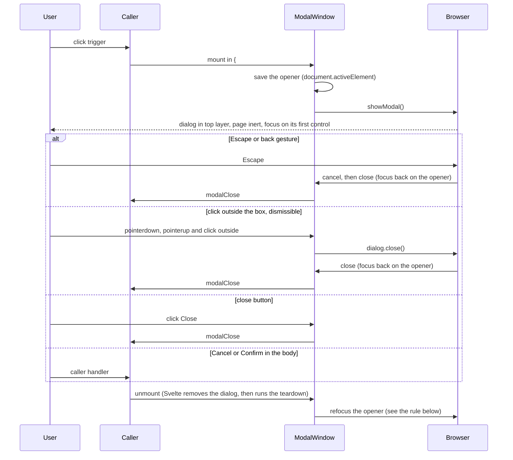
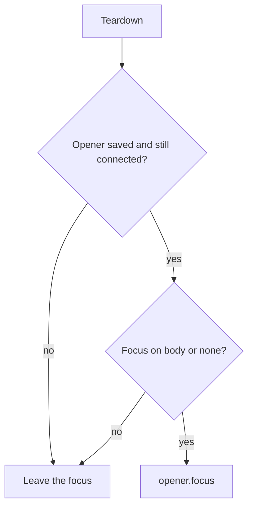
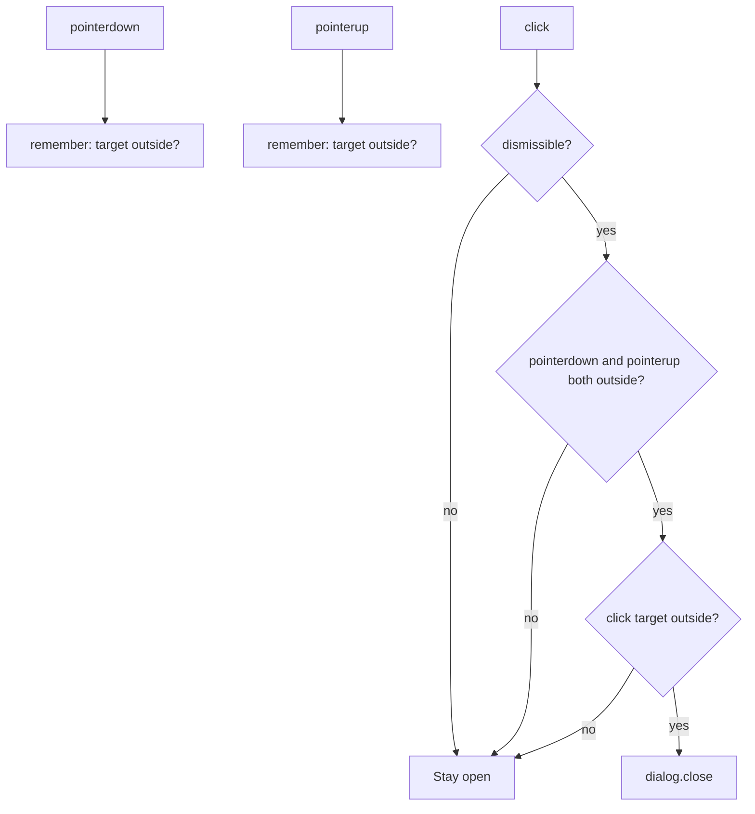
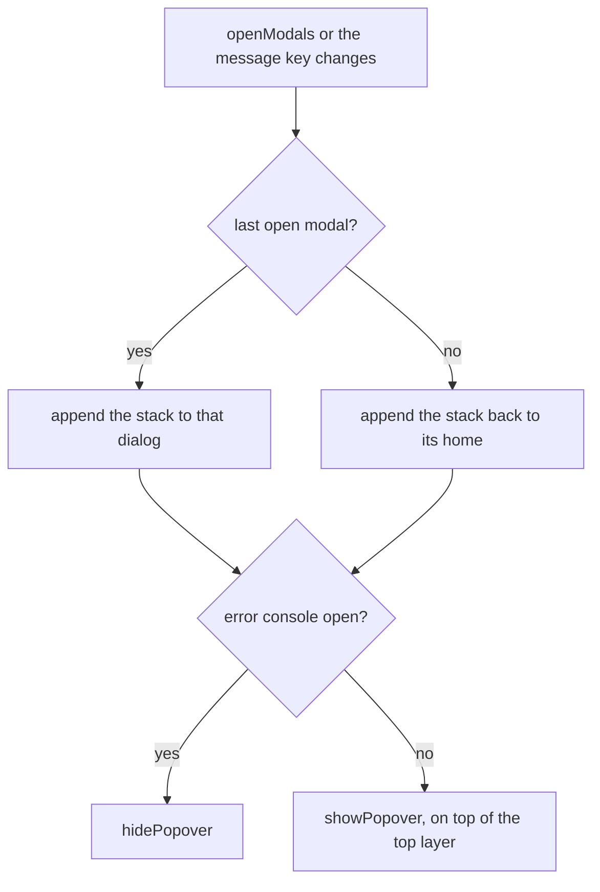

# ARGUS-274 — Build ModalWindow on the native dialog element

**Parent**: ARGUS-273 · no `argus:tasks/ARGUS-273/spec.md` yet; the story
text in Jira is the parent context.

## Overview

ModalWindow renders a `<dialog>` and calls `showModal()` when it mounts. The
browser then provides the top layer, the inert page, the focus containment
and Escape. The dialog is a transparent scroller that fills the viewport and
holds today's white box. `::backdrop` dims the page behind it. Escape closes
the dialog natively, and a click outside the box closes it through the same
`close()`, unless the caller passes `dismissible={false}`. The `close` event
becomes `modalClose`. Callers
unmount the modal on `modalClose`. Svelte removes the dialog from the DOM
before teardown, so ModalWindow saves the opener at open and refocuses it at
teardown. Two body-level layers must show above an open modal and stay
usable, so they move into the dialog: the error toasts become a manual
popover that is a child of the topmost open modal, and the results graph
tooltip mounts inside the dialog. ModalWindow lists its open dialog in a
shared store, and the toast stack follows the last one. The error console
becomes a native modal dialog too, and the toast stack hides while it is
open.

## Constraints

- The props `widthClass`, `title` and `body` and the `on:modalClose` event
  stay as they are. The one caller change is `dismissible={false}` on the
  modals that hold a form.
- Every caller mounts ModalWindow inside `{#if}` and unmounts it on
  `modalClose`. Svelte 5.55 `destroy_effect` removes the branch DOM before it
  runs the effect teardowns. A `close()` at teardown therefore runs on a
  detached dialog, and the browser's own focus return never happens.
- The frontend targets Baseline Widely available. `<dialog>`, `showModal()`,
  `::backdrop` and `:modal` are in that target. Popover (Newly available
  2025-01-27) and `overscroll-behavior` on a scroll container that does not
  overflow are not, so each is progressive enhancement. `closedby` has
  limited availability, with no Safari, so light dismiss cannot rest on it.
- A modal dialog makes every node outside its own subtree inert, whatever its
  place in the top layer. A popover raised above the modal is drawn there but
  takes no click, and the click lands on whatever is under it.
- jsdom 29 ships an empty `HTMLDialogElement`: no `showModal`, no `close`, no
  top layer, no inert page and no `cancel` on Escape. Its default stylesheet
  hides `dialog:not([open])`. Six suites render a component that holds a
  ModalWindow.
- `vite.config.ts` and the `suppressedSvelteCodes` list belong to ARGUS-275
  and ARGUS-276. This task checks the six codes against a list it empties
  locally for one build, and never commits that edit.

## Design

| Component | Role |
|---|---|
| Caller (17 files) | Mounts ModalWindow in `{#if open}` and sets `open = false` on `modalClose`; passes `dismissible={false}` for a form |
| ModalWindow | Renders the `<dialog>`, opens it modal, lists it in `openModals`, maps `close` to `modalClose`, restores the focus, closes the dialog on a click whose press and release both land outside the box when `dismissible` |
| `Stores/ModalStore` | `openModals`, the open ModalWindow dialogs in the order they opened |
| Browser | Top layer, inert page, focus containment, Escape to `cancel` then `close` |
| AlertWidget toast stack | Becomes `popover="manual"`. It moves into the last dialog of `openModals`, or back to its home when none is open, and shows there. Raised on each new message. Hidden while the error console is open |
| AlertWidget error console | A `<dialog>` opened with `showModal()`, above any open modal; Escape, its close button and "Clear all" close it |
| ResultsGraph tooltip | Mounts in the dialog that holds the chart, else in `document.body` as today |



The focus rule at teardown:



The focus sits on `body` after Svelte removes a dialog that held it. A native
close already returned the focus, and a caller may have moved it on purpose.
In both cases the rule leaves the focus where it is.

Layout and scroll, in the component's scoped style. No `z-index`, and no
`overflow` change on `html` or `body`:

```css
dialog.modal-window {
    position: fixed; inset: 0; width: 100%; height: 100%;
    max-width: none; max-height: none; margin: 0; padding: 0; border: 0;
    background: transparent; overflow-y: auto; overscroll-behavior: contain;
}
dialog.modal-window::backdrop {
    background-color: rgba(0, 0, 0, 0.55); overflow: hidden; overscroll-behavior: contain;
}
```

The light-dismiss rule. "Outside" means that the event target is the dialog
itself or the transparent frame around the box. A target inside the box is
inside, and so is an element appended to the dialog, such as the graph
tooltip or the toast stack. A modal with `dismissible={false}` skips the rule:



The rule needs all three events. A drag from the box to the outside, such as
a text selection in an input, fires `pointerdown` on the box and `click` on
the dialog. A drag from the outside into the box fires `pointerdown` and
`click` outside the box, because the `click` goes to the nearest common
ancestor, and only `pointerup` lands in the box. Escape is the keyboard path to the same close.

The toast stack and the modals. A toast outside the modal is inert, so the
stack becomes a child of the topmost modal while one is open. It is then
inside the modal's subtree, takes clicks, sits in the modal's tab order, and
a click on it is inside for light dismiss:



Moving the node hides its popover, so the stack shows again after each move.
When Svelte removes a dialog that holds the stack, the stack leaves the
document with it. ModalWindow's teardown then drops the dialog from
`openModals`, and the stack moves back home in the same flush, before any
paint. The stack sits in a plain wrapper `div`, so it is never the first or
last node of a Svelte block, and the action removes it from a host at destroy.

The error console was a `z-index: 9999` overlay. The toast stack in the top
layer covered it, and on a phone the toast bar covered "Clear all". The
console becomes a `<dialog>` opened with `showModal()`. It is then the
topmost modal, above any ModalWindow, so the "Show errors" button of the
phone bar, which moves into a modal with the stack, opens a console that is
visible and usable. The stack hides while the console is open, because a
new message would otherwise raise it above the console.

A nested modal is a `<dialog>` inside the outer dialog's body. `showModal()`
stacks it above the outer one, and Escape closes only the inner one.

Browser behavior that the design relies on. A static probe page measured it
in headless Chrome 157:

| Probe | Result |
|---|---|
| Focus after `showModal()`, no `autofocus` | The close button, the first focusable element |
| `trigger.focus()` while the modal is open | Refused; the focus stays in the dialog |
| Open dialog removed from the DOM | The focus falls to `body` |
| `close()` and then removal | The focus returns to the trigger |
| Escape twice with `cancel` prevented | 1st: `cancelable=true`; 2nd: `cancelable=false`, and the dialog closes |
| Escape with a modal nested in a modal | Only the inner one gets `cancel` and `close` |
| Fixed layer at `z-index: 999999`, body tooltip at `10000` | Both drawn under the backdrop; the hit test returns the dialog |
| Element appended inside the dialog | Drawn above the backdrop and hit-testable |
| `popover="manual"` shown after the modal | Drawn above the backdrop, but inert |
| `popover="manual"` outside the modal, hidden and shown again | Still inert; the hit test returns the dialog's frame |
| `popover="manual"` appended into the modal, then shown | Drawn above the backdrop and hit-testable |
| `showModal()` on a second dialog outside the open modal | It becomes the topmost modal, and the first one is inert |
| The modal removed while the popover is inside it | The popover is detached and hidden; appended home and shown, it is open and hit-testable |
| Dialog in a `display: none` ancestor | Open and modal, 0 px wide, page inert |
| Backdrop click, no `closedby` | The dialog stays open |
| Press, then drag, on the dialog's own scrollbar | No `pointerdown` and no `click` reach the page |
| Drag from the box to the outside | `pointerdown` on the box, `click` on the dialog |
| Drag from the outside into the box | `pointerdown` on the dialog, `pointerup` on the input in the box, `click` on the dialog |

Failure behavior:

| Condition | Behavior |
|---|---|
| The opener is gone at teardown, for example a deleted row | The focus stays on `body`; nothing throws |
| A second Escape gives a `cancel` that cannot be cancelled | No effect: ModalWindow never cancels `cancel` |
| An action in a modal fails, and the modal stays open | Its toast shows above the backdrop, inside the dialog. Its close button closes the toast, and the modal stays open with its input |
| The browser lacks Popover | The stack still moves into the dialog, a fixed box drawn after the frame, so it shows above the box and takes clicks |
| The error console opens while toasts show | The stack hides until the console closes, then shows again |
| "Show errors" in the phone bar while a modal is open | The console opens above the modal; closing it leaves the modal open |
| An Escape keydown cancelled by a control in the modal, such as an open svelte-select list | Only the control reacts; the modal stays open |

The a11y check on today's ModalWindow: a dev build with an empty
`suppressedSvelteCodes` printed 38 a11y warnings, 37 with the six codes, in
other components. None came from `Common/ModalWindow.svelte`. The new component
must keep that count at zero. The dialog carries `close`, `pointerdown`,
`pointerup` and `click` handlers, and Svelte flags none of them on a `<dialog>`.

## Contracts

### Module API

The props and the event are unchanged:

```ts
interface Props {
    widthClass?: string;   // default "w-50"; "w-100" below 768 px
    title?: Snippet;       // rendered in the h5 that names the dialog
    body?: Snippet;
}
// on:modalClose — CustomEvent<null> from createEventDispatcher
```

One prop is new:

```ts
dismissible?: boolean;     // default true; false: a click outside the box keeps the modal open
```

`dismissible={false}` goes on the modals that hold a form, where a stray
click would drop typed input: the release plan creator, the "create from"
plan and the plan editor (all three are `ReleasePlanCreator`), the plan copy
form, the plan creator's Grid View, the view creator in `Views.svelte`, the
assistant identity editor and the proxy tunnel create form. Confirmations,
viewers, pickers and single-field prompts keep the default.

The shared store, `frontend/Stores/ModalStore.ts`:

```ts
export const openModals: Writable<HTMLDialogElement[]>;   // in open order
export const addModal: (dialog: HTMLDialogElement) => void;     // ModalWindow, after showModal()
export const removeModal: (dialog: HTMLDialogElement) => void;  // ModalWindow, at teardown
```

The toast action, `frontend/Alerts/topLayer.ts`:

```ts
interface TopLayerParams {
    key: unknown;                   // the newest message id; a change raises the stack
    host?: HTMLElement | null;      // the dialog to live in; none: its home, the parent at mount
    shown?: boolean;                // false: hidden; default true
}
export function topLayer(node: HTMLElement, params: TopLayerParams): ActionReturn<TopLayerParams>;
```

The error console renders as
`<dialog class="alert-bucket-modal" aria-labelledby="{id}">`, named by its
"Error console" heading.

### Outputs

The rendered element. Callers and tests reach it by role:

```html
<dialog class="modal-window" aria-labelledby="{id}">   <!-- no aria-labelledby without a title -->
  <div class="d-flex align-items-center justify-content-center p-4">
    <div class="rounded bg-white p-4 w-50">
      <div class="mb-2 d-flex border-bottom pb-2">
        <h5 id="{id}">…title…</h5>
        <div class="ms-auto"><button class="btn btn-close" aria-label="Close" title="Close"></button></div>
      </div>
      <div>…body…</div>
    </div>
  </div>
</dialog>
```

When `modalClose` fires, once per close:

| User action | Before | After |
|---|---|---|
| Close button | `modalClose` | `modalClose` |
| Escape | `modalClose` from every open ModalWindow | `modalClose` from the topmost one, on its `close` event |
| Back gesture on mobile | nothing | as Escape |
| Click outside the white box | nothing | `modalClose`, on its `close` event; nothing when `dismissible={false}` |
| Drag from inside the box to outside | nothing | nothing |
| Drag from outside into the box | nothing | nothing |

## Risks

| Risk | Response |
|---|---|
| Another body-level layer must show above a modal | A search found two: `#argusErrors` and `#chartjs-tooltip`, and the design covers both. Review checks new ones |
| A keyed `{#each}` moves an open dialog, and the dialog drops out of the top layer | `EntityReplacer` sits in a keyed `{#each}` in `ReleasePlanCopyForm`, and that list does not reorder while its modal is open |
| A dialog opens inside a `display: none` ancestor, so an invisible modal makes the page inert | No caller opens from a hidden ancestor. Escape still closes it |
| The mobile Sidebar offcanvas runs Bootstrap's focus trap under the modal | Under the dialog the offcanvas is inert. A live check at 400 px confirms typing in the delete confirmation |
| The focus lands on the close button, so Enter right after open closes the modal | Accepted: see Decisions |
| A stray click outside the box drops a half-filled form | The form modals pass `dismissible={false}`. A drag that starts or ends in the box never closes the others. Review checks that a new form modal opts out |
| A toast covers the modal and its click falls through to the dialog, so light dismiss closes the modal | The stack is a child of the topmost modal and takes the click itself |
| The toast stack covers the error console | The console is a modal dialog above the stack, and the stack hides while it is open |
| Moving a Svelte-owned node breaks the block that owns it | The stack sits in a wrapper `div`, never a block boundary; its `{#each}` moves with it. The action removes it from a host at destroy |
| A caller keeps a closed ModalWindow mounted, so the stack stays in a closed dialog | Every caller unmounts on `modalClose` (Constraints) |
| Another browser dispatches pointer events for a press on the dialog's scrollbar, and the press closes the modal | Chrome dispatches none. The live check covers Chrome only |
| `ResultsGraph.svelte` also carries ARGUS-276 a11y warnings | This task touches only the tooltip handler. Whichever lands second rebases |
| The ConfirmDeleteModal suite fires Escape as a window `keydown` | Its Escape case moves to the dialog's `close` event; the caller code does not change |

## Deferred work

- The other hand-made overlays (Jenkins build and clone, screenshot, the
  `ResultsGraph` enlarge view) can move to the same `<dialog>` later.
  ModalWindow takes no props for them now.

## Decisions

- The dialog is a full-viewport transparent scroller holding today's box. The
  box keeps its top placement, a tall body (the graph modal is 800 px) scrolls
  as one page, and svelte-select lists, absolutely positioned, are not clipped
  at the box edge. (spec)
- A click outside the box closes the modal, as light dismiss. The modals that
  hold a form opt out with `dismissible={false}`, default `true`, so a stray
  click keeps the typed input. Escape and the close button still close them.
  (review)
- Light dismiss closes only when the press, the release and the click all
  land outside the box, so a drag into the box or out of it keeps the modal
  open. (review)
- Light dismiss is a pair of pointer handlers on the dialog and does not use
  `closedby`. `closedby` is not Baseline Widely available, and the
  full-viewport dialog leaves no backdrop for it to hit. (review)
- Light dismiss calls `dialog.close()`, so it shares the `close` path of
  Escape, including the browser's focus return. (review)
- ModalWindow never cancels `cancel`, and `close` is its one Escape signal,
  because Chrome makes a repeated `cancel` non-cancelable. (spec)
- The close button keeps dispatching `modalClose` itself, as today. (spec)
- The toast popover is feature-detected, because Popover is only Newly
  available. (spec)
- The callers' markup stays as it is apart from `dismissible`, so the user
  manager's admin-toggle modal, which has no title, stays unnamed. (spec)
- The work proceeds without a parent spec for ARGUS-273, as obvious work. (review)
- The AlertWidget toast popover and the ResultsGraph tooltip host join this
  task, because without them a modal hides its own errors and graph links. (review)
- The initial focus stays the browser default, the close button, with no
  `autofocus` added by ModalWindow. Enter right after open closes the modal,
  and that is accepted. (review)
- The toast stack moves into the topmost open modal instead of skipping light
  dismiss over its area. The inert rule follows the DOM tree, so only a child
  of the modal takes the click, and the toast's close button works with the
  modal open. (review)
- ModalWindow lists its dialog in a store in `Stores/`, because the modals
  and the alerts are two feature areas. (review)
- The error console becomes a native modal dialog, and the toast stack hides
  while it is open. A console overlay below the top layer is covered by the
  stack, and on a phone the console opens from inside a modal. (review)
