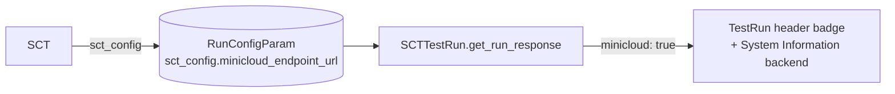

# ARGUS-285 — Mark SCT runs that ran on minicloud

## Design

- **Backend.** `SCTTestRun.get_run_response` reads the one
  `sct_config.minicloud_endpoint_url` row by its full key and sets
  `minicloud` in the response: true when the value is set and not empty.
  No model change: the value is already stored.
- **Frontend.** When `minicloud` is true, the run header shows a `minicloud`
  badge next to the build name, and System Information shows the same
  badge after the backend (`Backend: aws [minicloud]`).

## Contracts

The run fetch behind the run view (`api.testrun_api.get_testrun`, which
returns `SCTTestRun.get_run_response`) gains one boolean field, `minicloud`. Runs without the param return `false`.

## Limits

A run that turned minicloud on only through the `AWS_ENDPOINT_URL` or
`GCE_ENDPOINT_URL` environment variables, without `minicloud_endpoint_url`,
stays unmarked: Argus never sees those variables. The SCT pipelines set
`SCT_MINICLOUD_ENDPOINT_URL`, which lands in the config.
