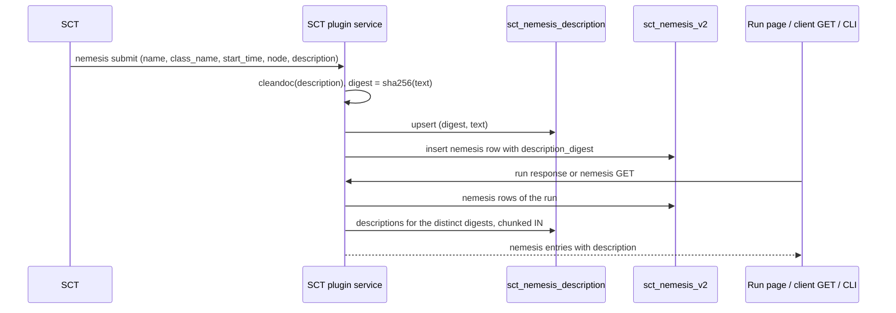

# ARGUS-47 — Support nemesis descriptions and extend NemesisTable

## Overview

The nemesis submit stores the description SCT sends in a content-addressed
table: the text is normalised as a docstring, hashed, written once per
distinct text, and the nemesis row keeps the digest. The run response and
the client nemesis GET resolve the digests in one batched read and attach
`description` to every nemesis. The run page replaces the nemesis `<table>`
with a responsive list of rows that keeps the sorting, the filter, the
status colours and the expandable details, and shows the description under
the name and in the details. The Go CLI prints the description on request.

## Constraints

- The row key of a nemesis is `(run_id, start_time, name)` after
  ARGUS-150, so two nemeses of one run can share a start time.
- The table of ARGUS-150 is `sct_nemesis_v2`, and its copy script already
  ran. A schema change is additive: a new table and a new nullable column,
  applied by `sync-models`, with no migration script.
- Old and new workers serve traffic side by side during a deploy.
- The client payload of the submit does not change. The client is vendored
  in SCT at 0.16.5 and already sends the field.
- The frontend follows the Svelte 5 rune, CSS, responsive and
  accessibility standards: no `querySelector`, no fixed widths, Bootstrap
  utilities and theme classes only, real buttons with ARIA state.

## Design

Components:

- `SCTNemesisDescription`, a new document in the SCT plugin: one row per
  distinct description text, keyed by the SHA-256 hex digest of the text.
- `SCTNemesis` gains `description_digest`, a nullable reference to that row.
- `SCTService.submit_nemesis` normalises the text with `inspect.cleandoc`,
  stores the description row, and sets the digest on the nemesis row it
  inserts. A missing, empty or whitespace-only text stores nothing and
  leaves the digest `NULL`.
- `SCTNemesis.with_descriptions` turns a list of nemesis rows into the
  response entries: it collects the distinct digests, reads the description
  rows in chunks of 90 with one `IN` query per chunk, and adds
  `description` to each entry. The run response and the client GET both
  call it.
- `frontend/TestRun/Nemesis/`: `NemesisList` (filter, sortable header,
  rows, empty states, the set of expanded rows), `NemesisRow` (one
  responsive row), `NemesisDetails` (the expanded panel), and a helper
  module with the pure sort, filter and label functions.
- The Go CLI `argus run nemeses` gains `--with-description`.

The submit and the read:



Failure and edge behaviour:

| Condition | Behavior |
|---|---|
| The description is `None`, empty or whitespace only | No description row; `description_digest` is `NULL`; the entry carries `description: null` |
| Two nemeses carry the same text, in one run or across runs | One description row; both entries carry the text |
| The docstring changes in SCT | A new row under a new digest; the older run keeps its old digest and text |
| A re-submit of the same `(run_id, start_time, name)` | The duplicate check returns first; no description write, the digest is unchanged |
| A finalize arrives | The row is loaded and saved whole; the digest is kept |
| A digest has no description row | The entry carries `description: null` |
| A row written before this change, or by an old worker during the deploy | `description_digest` is `NULL`, the entry carries `description: null` |
| A new worker starts before `sync-models` ran | Every nemesis submit fails on the missing column; `sync-models` runs first in the deploy |

The run-page list:

| Behavior | Rule |
|---|---|
| Columns | Nemesis (name, description line under it), Target node, Status, Started, Ended |
| Rows | One rounded block of flush rows that scrolls inside the tab; the header stays above the scroll area, and the tab panel itself does not scroll |
| Target node | A button that opens the Resources tab and highlights the row of the node; hovering it highlights every row of that node in the list |
| Default order | Start time, newest first; a running nemesis sorts as the latest end time |
| Sort click | The same column flips the direction; a new column takes its own default, ascending for name, node and status, descending for the times |
| Filter | One labelled text input; a valid regular expression matches case-insensitively against name, class, node, status, start, end and description; an invalid pattern matches as plain text |
| Status | A `NemesisStatusBg` and `NemesisStatusFg` pair, with `terminated` added to both maps and a secondary fallback for an unknown value |
| Expand | The name is a button with `aria-expanded`; the expanded set is keyed by `start_time` and `name` and survives the periodic refresh and the filter |
| Details | Nemesis facts, target node with private IP and state from the run resources, the full description with its line breaks, the failure or skip reason with a copy button |
| Narrow width | The header row is hidden, each row wraps the name line above the data line; the details stack in one column |
| Empty | "No nemeses were reported for this run." or "No nemesis matches the filter." |

## Contracts

### Inputs

```
POST /api/v1/client/sct/{run_id}/nemesis/submit
  nemesis: name, class_name, start_time, node_name, node_ip, node_shards, description
GET /api/v1/run/scylla-cluster-tests/{run_id}      # allocated_resources, nemesis_data
```

### Outputs

```sql
CREATE TABLE sct_nemesis_description (
    digest ascii,
    description text,
    PRIMARY KEY (digest)
);

ALTER TABLE sct_nemesis_v2 ADD description_digest ascii;
```

A nemesis entry of the run response (`nemesis_data[]`) and of
`GET /api/v1/client/sct/{run_id}/nemesis/get`:

```ts
interface NemesisInfo {
    class_name: string;
    name: string;
    duration: number;
    target_node: { name: string; ip: string | null; shards: number | null };
    status: string;
    start_time: number;
    end_time: number;
    stack_trace: string;
    description_digest: string | null;
    description: string | null;   // the normalised docstring, with its line breaks
}
```

The CLI:

```
argus run nemeses --run-id <uuid> [--with-description]
  table: Class | Name | Status | Duration(s) | Start Time | End Time | Target Node | Stack Trace [| Description]
  --output json: every record carries "description" regardless of the flag
```

### Module API

```python
class SCTNemesis(Document):
    @classmethod
    async def with_descriptions(cls, nemeses: list["SCTNemesis"]) -> list[dict]: ...

class SCTService:
    @staticmethod
    async def store_nemesis_description(raw: str | None) -> str | None: ...
```

```ts
// frontend/TestRun/Nemesis/NemesisList.svelte
interface Props { nemeses?: NemesisInfo[]; resources?: NemesisResource[] }
```

## Risks

| Risk | Response |
|---|---|
| A nemesis submitted by an old worker during the deploy loses its description | Accepted: the old code discards the text and nothing can backfill it |
| A description row is written by every submit that carries a text | The key is the hash of the content, so the write repeats identical bytes; one write per submit, no read before it |
| The `IN` read of the descriptions grows with the distinct texts of a run | A run has tens of nemeses and a handful of distinct texts; the read is chunked at 90 like the nemesis stats widget |

## Deferred work

- The nemesis stats and graphed stats view widgets, and the email nemesis
  section, build their rows by hand and do not carry the description.
- Typing the nemesis submit and finalize request bodies as Pydantic models
  changes the error class of a malformed request on both routes.
- The dead `NemesisRunInfo` link in `docs/api_usage.md`.
- A fallback to the `disrupt_*` method docstring in SCT, for the classes
  without a class docstring.

## Decisions

- The description lives in its own content-addressed table, and the
  nemesis row keeps a digest. A run keeps the text it was reported with,
  and the text is stored once. (spec)
- The partition key of the description table is the digest alone, so a
  read is one `IN` query per chunk; the nemesis row already carries the
  name. (spec)
- `inspect.cleandoc` normalises the text before hashing, so one docstring
  written with different margins hashes the same. (spec)
- The run page shows the description as a line under the name and in full
  in the details. (spec)
- The readers in scope are the run page, the client GET and the Go CLI;
  the CLI table shows the column only with `--with-description`, and its
  JSON always carries the field. (spec)
- The list is a Bootstrap grid of rows, not a `<table>`, so it wraps on a
  narrow window; the header and the column widths apply at the `lg`
  breakpoint and up. (spec)
- The filter falls back to a plain text match on an invalid pattern
  instead of hiding every row. (spec)
- The rows scroll inside the list, with the header above the scroll area,
  so a run with hundreds of nemeses does not grow the page. (build)
- The target node chip opens the Resources tab and highlights the node,
  so the node details are one click away. (build)
- Hovering a node chip highlights every row of that node, so the nemeses
  that hit one node stand out without a filter. (build)
