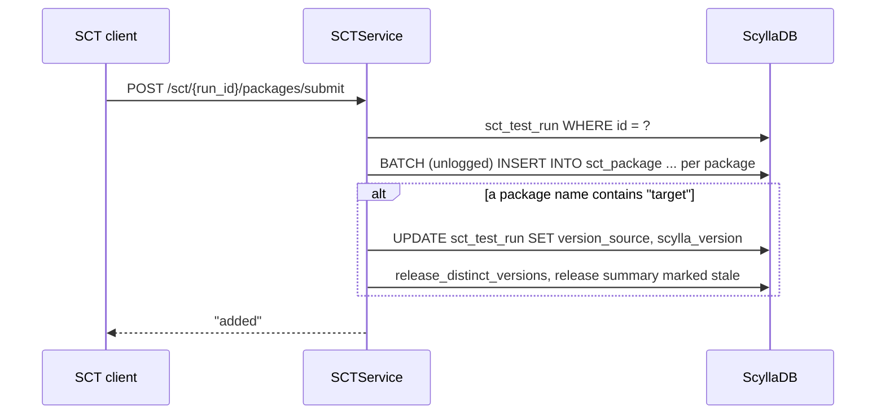
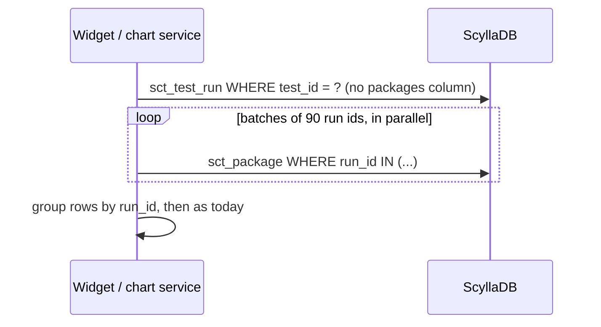

# ARGUS-8 — Store SCT packages in their own table

## Overview

The package versions of an SCT run move from the `packages` column of
`sct_test_run` to a new table, `sct_package`, with one row per run and package
name. A submission upserts its rows, and the run row is touched only when a
target package sets the run's version. Every reader takes the packages from the
new table: a single run reads its partition, and a reader over many runs reads
the partitions of their ids in batches. The run response keeps its `packages`
key, so the run page, the CLI and SCT see no change. A dated script copies the
existing lists into the table.

## Constraints

- The table is keyed by the run id, like `sct_nemesis_v2` and `sct_resource`.
  A run's `test_id` can be empty at submission and set later, so it cannot key
  the rows.
- Zero downtime across the four workers. The release flip runs old and new
  code side by side for a short time.
- The schema change is additive: `sync-models` creates the table. The legacy
  column and its user-defined type stay in the database until a later drop.
- The client route and payload of the submission do not change.

## Design

**Components**

- `SCTPackage`: the new table, keyed by the run and the package name.
- `SCTService.submit_packages`: upserts the submitted packages, then updates
  the run's version for a target package. No read of the stored list, no
  conditional write.
- The run response: reads the run's packages next to its nemeses and
  resources, and returns them under `packages`.
- The readers over many runs (results charts, the Summary, Graphed Stats and
  Nemesis Stats widgets, graphed-stats run details, the performance history,
  the release kernel report): select the runs without `packages`, then read the
  packages of the selected run ids in batches.
- The readers of one run (report email, `sut_timestamp`, similar runs): read
  that run's partition.
- The run cleanup: deletes the run's packages with its other SCT rows.
- The client: a getter for the packages of a run.
- The backfill script: copies every run's list into the table.





| Condition | Behavior |
|---|---|
| The run does not exist | `SCTServiceException("Run not found")`, as today |
| A package is submitted again with the same values | The upsert writes the same row; the result is `"added"` |
| A package is submitted with a name the run already has and other values | The new values replace the row |
| A full-row save of the run races a submission | No effect on packages; the run row no longer holds them |
| A run has no packages | The readers get an empty list, as they do for an empty column today |
| A run submitted on the new release is read by an old worker during the flip | The old worker shows no packages for it until the flip ends |

## Contracts

### Outputs

The table, created by `sync-models`:

```sql
CREATE TABLE sct_package (
    run_id uuid,
    name text,
    version text,
    date text,
    revision_id text,
    build_id text,
    PRIMARY KEY (run_id, name)
);
```

The run response, `GET /api/v1/run/scylla-cluster-tests/{run_id}`, unchanged in
shape. The entries come in name order, not submission order:

```json
{"status": "ok", "response": {"id": "…", "packages": [
  {"run_id": "…", "name": "kernel", "version": "5.15.0", "date": null, "revision_id": null, "build_id": null},
  {"run_id": "…", "name": "scylla-server", "version": "2026.1.0", "date": "20261102", "revision_id": "a1b2c3", "build_id": "…"}
], "nemesis_data": [], "allocated_resources": []}}
```

A new client route, behind `api_current_user`, route name
`api.client_api.sct_api.sct_get_packages`:

```
GET /api/v1/client/sct/{run_id}/packages/get
```

```json
{"status": "ok", "response": [{"run_id": "…", "name": "scylla-server", "version": "2026.1.0", "date": "20261102", "revision_id": "a1b2c3", "build_id": "…"}]}
```

The release kernel report, `GET /api/v1/client/sct/release/{release_name}/kernels`,
returns what it was written to return:

```json
{"status": "ok", "response": {
  "versions": {"2026.1.0-20261102.a1b2c3": ["5.15.0", "6.8.0"]},
  "metadata": {"5.15.0": {"passed": 12, "failed": 1, "aborted": 0, "test_error": 0}}
}}
```

The run dumps outside the run response lose the `packages` key: the client
`GET /client/testrun/{type}/{id}/get`, `GET /client/testrun/{run_id}/info`, the
run lookup, and `argus run list --full`. A caller that needs the packages uses
the new route.

### Module API

```python
class SCTPackage(Document):
    run_id: Annotated[UUID, PrimaryKey()]
    name: Annotated[str, ClusteringKey()]
    version: Optional[str] = None
    date: Optional[str] = None
    revision_id: Optional[str] = None
    build_id: Optional[str] = None

    @classmethod
    async def for_runs(cls, run_ids: Iterable[UUID]) -> dict[UUID, list["SCTPackage"]]: ...
```

`SCTPackage` keeps the attribute names of the `PackageVersion` type it
replaces, so the code that reads `name`, `version`, `date`, `revision_id` and
`build_id` stays as it is.

```python
class ArgusSCTClient:
    def get_packages(self) -> list[dict]: ...
```

## Risks

| Risk | Response |
|---|---|
| A run submits during the release flip and its packages exist only in the column | The backfill runs before the flip and again right after it |
| A reader still selects the dropped field and fails at runtime | Every reader of the column is switched in this change; the backend suite and a live check on the dev cluster cover each one |
| More partitions read per widget than before | Each partition holds about four small rows; reads go in batches of 90 ids in parallel |
| A same-name package with other values now replaces the earlier one | No run on the dev cluster has one; the run page and the charts read one version per name already |

## Deferred work

- A script drops `sct_test_run.packages` and the `packageversion_v2` type once
  the deploy has settled, as `migration_2026-05-08_drop_columns.py` did for the
  nemesis and resource columns.

## Decisions

- The task keeps the run id as the partition key of the precedents. A test id
  key would lose packages submitted before the run has a test. (spec)
- The release kernel report is ported and fixed, with a test, rather than
  removed. (spec)
- The work branches from `master`; the conflicts with PR #1217 on the run
  selects are resolved by whichever change lands second. (spec)
- The client gains a package getter, as it did for nemeses and resources,
  because the run dumps it reads today lose the key. (spec)
- The rows of one name replace each other. On the dev cluster every repeated
  name in a run carries identical values. (spec)
