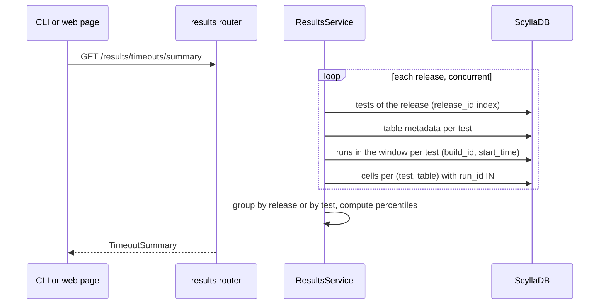
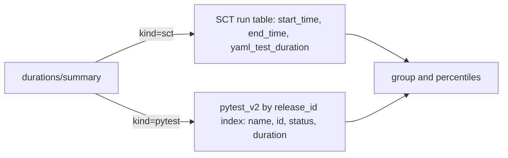

# ARGUS-96 — Summaries of timeouts and test durations across releases

## Overview

Two new reads return summary statistics, not raw cells. The timeout summary
reads the `<operation> - Timeout Statistics` tables that SCT submits, for
each test of one or more releases in a time window. It returns the
percentiles of `duration` and `timeout`, and the count of runs that hit the
timeout. The duration summary does the same for the duration of SCT runs and
of pytest cases. Both reads reuse the ARGUS-176 fan-out over the tests of a
release, with no schema change. The CLI and a new web page show the
results. One pull request builds the timeout summary, the duration summary
and the web page.

## Constraints

- A summary read of one operation, two releases and a 183-day window answers
  in under 3 s at p95 on production.
- No new table, no new index, no backfill, and no `ALLOW FILTERING` query.
- One request names at most 5 releases. The window is at most 366 days.
- The database reads stay concurrent and use the limit of 50 in
  `gather_limited`.

## Design

`ResultsService` gets the timeout summary. A new `DurationService` gets the
duration summary. One router, `results`, serves both. The CLI command
`argus results` gets two subcommands. A new web page calls the same two
endpoints.



The duration summary has two sources:



Rules:

- Percentiles use the nearest-rank method over all samples in the group.
- Durations are in seconds. `yaml_test_duration` holds minutes, and the
  read converts it to seconds.
- A cycle row of a timeout table is one sample. A run with three
  decommission cycles gives three samples.
- A sample counts as a timeout hit when `duration >= timeout`, or when its
  cell status is `ERROR`.
- Runs with the investigation status `ignored` are left out, as in
  ARGUS-176.
- Each test reads at most 1000 runs in the window. A test that has more
  runs is counted in `truncated_tests`.
- Samples with no value are left out of the percentiles and counted in
  `missing`.

| Condition | Behavior |
|---|---|
| A release name or UUID matches no release | `DataValidationError` that names the release |
| More than 5 releases, or a window longer than 366 days | `DataValidationError` |
| No test of a release submits the operation table | The group has `count: 0` and null statistics |
| The fan-out goes past `tableLimit` (test, table) pairs | `DataValidationError`, as in ARGUS-176 |
| A database read times out | The request fails with a 5xx. No partial summary is returned |

## Contracts

### Inputs

```
argus_test_v2            by release_id        # id, name, build_system_id, plugin_name
generic_result_metadata  by test_id           # name, columns_meta
generic_result_data_v1   by (test_id, name)   # run_id, row, column, value, status
sct_test_run             by build_id          # id, start_time, end_time, investigation_status, yaml_test_duration
pytest_v2                by release_id index  # name, id, status, duration, test_id
```

The tables named `<operation> - Timeout Statistics` (SCT,
`sdcm/utils/adaptive_timeouts/load_info_store.py`) carry the columns
`duration`, `timeout` and `hard_timeout`, one row per cycle (`#1`, `#2`).

### Outputs

```
GET /api/v1/results/timeouts/summary
    operation   decommission          # table "<operation> - Timeout Statistics"
    release[]   scylla-master         # 1 to 5 names or UUIDs
    since       2026-05-12            # optional, default until - 30 days
    until       2026-11-12            # optional, default now
    groupBy     release | test        # default release

GET /api/v1/results/durations/summary
    kind        sct | pytest
    release[]   scylla-master
    since, until, groupBy             # as above
    test        decommission_test     # optional substring of the test or case name
    limit       50                    # groups returned with groupBy=test, highest p99 first
```

```python
class Stats(TypedDict):          # seconds; every field is null when count == 0
    count: int
    missing: int
    min: float | None
    p50: float | None
    p90: float | None
    p99: float | None
    max: float | None

class TimeoutGroup(TypedDict):
    release: str
    test_name: str | None        # set with groupBy=test
    tests: int
    runs: int
    truncated_tests: int
    duration: Stats
    timeout: Stats
    timeouts_hit: int

class TimeoutSummary(TypedDict):
    operation: str
    table: str
    since: datetime
    until: datetime
    groups: list[TimeoutGroup]

class DurationGroup(TypedDict):
    release: str
    test_name: str | None
    runs: int
    truncated_tests: int
    duration: Stats
    limit: Stats | None          # yaml_test_duration for sct, null for pytest
    over_limit: int

class DurationSummary(TypedDict):
    kind: Literal["sct", "pytest"]
    since: datetime
    until: datetime
    groups: list[DurationGroup]
```

Both endpoints return the `APIResponse` shape, `{"status": "ok", "response": ...}`.

```
argus results timeouts <operation> --release <r> [--release <r>] [--since] [--until] [--by test] [--json]
argus results durations --kind sct|pytest --release <r> [--test <substr>] [--since] [--until] [--by test] [--limit 50] [--json]
```

The table output has one line per group: release, test, count, p50, p90, p99,
max, and timeouts hit or over limit.

### Module API

```python
class ResultsService:
    async def get_timeout_summary(self, operation: str, releases: list[str], since: datetime | None = None,
                                  until: datetime | None = None, group_by: Literal["release", "test"] = "release"
                                  ) -> TimeoutSummary: ...

class DurationService:
    async def get_duration_summary(self, kind: Literal["sct", "pytest"], releases: list[str],
                                   since: datetime | None = None, until: datetime | None = None,
                                   test_filter: str | None = None, group_by: Literal["release", "test"] = "release",
                                   limit: int = 50) -> DurationSummary: ...
```

## Risks

| Risk | Response |
|---|---|
| The pytest read by the `release_id` index reads the full history of the release, not only the window | The read selects four columns only. The build measures it on production data before merge. If it misses the 3 s budget, the read scopes to case names. |
| A 183-day window over two releases misses the 3 s budget | The build measures it on production data before merge. The fallback is a shorter default window, and the page says so. |
| A cap of 1000 runs per test biases the percentiles | `truncated_tests` shows the bias. A nightly test has about 180 runs in 183 days. |
| An operation table uses another name or unit | The endpoint returns `count: 0`, and the CLI shows it. |

## Deferred work

- A precomputed snapshot table of the summaries, if the fan-out misses the
  budget. The `Stats` shape is the row shape of that table.
- Grouping by the Scylla version of the run, inside a release.
- The node-load columns (`cpu_load_5`, `read_iops`) as dimensions of the
  timeout summary.

## Decisions

- The reads return server-side summary statistics. Raw cells stay on the
  ARGUS-176 endpoint. (spec)
- Groups are Argus releases, and one request takes up to 5 releases. (spec)
- Test duration covers SCT runs and pytest cases. The pytest part gives
  DTEST-82 its evidence. (spec)
- ARGUS-96 is one task with one pull request. The timeout summary, the
  duration summary and the web page ship together. (spec)
- The latency budget is 3 s at p95 for one operation, two releases and a
  183-day window. (spec)
- The `health` example of ARGUS-213 is not an adaptive-timeout operation in
  SCT. Which table holds it? (open)
- Should the unused `generic_result_data_v1_column_idx` and `_row_idx`
  indexes be dropped in a separate issue? (open)
