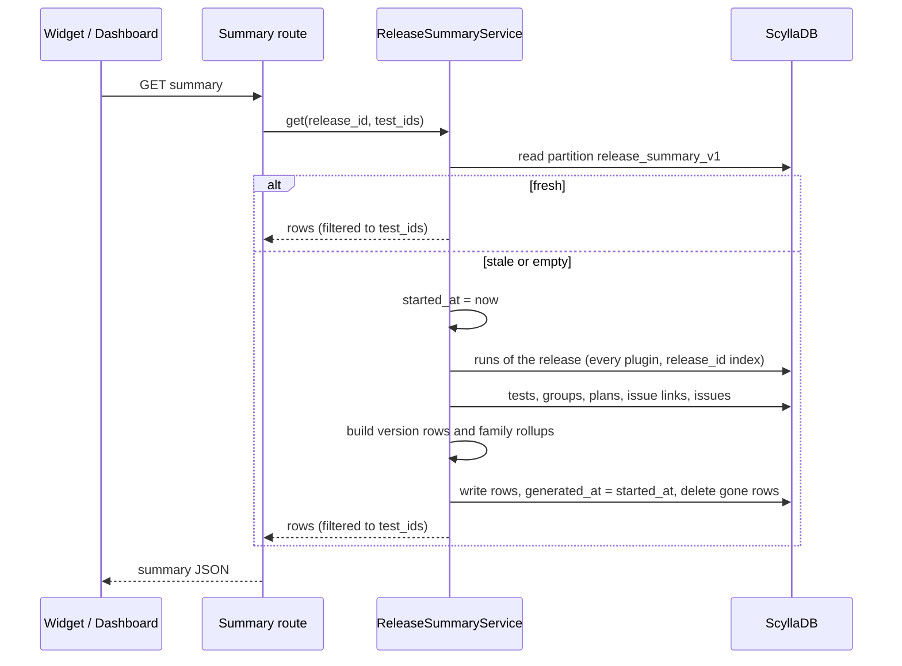
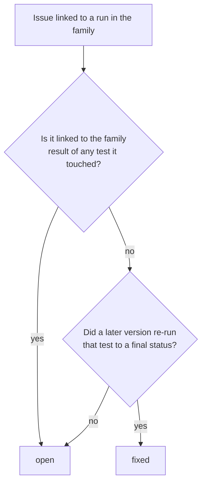

# QATOOLS-615 — Release summary per version, rolled up into the final version

## Overview

A new table, `release_summary_v1`, holds one summary row per version of a
release and one rollup row per family. A family is the final version that
its `~rcN` and `~dev` builds fold into. A release-level timestamp marks the
partition stale whenever a release action changes runs, plans or issues.

On a read, `ReleaseSummaryService` returns the rows when they are fresh. When
they are stale, it reads the release's runs, plans and issue links once,
recomputes every row of the release, and writes them back.

A view widget shows the summary of the view's tests. The release dashboard
mounts the same component for the whole release.

## Constraints

- The database enforces nothing. Staleness has to survive an invalidation
  that lands while a recompute runs, across four workers.
- Runs carry no index on `scylla_version`. A per-version run read is not
  available.
- No breaking schema change. The new table and the new `JiraIssue` column
  are additive.
- The release chat (QATOOLS-617 and later) reads the summary through the same
  service. The summary has to be a plain, serializable document.

## Design

### Versions and families

```python
# argus/common/versions.py
VERSION_RE = re.compile(r"^(?P<base>\d+\.\d+\.\d+)(?:[~.](?P<pre>rc\d+|dev))?(?:[.~-].*)?$")

@dataclass(frozen=True, slots=True)
class ScyllaVersion:
    base: str            # "2025.1.0", the family
    pre: str | None      # "rc2", "dev" or None for the final build
    def __str__(self) -> str: ...     # "2025.1.0~rc2", "2025.1.0"
    def sort_key(self) -> tuple: ...  # dev < rc0 < rc1 < ... < final

def parse_version(raw: str | None) -> ScyllaVersion | None: ...
```

| Raw `scylla_version` | Version | Family |
|---|---|---|
| `2025.1.0~rc2` | `2025.1.0~rc2` | `2025.1.0` |
| `2025.1.0.rc0.0.20250128.f407799f252d` | `2025.1.0~rc0` | `2025.1.0` |
| `2025.1.0.0.20250325.9dca28d2b818` | `2025.1.0` | `2025.1.0` |
| `2024.1.0~dev` | `2024.1.0~dev` | `2024.1.0` |
| `2025.1.1` | `2025.1.1` | `2025.1.1` |
| empty, or no match | none | none: the run is left out |

### Read and recompute



- The partition is stale when `invalidated_at > generated_at`, or when it
  holds no rows. Both columns are static, one value per release.
- `mark_stale(release_id)` is one blind write, `invalidated_at = now`, with
  no read.
- A recompute stores `generated_at` as the time it *started*. An invalidation
  that lands during the recompute is later than that, so the partition stays
  stale and the next read recomputes again.
- Within one worker, concurrent reads of a stale release share one recompute
  task.

### What a version row counts

Each test is counted once per version, by its latest run on that version
(the highest `start_time`). Disabled tests and groups are left out, as in the
release stats.

| Count | Rule |
|---|---|
| `executed` | Latest run is `passed`, `failed`, `test_error`, `error` or `aborted` |
| `passed` | Latest run is `passed` |
| `failed` | Latest run is `failed`, `test_error` or `error` |
| `aborted` | Latest run is `aborted` |
| `in_progress` | Latest run is `created` or `running` |
| `pending` | The test is planned for the version and has no run on it |
| `issues_new` | Distinct issues linked to any run of the version, first seen on this version |
| `issues_existing` | Distinct issues linked to any run of the version, first seen before it |

- **Planned for a version:** a plan of the release whose `target_version`
  parses to that version. Its `tests` count, plus every enabled test of its
  `groups`. A plan with no target version plans no version.
- **The versions of a release:** every version found on a run of the
  release, plus every version that a plan targets. A planned version with no
  runs yet shows all its planned tests as pending.

### The family rollup (QATOOLS-616)

- **Tests:** a test's result in the family is its latest run in version
  order, then by start time. The counts follow the version-row table above.
  `pending` covers the tests planned for any version of the family that have
  no run in the family.
- **Issues:** each issue reproduced in the family takes one state.



- The rollup counts `issues_new`, `issues_existing` and `issues_fixed`.

### New or existing

- `JiraIssue` gains `first_run_id`, set when Argus creates the issue row on
  its first link. A dated script fills it for existing rows from each issue's
  earliest `IssueLink.added_on`.
- An issue is *new* on a version when its first run is a run of this release
  on that version. On the family rollup, it is new when its first run is on
  any version of the family. Otherwise the issue is *existing*.
- A GitHub issue, or a Jira issue with no `first_run_id`, is always
  *existing*.

### Staleness hooks

Each action below calls `mark_stale(release_id)` after its own write.

| Action | Hook |
|---|---|
| Comments, issue link and unlink, assignee, status from the UI, investigation status, batch ignore, plan changes, release and test admin edits | Inside `invalidate_release_snapshots`, which every one of these already calls |
| Run submit and finish | Inside `PluginModelBase.invalidate_release_snapshot` |
| Run finish, after the run row is saved | Client service, after `run.save()` |
| Status update from the client API | New call |
| Stuck-run sweep | New call |
| Gemini and performance auto-fail | New call |
| Product version and package submit | New call |
| Moving a test's runs to another release | New call, for both releases |
| The replay backfill | New call |

### Failure behavior

| Condition | Behavior |
|---|---|
| `mark_stale` write fails | Log a warning, do not fail the action. The next successful mark makes the partition stale again |
| The recompute fails on a read | Return the stored rows with `stale: true`. Return HTTP 500 only when no rows exist |
| The recompute write fails | Return the computed result. The partition stays stale |
| An issue row is missing for a link | Count the link under the issue id, with no title, as existing |
| A run's version does not parse | Leave the run out of every count |

## Contracts

### Outputs

```sql
CREATE TABLE release_summary_v1 (
    release_id uuid,
    family text,
    version text,              -- '' on the family rollup row
    invalidated_at timestamp static,
    generated_at timestamp static,
    payload text,              -- JSON, one Summary
    PRIMARY KEY (release_id, family, version)
);

ALTER TABLE jira_issue ADD first_run_id uuid;
```

```python
class Counts(TypedDict):
    executed: int
    passed: int
    failed: int
    aborted: int
    in_progress: int
    pending: int
    issues_new: int
    issues_existing: int
    issues_fixed: int          # 0 on a version row

class TestEntry(TypedDict):
    test_id: str
    group_id: str
    test_name: str
    group_name: str
    status: str                # TestStatus value, or "pending"
    run_id: str | None
    build_id: str | None
    build_number: int | None
    version: str | None        # the version of the counted run

class IssueEntry(TypedDict):
    id: str
    type: Literal["jira", "github"]
    key: str                   # "SCYLLADB-123" or "scylladb/scylladb#123"
    title: str | None
    url: str | None
    state: str | None          # tracker state
    novelty: Literal["new", "existing"]
    status: Literal["open", "fixed"]   # always "open" on a version row
    test_ids: list[str]
    run_ids: list[str]

class Summary(TypedDict):
    version: str | None        # None on the rollup
    counts: Counts
    tests: list[TestEntry]
    issues: list[IssueEntry]
```

`GET /api/v1/release/{release_id}/summary`

```json
{"status": "ok", "response": {
  "release_id": "1a2c714b-…", "release_name": "scylla-2025.1",
  "generated_at": "2026-11-05T10:00:00Z", "stale": false,
  "families": [
    {"family": "2025.1.1", "rollup": {"version": null, "counts": {…}, "tests": […], "issues": […]},
     "versions": [{"version": "2025.1.1", …}]},
    {"family": "2025.1.0", "rollup": {…},
     "versions": [{"version": "2025.1.0~rc0", …}, …, {"version": "2025.1.0", …}]}
  ]}}
```

- Families come newest first. Versions inside a family run from `~dev`
  through the rcs to the final build.

`GET /api/v1/views/widgets/release_summary?view_id=<uuid>`

```json
{"status": "ok", "response": {"releases": [<the release object above, filtered to the view's tests>]}}
```

- On a view, `tests` and `issues` keep only the view's tests and the counts
  are recomputed from them. An issue stays when any of its `test_ids` is in
  the view.

### Module API

```python
class ReleaseSummaryService:
    async def get(self, release_id: UUID, test_ids: set[UUID] | None = None) -> dict: ...
    async def get_for_view(self, view_id: UUID) -> dict: ...

async def mark_release_summary_stale(release_id: UUID | None) -> None: ...
```

Frontend: the view widget type `releaseSummary` in `WIDGET_TYPES`, with no
settings. The same component takes `{dashboardObject, dashboardObjectType}`,
where the type is `"view"` or `"release"`.

## Risks

| Risk | Response |
|---|---|
| A release with very many runs, for example master, makes each recompute a large read. It is stale after nearly every change | One recompute per release per worker at a time. The dev cluster reads 4,022 runs in under 0.4 s. If production is slow, serve the stored rows and recompute in the background |
| A large partition: one payload per version, with an entry per test | Only tests that ran on, or were planned for, a version get an entry. A release branch has tens of versions |
| PR #1027 rewrites the same invalidation call sites | The hook is one call inside the existing helpers. Whichever change lands second keeps that call |
| PR #1140 removes runs, tests and groups through new paths | Those paths call `invalidate_release_snapshots`, which marks the summary stale |
| Clock skew between hosts reorders `invalidated_at` and `generated_at` | The workers of one deployment share a host. A skew only delays freshness by one change |

## Deferred work

- The release chat and memory (QATOOLS-617 to QATOOLS-621) reads
  `ReleaseSummaryService.get`. Notes and corrections from the chat go to
  their own table, so a recompute never erases them.

## Decisions

- QATOOLS-615 and QATOOLS-616 are designed and built as one task: the rollup
  reads the same rows. (spec)
- The table is keyed by `release_id`, not by release name, like every
  release-scoped table. (spec)
- Staleness is one pair of static timestamps per release, not a boolean per
  row. Clearing a boolean after a recompute erases a mark that landed during
  it, and one release read recomputes every version anyway. (spec)
- The versions of a release come from its runs and plans, which the
  recompute reads anyway. `release_distinct_versions` lists only versions
  with runs, so it would miss a planned version that has not started. (spec)
- `~dev` builds fold into their family like release candidates. (spec)
- A patch version is its own family, and its own rcs fold into it. (spec)
- The view widget counts only the view's tests. The release dashboard mounts
  the same component, with no settings, for the whole release. (spec)
- New or existing comes from the first run recorded on the issue. GitHub
  issues count as existing: the tracker is deprecated. (spec)
- `aborted` is its own count, part of `executed` and not of `failed`. (spec)
- A test that ran on several versions counts once in the rollup, by its
  latest result. (spec)
