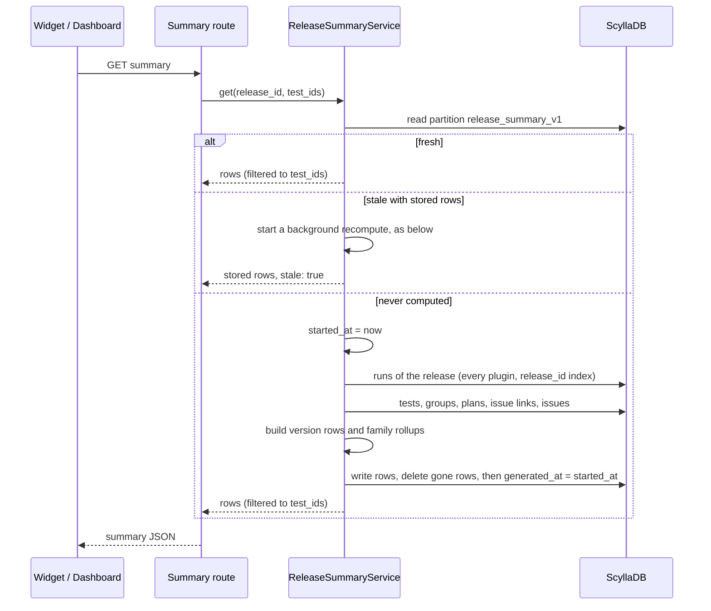
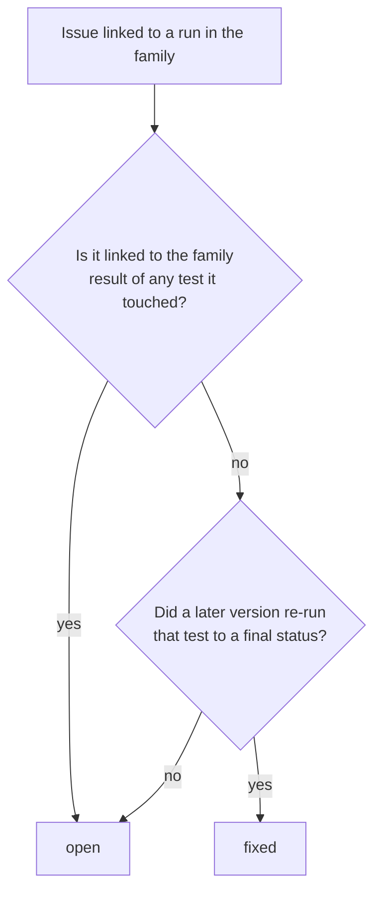

# QATOOLS-615 — Release summary per version, rolled up into the final version

## Overview

A new table, `release_summary_v1`, holds one summary row per version of a
release and one rollup row per family. A family is the final version that
its `~rcN` and `~dev` builds fold into. A release-level timestamp marks the
partition stale whenever a release action changes runs, plans or issues.

On a read, `ReleaseSummaryService` returns the rows when they are fresh. When
they are stale, it reads the release's runs, plans and issue links once,
recomputes every row of the release, and writes them back.

A view widget shows the summary of the view's tests. The release dashboard
mounts the same component for the whole release.

## Constraints

- The database enforces nothing. Staleness has to survive an invalidation
  that lands while a recompute runs, across four workers.
- Runs carry no index on `scylla_version`. A per-version run read is not
  available.
- No breaking schema change. The new table is additive, and no existing
  table changes.
- The release chat (QATOOLS-617 and later) reads the summary through the same
  service. The summary has to be a plain, serializable document.

## Design

### Versions and families

```python
# argus/common/versions.py
VERSION_RE = re.compile(r"^(?P<base>\d+\.\d+(?:\.\d+)?)(?:[~.-](?P<pre>rc\d+|dev))?(?:[.~-].*)?$")
# A two-part base gets a .0: 2022.1~rc5 is 2022.1.0~rc5. -rc1 and -dev read as ~rc1 and ~dev.

@dataclass(frozen=True, slots=True)
class ScyllaVersion:
    base: str            # "2025.1.0", the family
    pre: str | None      # "rc2", "dev" or None for the final build
    def __str__(self) -> str: ...     # "2025.1.0~rc2", "2025.1.0"
    def sort_key(self) -> tuple: ...  # dev < rc0 < rc1 < ... < final

def parse_version(raw: str | None) -> ScyllaVersion | None: ...
```

| Raw `scylla_version` | Version | Family |
|---|---|---|
| `2025.1.0~rc2` | `2025.1.0~rc2` | `2025.1.0` |
| `2025.1.0.rc0.0.20250128.f407799f252d` | `2025.1.0~rc0` | `2025.1.0` |
| `2025.1.0.0.20250325.9dca28d2b818` | `2025.1.0` | `2025.1.0` |
| `2024.1.0~dev` | `2024.1.0~dev` | `2024.1.0` |
| `2025.1.1` | `2025.1.1` | `2025.1.1` |
| empty, or no match | none | none: the run is left out |

### Read and recompute



- A stale summary with stored rows comes back at once, marked stale, while a
  background recompute runs; the widget says it is refreshing and asks again
  every 3 s, at most 5 times. Only a release with no stored rows waits for
  its recompute. The build of the rows runs off the event loop.
- The partition is stale when `invalidated_at >= generated_at`, or when it
  has no `generated_at`. Both columns are static, one value per release, so a
  release with no versioned runs is still stored as computed.
- Both timestamps are stored at millisecond precision, and the recompute
  rounds its start down to the millisecond. A mark in the same millisecond as
  the start counts as later.
- `mark_stale(release_id)` is one blind write, `invalidated_at = now`, with
  no read.
- A recompute stores `generated_at` as the time it *started*, after it wrote
  the rows. An invalidation that lands during the recompute is not older than
  that, so the partition stays stale and the next read recomputes again. A
  recompute never deletes the partition, since that would erase a newer
  `invalidated_at`.
- Within one worker, concurrent reads of a stale release share one recompute
  task, unless that task started before the latest invalidation; such a read
  starts a recompute that sees the change.
- Every response reads each listed issue's tracker state, title and card
  from the Jira and GitHub issue rows, so an issue the tracker refresh closed
  shows as closed without a recompute.

### What a version row counts

Each test is counted once per version, by its latest run on that version
(the highest `start_time`). Disabled tests and groups are left out, as in the
release stats.

| Count | Rule |
|---|---|
| `executed` | Latest run is `passed`, `failed`, `test_error`, `error` or `aborted` |
| `passed` | Latest run is `passed` |
| `failed` | Latest run is `failed`, `test_error` or `error` |
| `aborted` | Latest run is `aborted` |
| `in_progress` | Latest run is `created` or `running` |
| `pending` | The test is planned for the version and has no run on it |
| `issues_new` | Distinct issues linked to any run of the version, first seen on this version |
| `issues_existing` | Distinct issues linked to any run of the version, first seen before it |

- **Planned for a version:** a plan of the release whose `target_version`
  parses to that version. Its `tests` count, plus every enabled test of its
  `groups`. A plan with no target version plans no version.
- **The versions of a release:** every version found on a run of the
  release, plus every version that a plan targets. A planned version with no
  runs yet shows all its planned tests as pending.
- **The release's version pattern:** when the release sets
  `valid_version_regex`, a run or a plan counts only when the pattern matches
  its raw version (`re.search`, unanchored, as the dashboard's version filter
  does). An invalid pattern filters nothing and logs a warning. Editing the
  pattern already marks the summary stale.

### The family rollup (QATOOLS-616)

- **Tests:** a test's result in the family is its latest run in version
  order, then by start time. The counts follow the version-row table above.
  `pending` covers the tests planned for any version of the family that have
  no run in the family.
- **Issues:** each issue reproduced in the family takes one state.



- The rollup counts `issues_new`, `issues_existing` and `issues_fixed`.

### New or existing

- An issue's first run is the run of its earliest link, by
  `IssueLink.added_on`, across every release. The recompute reads
  `IssueLink.find(issue_id=...)` for each issue linked in the release, at
  most 20 reads at a time. A recurring issue has tens of links, a few
  hundred at most.
- An issue is *new* on a version when its first run is a run of this release
  on that version. On the family rollup, it is new when its first run is on
  any version of the family. Otherwise the issue is *existing*.
- Jira and GitHub issues follow the same rule, since both link through
  `IssueLink`.

### Staleness hooks

Each action below calls `mark_stale(release_id)` after its own write.

| Action | Hook |
|---|---|
| Comments, issue link and unlink, assignee, status from the UI, investigation status, batch ignore, plan changes, release and test admin edits | Inside `invalidate_release_snapshots`, which every one of these already calls |
| Run submit and finish | Inside `PluginModelBase.invalidate_release_snapshot` |
| Run finish, after the run row is saved | Client service, after `run.save()` |
| Status update from the client API | New call |
| Stuck-run sweep | New call |
| Gemini and performance auto-fail, and a performance result that passes | New call |
| Driver-matrix environment info (sets the version) and the legacy matrix submit | New call |
| Product version and package submit | New call |
| Moving a test's runs to another release | New call, for both releases |
| The replay backfill | New call |

### Failure behavior

| Condition | Behavior |
|---|---|
| `mark_stale` write fails, for any reason | Log a warning, do not fail the action. The next successful mark makes the partition stale again |
| A release is deleted | Its summary partition is deleted with it |
| The recompute fails on a read | Return the stored rows with `stale: true`. Return HTTP 500 only when no rows exist |
| The recompute write fails | Return the computed result. The partition stays stale |
| An issue row is missing for a link | Count the link under the issue id, with no title, as existing |
| A stored family has no rollup row (a partial write) | Leave the family out of the response |
| A run's version does not parse | Leave the run out of every count |

## Contracts

### Outputs

```sql
CREATE TABLE release_summary_v1 (
    release_id uuid,
    family text,
    version text,              -- '' on the family rollup row
    invalidated_at timestamp static,
    generated_at timestamp static,
    payload text,              -- JSON, one Summary
    PRIMARY KEY (release_id, family, version)
);
```

```python
class Counts(TypedDict):
    executed: int
    passed: int
    failed: int
    aborted: int
    in_progress: int
    pending: int
    issues_new: int
    issues_existing: int
    issues_fixed: int          # 0 on a version row

class TestEntry(TypedDict):
    test_id: str
    group_id: str
    test_name: str
    group_name: str
    status: str                # TestStatus value, or "pending"
    run_id: str | None
    build_id: str | None
    build_number: int | None
    version: str | None        # the version of the counted run
    issues: int                # distinct issues linked to the counted run
    comments: int              # comments on the counted run
    start_time: str | None     # the counted run's start, ISO 8601

class IssueEntry(TypedDict):
    id: str
    type: Literal["jira", "github"]
    key: str                   # "SCYLLADB-123" or "scylladb/scylladb#123"
    title: str | None
    url: str | None
    state: str | None          # tracker state
    novelty: Literal["new", "existing"]
    status: Literal["open", "fixed"]   # always "open" on a version row
    on_latest_run: bool        # linked to a test's latest run in the family; False on a version row
    open_test_ids: list[str]   # the tests that keep it open; all its tests on a version row
    latest_test_ids: list[str] # the tests whose latest run in the family carries it
    test_ids: list[str]
    run_ids: list[str]
    issue: dict                # the issue as the issues API returns it with
                               # aggregate_by_issue: its fields, "subtype" and
                               # the "links" inside this summary's scope

class Summary(TypedDict):
    version: str | None        # None on the rollup
    counts: Counts
    tests: list[TestEntry]
    issues: list[IssueEntry]
```

`GET /api/v1/release/{release_id}/version_summary`

```json
{"status": "ok", "response": {
  "release_id": "1a2c714b-…", "release_name": "scylla-2025.1",
  "generated_at": "2026-11-05T10:00:00Z", "stale": false,
  "families": [
    {"family": "2025.1.1", "rollup": {"version": null, "counts": {…}, "tests": […], "issues": […]},
     "versions": [{"version": "2025.1.1", …}]},
    {"family": "2025.1.0", "rollup": {…},
     "versions": [{"version": "2025.1.0~rc0", …}, …, {"version": "2025.1.0", …}]}
  ]}}
```

- Families come newest first. Versions inside a family run from `~dev`
  through the rcs to the final build.

`GET /api/v1/views/widgets/release_summary?view_id=<uuid>`

```json
{"status": "ok", "response": {"releases": [<the release object above, filtered to the view's tests>]}}
```

- On a view, `tests` and `issues` keep only the view's tests and the counts
  are recomputed from them. Each issue is narrowed to those tests: its status
  is open while one of them keeps it open (`open_test_ids`), it is on a latest
  run when one of them carries it there (`latest_test_ids`), and its tests,
  runs and links are theirs. An issue stays when any of its `test_ids` is in
  the view.

### Module API

```python
class ReleaseSummaryService:
    async def get(self, release_id: UUID, test_ids: set[UUID] | None = None) -> dict: ...
    async def get_for_view(self, view_id: UUID) -> dict: ...

async def mark_release_summary_stale(*release_ids: UUID | None) -> None: ...
```

Frontend: the view widget type `releaseSummary` in `WIDGET_TYPES`, with no
settings. The same component takes `{dashboardObject, dashboardObjectType,
collapsible, onTestClick}`, where the type is `"view"` or `"release"`.

- **Each family** has two tabs:
  - **Timeline:** one row per version with a status bar and its counts.
    Each count filters the test list below.
  - **Grid:** tests by version, one status cell per run.

  An issue list beside them groups issues by tracker state: open in the
  tracker, then closed in the tracker.
  - Each issue is a compact row: the tracker state pill, the key and the
    title, then badges for whether it is on a latest run (or when it was
    last seen), new or existing, and the versions it reproduced on.
  - Issues on a latest run sort first.
  - A row expands into the shared `IssueCard` in aggregated mode.
- **The release dashboard** mounts the component as a collapsed accordion. A
  test click adds the test to the existing test popout. A pill with the test
  name flies in an arc from the cursor towards the popout, because the
  popout sits below the summary and usually off screen.

## Risks

| Risk | Response |
|---|---|
| A release with very many runs, for example master, makes each recompute a large read. It is stale after nearly every change | One recompute per release per worker at a time, in the background whenever stored rows exist, with the build off the event loop. A page view never waits for it after the first computation |
| A large partition: one payload per version, with an entry per test | Only tests that ran on, or were planned for, a version get an entry. A release branch has tens of versions |
| PR #1027 rewrites the same invalidation call sites | The hook is one call inside the existing helpers. Whichever change lands second keeps that call |
| PR #1140 removes runs, tests and groups through new paths | Those paths call `invalidate_release_snapshots`, which marks the summary stale |
| Clock skew between hosts reorders `invalidated_at` and `generated_at` | The workers of one deployment share a host. A skew only delays freshness by one change |

## Deferred work

- Store the close date of each tracker issue (Jira `resolutiondate`, GitHub
  `closed_at`) during `refresh-issues`. The summary can then flag an issue
  that was linked to a run started after it was closed.

- The release chat and memory (QATOOLS-617 to QATOOLS-621) reads
  `ReleaseSummaryService.get`. Notes and corrections from the chat go to
  their own table, so a recompute never erases them.

## Decisions

- QATOOLS-615 and QATOOLS-616 are designed and built as one task: the rollup
  reads the same rows. (spec)
- The table is keyed by `release_id`, not by release name, like every
  release-scoped table. (spec)
- Staleness is one pair of static timestamps per release, not a boolean per
  row. Clearing a boolean after a recompute erases a mark that landed during
  it, and one release read recomputes every version anyway. (spec)
- The versions of a release come from its runs and plans, which the
  recompute reads anyway. `release_distinct_versions` lists only versions
  with runs, so it would miss a planned version that has not started. (spec)
- `~dev` builds fold into their family like release candidates. (spec)
- A patch version is its own family, and its own rcs fold into it. (spec)
- A release's `valid_version_regex` limits its summary to the matching
  versions. Runs of other versions, such as the sources of upgrade tests,
  would otherwise show up as families of their own. (build)
- The view widget counts only the view's tests. The release dashboard mounts
  the same component, with no settings, for the whole release. (spec)
- New or existing comes from the issue's earliest link, read at recompute
  time. If those reads become slow, a first-run column on the issue
  replaces them. (build)
- `aborted` is its own count, part of `executed` and not of `failed`. (spec)
- A test that ran on several versions counts once in the rollup, by its
  latest result. (spec)
- A family shows both a version timeline and a test-by-version grid, as
  tabs. The timeline answers how far each candidate got; the grid answers
  which tests changed between candidates. (build)
- The release dashboard shows the summary as a collapsed accordion, so the
  test dashboard keeps its place on load. (build)
- A count filters the test list, issues show their tracker state, versions
  and tests, the summary says when it was refreshed, and a test click on the
  release dashboard fills the test popout. (build)
- Issues group by tracker state, and whether the issue is on a test's latest
  run is a badge on each row. Grouping by reproduction put tracker-closed
  issues under an "open" heading. (build)
- The summary does not flag a closed issue on a latest run as a regression.
  The issue may have been closed after that run, and Argus stores no close
  date to tell the two apart. (build)
- A row expands into the shared `IssueCard`, so the summary entry carries
  the issue in the issues API's aggregated shape. (build)
- The status filter is a set of independent toggles, as in the SCT events
  tab. A count or a bar segment shows only its status. (build)
- A new release plan's view starts with highlights and action items, the
  issues, the stat bar, the release summary and the test dashboard, in that
  order. (build)
- The release route is `/release/{release_id}/version_summary`. A
  `/release/{release_id}/summary` route answers `/release/stats/summary`
  first and breaks it. (build)
