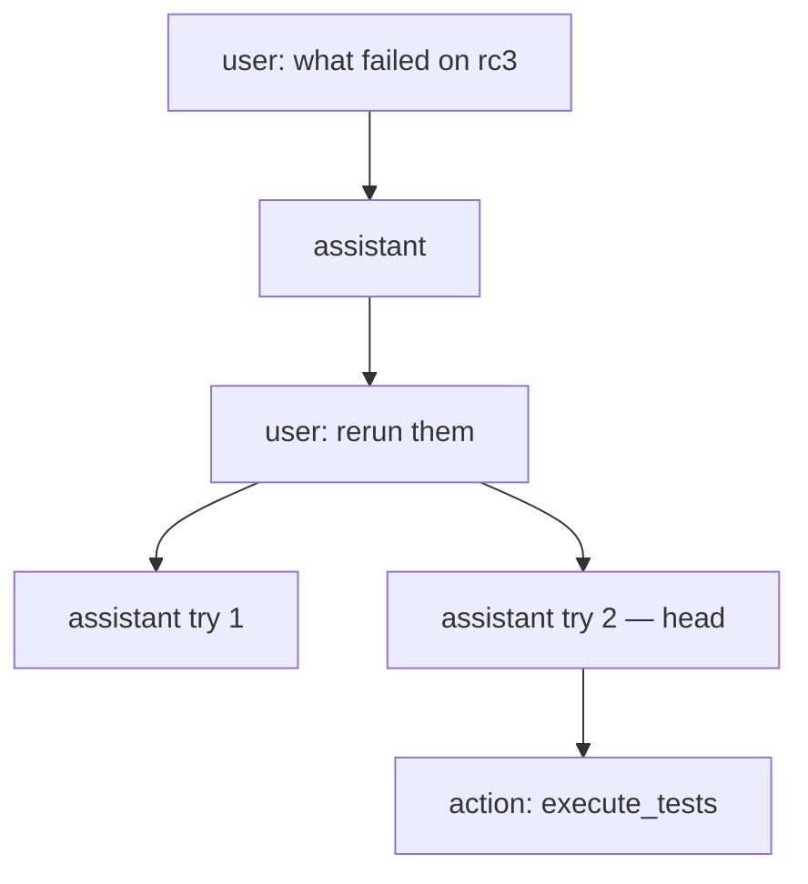
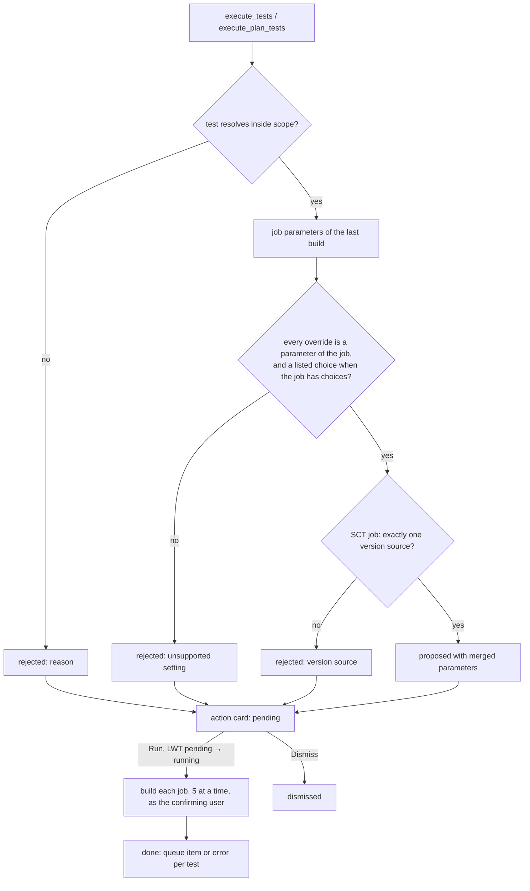
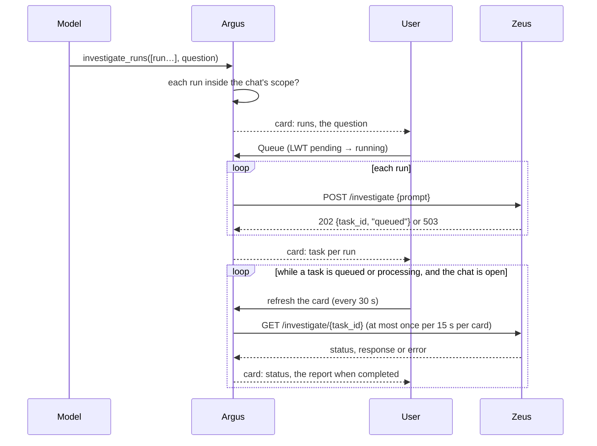

# QATOOLS-617 — Shared chat with memory on releases and views

## Overview

Argus connects to any OpenAI-compatible chat completions endpoint. An
administrator adds connections, probes each endpoint's models and their
capabilities, and picks one default model.

Every release and every view gets one shared conversation. A user opens it
from an anchor bar on the release dashboard, or from a `chat` widget on a
view. The conversation is a message tree: a retry adds a sibling answer, and
an undo moves the active branch back.

Each answer is built from:
- the entity's summary
- its memories: notes and findings with a revision history, which a view
  shares with the releases of its tests
- a set of tools that read Argus

Tools that change Argus outside the memories propose an action card. Nothing
runs until a user confirms the card, or until the asker's Auto mode confirms
it. Findings show in the release summary.

Administrators extend the chat: MCP servers add tools, skills add prompt
text, and the system prompt itself can be edited.

## Constraints

- **Four gunicorn workers share no memory.** The active branch, the
  generation lock, and every message live in the database. An event stream
  on one worker learns about work on another worker through the database.
- **A graceful shutdown waits for every open response.** A reload, a
  deploy, or a worker restart must not wait for the event streams.
- **nginx sits in front of the event stream.** The production vhost lives in
  scylladb/qatools (`roles/argus`) and is not changed by this task. The
  stream turns proxy buffering off with the `X-Accel-Buffering: no` response
  header, and the client falls back to polling when no event or heartbeat
  arrives.
- **Small local models are first-class.** The test endpoint serves 4B–31B
  GGUF models with a 32k–64k context. Prompts and tool results stay compact,
  and a model without tool calling still answers from the prompt.
- **The database enforces nothing.** One-at-a-time generation, the
  active-branch moves, and single execution of a confirmed action use
  lightweight transactions.
- **Any logged-in user may chat, confirm an action, and edit memories.**
  Only an admin may clear a whole conversation. The
  existing issue and Jenkins routes check nothing more either.
- **Endpoint tokens never leave the server.** A token stored in the database
  is encrypted.

## Design

### Components

| Component | Role |
|---|---|
| Model adapter | Translates Argus's own message, tool and stream types to and from OpenAI chat completions. Lists and probes models. |
| Configuration service | Merges YAML connections with database connections, keeps the default model, and encrypts tokens. |
| History service | Owns the message tree: reading, appending, the active branch, the generation lock, undo, and the branch switch. |
| Memory service | Memories and their revisions: create, edit, delete, revert, scope. |
| Agent | Builds the prompt, runs the model and the tool loop as a background task, publishes events, and flushes progress to the database. |
| Background tasks | A per-worker registry of running generations, compactions and confirmed actions. A task outlives the request that started it, and a worker shutdown marks its node `stopped`. |
| Hub | A per-worker fan-out from published events to the worker's open event streams. For each entity with a local stream, a watcher polls the entity's state rows and pushes what another worker wrote. It also keeps the presence list. |
| Tools | Argus reads, memory writes, and action proposals, each limited to the entity's tests. |
| Actions | Validate a proposal against Jenkins job parameters, and run it once on confirmation. |
| Chat routes | REST commands that queue work and return at once, the conversation read, memories, and the event stream, under `/api/v1/chat/{entity_type}/{entity_id}`. |
| Admin routes | Connections, the probe, the tool-calling test, and the default model. |
| Frontend | The anchor bar, the chat modal, the action card, the memories panel, the context meter, and the admin manager with its model picker. |

### Sending a message


Streams on the asker's worker get every token. Streams on other workers get
the flushed node about every half second. A client that disconnects does
not stop the task. A stop request records the busy node in the state row,
and the task reads it at each flush and before it finishes. One turn can
span several assistant nodes, so the flag names the turn's lock, not the
node being written.

A confirmed action and a compaction run the same way: the route answers at
once, the background task publishes its progress, and every stream sees it.

### The message tree



- **Active conversation:** the path from `head` up to the root. Older
  branches stay readable.
- **Try again:** a new assistant sibling under the last user node. `head`
  moves to it.
- **Branch switch:** `head` moves to the newest leaf under the chosen sibling.
- **Fork:** `head` moves to the end of an earlier turn, so the next question
  becomes a new child there. Undo is refused while `head` has visible
  children. The client lists one branch per visible leaf.
- **Undo:** `head` moves to the parent of the last user node on the active
  path, and that node and its descendants are marked `hidden`. Started jobs
  and memory edits stay; a memory edit has its own revert.
- **Compaction:** the model summarizes the active path since the last
  summary into a `summary` node. The prompt starts from the newest finished
  summary on the path. Undo removes a summary like any node.
- **Automatic compaction:** a question sent while the active path uses 90% of
  the context window or more gets a `summary` node (`auto`) above it, written
  by the same task before the answer. A failed compaction is kept as an error
  and ignored by the prompt, and the answer still runs. The context stats carry
  `warn_at` (75%) and `compact_at` (90%) for the warning.

### The prompt

1. **System message,** from a template:
   - the assistant's rules: Argus vocabulary, the confirmation rule, never
     invent job parameters
   - the date
   - the entity: a release with its name, or a view with its name and its
     releases
   - the memories, each with its id, kind, scope and author
   - a compact summary: counts per family and per version, failed and
     aborted tests (capped at 40 names), and open issue keys
2. **The newest summary node** on the active path, if any.
3. **The messages after it.** A user message is prefixed with
   `Full Name (@username): `. A tool result is truncated to about 6 kB.
   Reasoning is never sent back.

The assistant node records the memories it was given, as
`(memory_id, revision)` pairs. The expanded answer lists them.

### Tools

| Tool | Reads or does | Confirmation |
|---|---|---|
| `get_summary(version?, family?, statuses?)` | the release summary, or the view's per-release summaries | — |
| `read_release(release?)` | enabled groups and tests with `build_system_id` | — |
| `read_view()` | the view, its releases, its plan, and its test count | — |
| `get_runs(test, version?, limit)` | a test's recent runs with the version of each, optionally of one version only (at most 20) | — |
| `read_run(run)` | one run, its issues, its last 3 comments, and for an SCT run its CRITICAL and ERROR counts and first events | — |
| `get_run_events(run, kind, severities, limit)` | the test's own events (SCT, by severity), or the run's activity in Argus with who did it | — |
| `get_plan(plan?)` | the plans with tests, groups, labels and target version | — |
| `read_memory(query?)` | the memories in scope | — |
| `write_memory(op, memory_id?, content?, kind?, scope?)` | add, edit or delete a memory | — (can be reverted) |
| `link_issue(run, url)` | link an issue to a run | card |
| `unlink_issue(run, issue)` | unlink an issue from a run | card |
| `execute_tests(tests, params, per_test?, seed?, build_number?)` | start tests by reference | card |
| `execute_plan_tests(plan, labels, match_all, params, per_test?, seed?, dry_run?)` | start a plan's tests that carry the labels; `dry_run` only lists them | card, none on a dry run |
| `get_job_params(test, seed?, build_number?)` | a job's parameters with their values, choices and descriptions | — |
| `adjust_run_params(card?, tests?, set, unset, seed?)` | change the parameters of a pending start card | — (rewrites the pending card) |
| `get_plan_labels(plan)` | every label of a plan with the tests and groups that carry it | — |
| `edit_plan(plan, …changes)` | add or remove tests, remove groups, assign, unassign, add or remove labels, rename, set the target version or the description, mark completed | card |
| `load_skill(name)` | the text of an on-demand skill; offered only when one exists | — |
| `mcp_<server>__<tool>(…)` | a tool of an enabled MCP server, with the server's own schema | — or card, as the admin set it |
| `get_users(user_ids)` | the username and full name behind user ids | — |
| `show_run(run)` | a card that opens the run in a new tab; it needs no confirmation | card, ready |
| `get_assignees(tests, version?)` | each test's assignee in every active plan that holds it, its own and its group's assignees, and its last run's assignee | — |
| `investigate_runs(runs, question?)` | queue a Zeus investigation for each of 1–5 runs | card |
| `get_investigation(run?)` | Zeus's report on a run, from the run's discussion or a chat-queued task; without a run, the state of the chat's investigations | a ready report card for a discussion report |
| `get_comments(run, limit)` | a run's comments with their authors; Zeus's comments marked | — |
| `post_comment(run, message)` | post a comment on a run, as the confirming user | card |

`investigate_runs` is offered only when `ZEUS_HOST` and `ZEUS_TOKEN` are
configured. Reading reports needs no connection to Zeus.

**People:** every tool names a user by username and full name instead of an
id: run assignees, comment authors, plan owners, participants and
assignees, and memory authors. An email address never reaches the model.

**Scope:** every tool is limited to the entity. A release chat reaches its
own tests. A view chat reaches the view's tests and, for reads, their
releases. A run, test or plan outside that scope is refused, with the reason
returned to the model.

**References:** a tool takes whatever the user or the model has at hand.
Names compare without case, and an ambiguous name answers with its
candidates.

| Reference | Accepted forms |
|---|---|
| Release | id, name, pretty name |
| Group | id, name, pretty name, `build_system_id`, `release/group` |
| Test | id, name, pretty name, `build_system_id`, a Jenkins job URL, `group/test`, `release/group/test`, each part by name or pretty name |
| Run | id, `build_id#number`, any test reference with `#number`, a Jenkins build URL |

A tool that acts on tests (`execute_tests`, `get_assignees`) takes a group or
a release for its enabled tests, at most 50. A test given where a run is
needed answers with the test's latest build numbers. Plan labels resolve as
the command line tool resolves them: a labelled group fans out to its enabled
tests.

**Run links:** a card links a run by its build, `/test/{build_id}/{number}`,
and by its plugin, `/tests/{plugin}/{run_id}`, when it has no build number.

### Validating and running a start



The card keeps the outcome: who confirmed it, and each test's queue item and
build number, or the error. The next prompt carries a done or dismissed card
as an `[Argus]` note before the next question, so the next answer knows which
jobs started. The card links each run as `/test/{build_system_id}/{build}`.

### Queueing a Zeus investigation

Zeus investigates a run when it is asked about it: `POST /investigate {prompt}`
queues the question and answers with a task id, and Zeus works through its
queue one question at a time, for up to 30 minutes each. Zeus finds the run
by its id in the question and picks the matching skill.



The prompt names the run, its test, status and version, the release, the
chat and the asker, and adds the question when the request has one:

```
Investigate the test run 7b7fa7f2-… (Artifacts Tests/artifacts-ami-t3_micro-test, failed, 2025.1.0~rc4)
of the release scylla-2025.1. Requested by Alice Smith from the Argus chat of scylla-2025.1.

Focus on why the AMI did not boot.
```

Zeus also posts reports on its own: its Jenkins monitor investigates the
failed builds of the jobs it watches, and posts "queued autoinvestigation"
and then the report into the run's discussion. `get_investigation` reads
that report: the latest comments of a Zeus account (a service user with
"zeus" in its username), without the notice. A long report arrives as
consecutive comments within 5 minutes; they are joined, with the pieces that
start with `## nemesis:` after the first one, since comments carry whole
seconds. The report shows as a ready card with the whole text, and the model
gets the start of it to summarize.

The card is the only state: its task ids, and each task's last status,
report and error. No background job follows Zeus. A card refreshes when
someone has the chat open, and `get_investigation` refreshes the cards it
reads. The next prompt carries a card's outcome as an `[Argus]` note, with
the start of a completed report.

### Adjusting a start

A start resolves each test's parameters from a **seed**: the last build (the
default), the job's configured defaults, or a given build number. The
overrides apply on top: one set for every test, then each test's own.

An override that sets a version source of an SCT job blanks the other
families' keys, as the command line tool does. A version taken from the last
build therefore does not clash with a new `scylla_version`.

An SCT job is also checked against the rules of the SCT parameter wizard on
the run page (`frontend/TestRun/Jenkins/SCTParameterWizard.svelte`), kept
on the server in one table so the chat and the card use the same rules:
- `backend` is one of the known backends. The region parameter of its group
  (`region`, `gce_datacenter`, `azure_region_name`, `oci_region_name`) takes
  a supported region, and is filled with the first one when a new backend
  leaves it empty.
- `provision_type` and the `post_behavior_*` parameters take their known
  values.
- Exactly one version source is set, in its format: a version or
  `branch:latest`, a repository URL, an AMI, a GCE, Azure or OCI image, a
  rolling upgrade's repository, or a BYO repository and branch that exist on
  GitHub.
- An empty `email_recipients` becomes `qa@scylladb.com`.

`get_job_params` returns an SCT job's parameters in the wizard's groups,
with the allowed values of each, so the model proposes values that pass.

A pending start card can change before anyone confirms it. The model calls
`adjust_run_params`, or a user edits the overrides in the card. Both
recompute every test through the same checks and rewrite the card with an
LWT on `action_state = pending`. A card already confirmed cannot change.

### Editing a plan

`edit_plan` turns its changes into the planner's update diff, with the
command line tool's rules:
- Labels give each entity's final set: added and kept labels are set, and an
  entity left without labels has its options removed.
- Assigning a test adds it to the plan.
- A new assignee becomes a participant, and a participant who loses their
  last assignment in the edit stops being one; participants added by hand
  in the planner stay.
- An edit that leaves the plan with no tests and no groups is refused.

The card shows the changes line by line and keeps the plan's `last_updated`.
Confirming applies the diff through the planner service, unless the plan
changed since the proposal; then the card fails and the model is asked to
propose again.

### MCP servers

An administrator registers an MCP server by URL, over streamable HTTP or
SSE, with optional headers that are stored encrypted. Probing the server
stores its tool list. Each tool is switched `off`, `direct`, or `confirm`;
a new tool starts `off`.

The chat offers the enabled tools of the enabled servers, from the stored
list, as `mcp_<server>__<tool>`. A `direct` tool runs at once, and its text
result goes back to the model. A `confirm` tool proposes an `mcp_call` card;
confirming it runs the tool once and keeps the result on the card.

### Skills and the system prompt

A skill is a named piece of prompt text with a description and a mode:
- `always`: its text joins every system prompt.
- `on_demand`: the prompt lists its name and description, and the model
  loads the text with `load_skill`.
- `off`.

The system prompt is a template. An administrator may replace it, and reset
it to the default. A template must keep the `tool_rules`, `scope`,
`memories` and `summary` placeholders and use no unknown one; `skills` is
optional and is appended when missing.

### Auto mode

A user may send a question in Auto mode. A card proposed while answering
that question is confirmed at once as the asker, with the same LWT as a
manual confirm, and runs inside the answer. The model receives the outcome
as the tool result. The card says that it was confirmed automatically. Other
users' questions are not affected.

### Failure behavior

| Condition | Behavior |
|---|---|
| No connection or no default model | Chat routes answer `chat not configured`, and the anchor bar says so |
| Another generation is running | The command is refused with the asker's name. The stream already shows the running answer |
| The stream does not connect, is closed for good, or is buffered (no event or heartbeat for 30 s) | `EventSource` reconnects on its own; until an event arrives, the client polls `GET` every 3 s |
| The server shuts down or reloads | Every open stream ends at once; the clients reconnect to the next worker |
| A lock older than 5 minutes (worker died) | The next send takes it over and marks the abandoned node `error` |
| The endpoint fails or times out | The assistant node gets `status=error` with the message, the lock is released, and Try again works |
| The model calls an unknown tool or sends bad arguments | The tool node carries the error and the loop continues, so the model can correct itself |
| The tool loop reaches 8 model calls | The answer ends with a note that the limit was reached |
| A tool raises | The error text goes back to the model as the tool result, and the turn continues |
| Jenkins fails while confirming | The card records the error per test. The other tests still start |
| Zeus answers 503 or fails while queueing | The card records the error for that run, with Zeus's reason. The other runs are still queued |
| Zeus cannot be reached while refreshing | The card keeps the last known status and shows when it was last refreshed |
| Zeus is not configured | The Zeus tools are not offered to the model |
| A second confirm, or a confirm after dismiss | Refused by the LWT; the card shows its current state |
| The model has no tool calling | The prompt carries the summary and memories, and no tools are sent |
| A parameter change on a card that is no longer pending | Refused by the LWT; the card shows its current state |
| The plan changed between an `edit_plan` proposal and its confirmation | The card fails with that reason, and the plan stays as it was |
| An MCP server cannot be reached, or a call times out after 30 s | The tool result carries the error, and the turn continues |
| An edited system prompt drops a required placeholder or uses an unknown one | Refused when saved, with the placeholder named |
| The token cannot be decrypted (`SECRET_KEY` rotated) | The connection shows `token unreadable` in the Admin Panel, and the chat answers `chat not configured` until the token is entered again |

## Contracts

### Inputs

```
GET  {endpoint}/models
     # data[].id, and when present: name, context_length, max_context_window,
     # max_model_len, labels[], info.meta.capabilities, info.meta.context_length
POST {endpoint}/chat/completions
     # model, messages, tools, stream=true, stream_options.include_usage
     # stream chunks: choices[0].delta.{content, reasoning_content, tool_calls[]},
     #                choices[0].finish_reason, usage.{prompt_tokens, completion_tokens}
Jenkins job config and last build   # parameter definitions, choices, last parameter values
POST {ZEUS_SCHEMA}://{ZEUS_HOST}/investigate {prompt}      # Authorization: Bearer ZEUS_TOKEN
     # 202 {task_id, status: "queued"}; 503 {detail} with Retry-After while a dependency is down
GET  {ZEUS_SCHEMA}://{ZEUS_HOST}/investigate/{task_id}
     # {task_id, status: queued|processing|completed|failed, prompt, response, error,
     #  created_at, started_at, completed_at}
```

Configuration, `argus_web.yaml`:

```yaml
CHAT_MODELS:
  - name: local-webui                 # unique id, shown in the Admin Panel
    endpoint: https://host/api        # OpenAI-compatible base URL
    token: sk-…
    model: Gemma-4-12B-it-GGUF        # optional fallback default
```

### Outputs

#### Tables

```sql
CREATE TABLE chat_configuration_v1 (
    scope text,                          -- always 'global'
    name text,
    endpoint text,
    token_encrypted text,
    updated_by uuid,
    updated_at timestamp,
    default_connection text static,
    default_model text static,
    default_context_window int static,
    default_tools boolean static,
    default_vision boolean static,
    default_set_by uuid static,
    default_set_at timestamp static,
    PRIMARY KEY (scope, name)
);

CREATE TABLE chat_identity_v1 (
    scope text,                          -- always 'global'
    connection text,
    name text,
    picture blob,                        -- square, at most 1 MB
    picture_type text,                   -- image/png | image/jpeg | image/gif | image/webp
    updated_by uuid,
    updated_at timestamp,
    active text static,                  -- the connection whose identity the chat shows
    PRIMARY KEY (scope, connection)
);

CREATE TABLE chat_state_v1 (
    entity_id uuid PRIMARY KEY,
    entity_type text,                    -- 'release' | 'view'
    head timeuuid,
    busy timeuuid,                       -- assistant node being generated
    busy_user uuid,
    busy_since timestamp,
    stop_requested timeuuid,             -- the busy node a user asked to stop
    changed_at timestamp,                -- touched by every write to the conversation
    memory_changed_at timestamp          -- touched by every memory change of this entity
);

CREATE TABLE chat_presence_v1 (
    entity_id uuid,
    user_id uuid,
    seen_at timestamp,
    PRIMARY KEY (entity_id, user_id)
);                                       -- rows written with USING TTL 45, refreshed every 15 s

CREATE TABLE chat_history_v1 (
    entity_id uuid,
    node timeuuid,
    entity_type text,
    parent timeuuid,
    role text,                           -- user | assistant | tool | action | summary
    content text,
    reasoning text,
    user_id uuid,
    tool_calls text,                     -- JSON [{id, name, arguments}]
    tool_call_id text,
    tool_name text,
    action text,                         -- JSON, see Action
    action_state text,                   -- pending | running | done | dismissed
    model_name text,
    prompt_tokens int,
    completion_tokens int,
    memory_snapshot text,                -- JSON [{memory_id, revision}]
    status text,                         -- streaming | done | error | stopped
    error text,
    hidden boolean,
    auto boolean,                        -- an assistant node answering in Auto mode
    created_at timestamp,
    updated_at timestamp,
    PRIMARY KEY (entity_id, node)
) WITH CLUSTERING ORDER BY (node ASC);

CREATE TABLE chat_mcp_server_v1 (
    scope text,                          -- always 'global'
    name text,
    url text,
    transport text,                      -- streamable_http | sse
    headers_encrypted text,              -- Fernet, JSON {header: value}
    enabled boolean,
    catalog text,                        -- JSON [{name, description, input_schema}]
    tool_modes text,                     -- JSON {tool: off | direct | confirm}
    probed_at timestamp,
    updated_by uuid,
    updated_at timestamp,
    PRIMARY KEY (scope, name)
);

CREATE TABLE chat_skill_v1 (
    scope text,                          -- always 'global'
    name text,
    description text,
    content text,
    mode text,                           -- always | on_demand | off
    updated_by uuid,
    updated_at timestamp,
    system_template text static,         -- null: the default template
    template_updated_by uuid static,
    template_updated_at timestamp static,
    PRIMARY KEY (scope, name)
);

CREATE TABLE chat_memory_v1 (
    entity_id uuid,
    id timeuuid,
    entity_type text,
    kind text,                           -- note | finding
    content text,
    created_by uuid,
    created_at timestamp,
    updated_by uuid,
    updated_at timestamp,
    deleted boolean,
    revision timeuuid,                   -- latest revision
    source_node timeuuid,
    PRIMARY KEY (entity_id, id)
);

CREATE TABLE chat_memory_revision_v1 (
    entity_id uuid,
    revision timeuuid,
    memory_id timeuuid,
    action text,                         -- create | update | delete | revert
    before text,
    after text,
    kind text,
    before_kind text,
    user_id uuid,
    source text,                         -- manual | chat
    source_node timeuuid,
    reverts timeuuid,
    created_at timestamp,
    PRIMARY KEY (entity_id, revision)
) WITH CLUSTERING ORDER BY (revision DESC);
```

All tables are additive and are created by `sync-models`.

#### Chat API

All routes require a logged-in user and return the `APIResponse` envelope,
except the event stream. The prefix is
`/api/v1/chat/{entity_type}/{entity_id}`, where `entity_type` is `release`
or `view`. A command that starts work answers once the work is queued; the
event stream carries its progress.

```
GET    ""                         -> Conversation
DELETE ""                         -> Conversation   # admins only: clears the conversation, keeps the memories
GET    /meta                      -> {configured, messages, last: {user_id, at} | null}
POST   /messages {content, auto?} -> Started   # queues a generation
POST   /regenerate {auto?}        -> Started   # retry the last answer on the active path
POST   /compact                   -> Started
POST   /undo                      -> Conversation
POST   /head {node}               -> Conversation
POST   /fork {node}               -> Conversation   # head at the end of an earlier turn
POST   /stop                      -> {stopping: node}
POST   /actions/{node}/confirm    -> Node      # state "running"; results follow on the stream
POST   /actions/{node}/dismiss    -> Node
POST   /actions/{node}/refresh    -> Node      # a Zeus card: re-reads its tasks from Zeus
POST   /actions/{node}/params {tests: {test_id: overrides}, seed?}  -> Node   # a pending start card
GET    /events                    -> text/event-stream, see below
GET    /memories                  -> [Memory]           # own, plus releases' for a view
POST   /memories {content, kind, scope?}         -> Memory
PUT    /memories/{memory_id} {content?, kind?}   -> Memory
DELETE /memories/{memory_id}      -> Memory
GET    /memories/history          -> [Revision]
POST   /memories/history/{revision}/revert       -> Memory
```

```ts
interface Started { user_node: Node | null; assistant_node: Node }
interface Conversation {
    entity_id: string; entity_type: "release" | "view"; entity_name: string;
    scopes: { id: string; type: "release" | "view"; name: string }[];   // where a memory can live
    configured: boolean;
    model: { connection: string; model: string; context_window: number; tools: boolean } | null;
    head: string | null;
    busy: { node: string; user_id: string; since: string } | null;
    nodes: Node[];                            // whole tree, oldest first
    context: { window: number; used: number; last_prompt_tokens: number | null;
               estimated_tokens: number; messages_since_compaction: number };
}
interface Node {
    node: string; parent: string | null;
    role: "user" | "assistant" | "tool" | "action" | "summary";
    content: string; reasoning: string | null; user_id: string | null;
    tool_calls: { id: string; name: string; arguments: string }[];
    tool_call_id: string | null; tool_name: string | null;
    action: Action | null; model_name: string | null;
    usage: { prompt_tokens: number; completion_tokens: number } | null;
    memory_snapshot: { memory_id: string; revision: string }[];
    status: "streaming" | "done" | "error" | "stopped";
    error: string | null; hidden: boolean; created_at: string; updated_at: string;
}
interface Action {
    kind: "execute_tests" | "link_issue" | "unlink_issue" | "zeus_investigation";
    state: "pending" | "running" | "done" | "dismissed";
    proposal: { tests?: { test_id: string; name: string; group: string;
                          build_system_id: string; params: Record<string, string>;
                          overrides: Record<string, string> }[];
                run_id?: string; test_id?: string; issue_url?: string; issue_id?: string;
                runs?: { run_id: string; test_id: string; test: string; status: string;
                         version: string | null; prompt: string }[];
                question?: string | null };
    rejected: { test: string; reason: string }[];
    confirmed_by: string | null; confirmed_at: string | null;
    results: { build_system_id?: string; queue_item?: number; issue?: object; error?: string;
               run_id?: string; task_id?: string | null; status?: string; response?: string | null;
               started_at?: string | null; completed_at?: string | null }[];
    refreshed_at?: string | null;          // a Zeus card: when its tasks were last read from Zeus
    auto?: boolean;                        // confirmed by the asker's Auto mode
}
// kind "edit_plan":  proposal {plan_id, plan, last_updated, diff: PlanDiffPayload, summary: string[]}
// kind "mcp_call":   proposal {server, tool, arguments}; results [{text, error}]
// kind "execute_tests" proposal tests also carry {seed, fields: [{name, value, choices?, group?}]}
interface Memory {
    id: string; entity_id: string; entity_type: "release" | "view"; entity_name: string;
    kind: "note" | "finding"; content: string; revision: string;
    created_by: string; created_at: string; updated_by: string; updated_at: string;
    source_node: string | null;
}
interface Revision {
    revision: string; memory_id: string; action: "create" | "update" | "delete" | "revert";
    before: string | null; after: string | null; kind: string;
    user_id: string; source: "manual" | "chat"; source_node: string | null; reverts: string | null;
}
```

The event stream is a `GET` that `EventSource` opens with the session
cookie, like the pages. It answers `text/event-stream` with the headers
`Cache-Control: no-cache` and `X-Accel-Buffering: no`. Each event is one
`data:` line holding a JSON object with a `type`. A `heartbeat` event every
15 s keeps proxies from closing an idle stream, and tells the client the
stream is live: `EventSource` hides comment lines from the page.

```ts
type ServerEvent =
  | { type: "snapshot"; conversation: Conversation }     // on connect and after a resync
  | { type: "node"; node: Node }                         // a node created or changed
  | { type: "delta"; node: string; content: string; reasoning: string }  // appended text, asker's worker only
  | { type: "tool"; node: string; name: string; state: "running" | "done" | "error" }
  | { type: "state"; head: string | null; busy: Conversation["busy"]; context: Conversation["context"] }
  | { type: "memory"; memories: Memory[] }               // the whole list in scope, after a change
  | { type: "presence"; users: string[] }                // user ids with the chat open
  | { type: "heartbeat" }
  | { type: "error"; message: string };
```

A `delta` appends to the node's text. A `node` event replaces the node,
so a stream that only sees flushed nodes still converges. Every connect,
including an automatic reconnect, starts with a fresh `snapshot`, so a
client that missed events converges without `Last-Event-ID`.

A stream lives at most 25 s. It starts with `retry: 1000`, and when it ends
`EventSource` reconnects into a fresh snapshot. A server shutdown also ends
every open stream at once: the app chains the server's SIGTERM and SIGINT
handlers. A graceful shutdown waits for every open response, so an endless
stream would hold a reload or a restart forever.

#### Admin API

The prefix is `/admin/api/v1/chat`, and every route is for admins only.

```
GET    /connections               -> {connections: Connection[], default: DefaultModel | null}
POST   /connection {name, endpoint, token?}       -> Connection     # upsert; no token keeps the old one
DELETE /connection/{name}         -> {deleted: name}
GET    /connection/{name}/models  -> ProbedModel[]
POST   /connection/{name}/test_tools {model}      -> {tools: boolean, detail: string, latency_ms: number}
POST   /default {connection, model, context_window, tools, vision}  -> DefaultModel
POST   /connection/{name}/identity  multipart {assistant_name, picture?, remove_picture?}  -> Identity
DELETE /connection/{name}/identity  -> {deleted: name}
POST   /identity/active {connection | null}  -> Identity | null
GET    /mcp                       -> McpServer[]
POST   /mcp/server {name, url, transport, headers?, enabled}  -> McpServer   # no headers keeps the old ones
DELETE /mcp/server/{name}         -> {deleted: name}
POST   /mcp/server/{name}/probe   -> McpServer   # lists the server's tools now
POST   /mcp/server/{name}/tools {modes: {tool: "off" | "direct" | "confirm"}}  -> McpServer
GET    /prompt                    -> {template, default, placeholders, required, updated_by, updated_at}
PUT    /prompt {template}         -> same
DELETE /prompt                    -> same      # back to the default template
GET    /skills                    -> Skill[]
POST   /skill {name, description, content, mode}  -> Skill   # upsert
DELETE /skill/{name}              -> {deleted: name}
```

```ts
interface McpServer { name: string; url: string; transport: "streamable_http" | "sse"; enabled: boolean;
                      headers: string[];               // header names only; values never leave the server
                      tools: { name: string; description: string; mode: "off" | "direct" | "confirm" }[];
                      probed_at: string | null; updated_by: string | null; updated_at: string | null }
interface Skill { name: string; description: string; content: string; mode: "always" | "on_demand" | "off";
                  updated_by: string | null; updated_at: string | null }
```

`GET /connections` also returns `identities: Identity[]` and
`active_identity: string | null`. Any logged-in user reads a picture at
`GET /api/v1/chat/identity/{connection}/picture`, and the conversation
carries the active identity as `assistant`.

```ts
interface Connection { name: string; endpoint: string; source: "config" | "database";
                       token_set: boolean; token_readable: boolean;
                       updated_by: string | null; updated_at: string | null }
interface ProbedModel { id: string; name: string; context_window: number | null;
                        tools: boolean | null; vision: boolean | null }   // null: unknown
interface DefaultModel { connection: string; model: string; context_window: number;
                         tools: boolean; vision: boolean; set_by: string | null; set_at: string | null }
interface Identity { connection: string; name: string; picture_url: string | null;
                     updated_by: string | null; updated_at: string | null }
```

The probe reads `context_length`, then `max_model_len`, then
`info.meta.context_length`, then `info.contextLength`. It reads `tools` and
`vision` from `labels` (`tool-calling`, `vision`), then from
`info.meta.capabilities`. Otherwise the value is `null`. It returns one model
per id: an endpoint that lists a model once per API it serves (a `type` such
as `openai/chat-completions`) keeps the chat completions entries, and a later
duplicate only fills what the first entry left unknown.

The stream adapter accepts a tool call's name and arguments in pieces, as
the value so far, or repeated whole in every chunk, and tells calls without
an `index` apart by their id.

#### Release summary

Both routes add `findings`, read at request time and never stored in the
summary row:

```
GET /api/v1/release/{release_id}/version_summary
    -> {…, "findings": Memory[]}                                # the release's findings
GET /api/v1/views/widgets/release_summary?view_id=
    -> {"releases": [{…, "findings": Memory[]}], "findings": Memory[]}   # per release, plus the view's
```

### Module API

```python
# service/chat/llm.py — provider-neutral types and the adapter
@dataclass(slots=True)
class ToolCall: id: str; name: str; arguments: str
@dataclass(slots=True)
class ChatMessage:
    role: Literal["system", "user", "assistant", "tool"]
    content: str
    tool_calls: list[ToolCall] = field(default_factory=list)
    tool_call_id: str | None = None
@dataclass(slots=True, frozen=True)
class ToolSpec: name: str; description: str; parameters: dict
StreamEvent = TextDelta | ReasoningDelta | ToolCallsReady | Usage | Finished

class ChatModelClient(Protocol):
    def stream(self, model: str, messages: list[ChatMessage],
               tools: list[ToolSpec] | None) -> AsyncIterator[StreamEvent]: ...
    async def list_models(self) -> list[ProbedModel]: ...

class OpenAIChatClient(ChatModelClient):
    def __init__(self, endpoint: str, token: str) -> None: ...

# service/chat/config.py
class ChatConfigService:
    async def connections(self) -> tuple[list[Connection], DefaultModel | None]: ...
    async def save_connection(self, name: str, endpoint: str, token: str | None, user: User) -> Connection: ...
    async def delete_connection(self, name: str) -> None: ...
    async def probe(self, name: str) -> list[ProbedModel]: ...
    async def test_tools(self, name: str, model: str) -> ToolTestResult: ...
    async def set_default(self, choice: DefaultModel, user: User) -> DefaultModel: ...
    async def resolve(self) -> ResolvedModel | None: ...   # default with its client, or None

# service/chat/memory.py
class ChatMemoryService:
    async def list(self, entity: ChatEntity) -> list[Memory]: ...       # in scope
    async def create(self, entity: ChatEntity, content: str, kind: str, user: User,
                     scope: UUID | None = None, source_node: UUID | None = None) -> Memory: ...
    async def update(self, entity: ChatEntity, memory_id: UUID, user: User, *, content: str | None = None,
                     kind: str | None = None, source_node: UUID | None = None) -> Memory: ...
    async def delete(self, entity: ChatEntity, memory_id: UUID, user: User,
                     source_node: UUID | None = None) -> Memory: ...
    async def history(self, entity: ChatEntity) -> list[Revision]: ...
    async def revert(self, entity: ChatEntity, revision: UUID, user: User) -> Memory: ...
    async def findings(self, entity_id: UUID) -> list[Memory]: ...

# service/chat/service.py — what the routes call
class ChatService:
    async def conversation(self, entity: ChatEntity) -> Conversation: ...
    async def meta(self, entity: ChatEntity) -> dict: ...
    async def send(self, entity: ChatEntity, content: str, user: User) -> Started: ...
    async def regenerate(self, entity: ChatEntity, user: User) -> Started: ...
    async def compact(self, entity: ChatEntity, user: User) -> Started: ...
    async def undo(self, entity: ChatEntity, user: User) -> Conversation: ...
    async def set_head(self, entity: ChatEntity, node: UUID) -> Conversation: ...
    async def stop(self, entity: ChatEntity) -> UUID | None: ...
    async def confirm(self, entity: ChatEntity, node: UUID, user: User) -> Node: ...
    async def dismiss(self, entity: ChatEntity, node: UUID, user: User) -> Node: ...

# service/chat/hub.py — one per worker
class ChatHub:
    def subscribe(self, entity: ChatEntity, user: User) -> AsyncIterator[dict]: ...  # events until the client leaves
    def publish(self, entity_id: UUID, event: dict) -> None: ...   # local streams only
async def touch(entity_id: UUID, *, memory: bool = False) -> None: ...  # other workers' watchers see it

# service/chat/tasks.py — one per worker
def spawn(coro: Coroutine, *, name: str) -> asyncio.Task: ...   # kept until done, cancelled at shutdown

@dataclass(slots=True, frozen=True)
class ChatEntity:
    id: UUID
    type: Literal["release", "view"]
    name: str
    release_ids: tuple[UUID, ...]      # the release itself, or the releases of the view's tests
    test_ids: frozenset[UUID] | None   # None for a release: every test of the release
```

## Risks

| Risk | Response |
|---|---|
| A conversation partition grows without bound. Compaction hides old messages from the prompt, not from the read | Reads take the whole partition. A thousand nodes stay within a few hundred kilobytes. Paging is deferred work |
| A small model invents parameters or test names | Every proposal is resolved and validated on the server, and nothing starts without a user's confirmation |
| A prompt injection through run data, such as a comment or an issue title, steers the model | Tools that change Argus only propose. The card shows exactly what runs. Memory writes can be reverted and carry `source=chat` |
| nginx buffers the stream despite the header | The heartbeat never arrives, so the client polls. The live check covers the dev server, which runs without nginx, and a production check follows the deploy |
| Watchers poll the database: one state-row read every 0.5 s per entity with an open stream, per worker, plus one read per release every 2 s for a view | One watcher serves every stream of an entity in a worker, and stops with its last stream. Ten people in one chat on four workers are at most 8 reads a second. A run with ten clients on one chat kept the other routes at their idle latency |
| An endpoint is slow, around 30 seconds before the first token on a cold local model | No request timeout below 5 minutes on the stream. The lock covers 5 minutes. The UI shows "waiting for the model" |
| A rotated `SECRET_KEY` makes stored tokens unreadable | Shown in the Admin Panel. The token is entered again |

## Deferred work

A first pass ships the design above. These follow, and the design leaves
room for each:

- **A second API shape** (the Anthropic Messages API) and the external Zeus
  service, as more adapters behind `ChatModelClient`. Connections then gain
  an additive `provider` column that defaults to `openai`.
- **Role limits** on chatting, confirming and editing memories: a check in
  `ChatService` and the memory routes.
- **A global memory scope:** another `entity_type`, read alongside the
  release and view memories.
- **The event summarizer on the new connections,** in place of its own
  `ANTHROPIC_*` settings.
- **An ArgusEvent kind for chat-started jobs.** A new kind needs an event
  processor too.
- **Paging the conversation read** once partitions grow large.

## Decisions

- The task covers QATOOLS-617 to QATOOLS-621. The stories share one chat, one
  memory, and one tool set, and none is useful alone. (spec)
- Any OpenAI-compatible chat completions endpoint, not one provider or the
  Zeus service. The goal is any model integration with Argus. The agent sees
  only Argus's own types, so another API shape is an adapter. (spec)
- A connection's "API name" is its unique display name. There is one API
  shape for now. (spec)
- Connections come from YAML `CHAT_MODELS` and from the database, which the
  Admin Panel edits. A YAML entry is read-only there. (spec)
- An administrator picks one default model, for every chat, in a modal
  whose list and capabilities are probed from the endpoint. (spec)
- A token stored in the database is Fernet-encrypted with a key derived from
  `SECRET_KEY`, and no route returns it. (spec)
- Memories are discrete entries, each a note or a finding, with a revision
  for every change and a revert. (spec)
- A release chat sees the release's memories. A view chat sees the view's
  memories plus those of the releases of its tests. There is no global
  scope. (spec)
- Findings are memories with `kind=finding`. The release summary shows them
  next to its counts. A recompute never touches them, and the counts stay
  computed. (spec)
- Starting tests and linking or unlinking issues go through a confirmation
  card that any user may confirm. The card records who confirmed. (spec)
- Memory writes from the chat need no confirmation, since each one can be
  reverted. (spec)
- On a view, the chat is a `chat` widget that renders an anchor bar. On the
  release dashboard it is a fixed section. (spec)
- A start validates overrides against the job's own parameters and choices,
  taken from its last build. The plan-wide trigger is not used, since it
  handles only longevity jobs. (spec)
- The active branch and the lock live in their own table, `chat_state_v1`,
  rather than as static columns of `chat_history_v1`. A conditional update
  that sets only static columns cannot name the clustering key, which the
  mapper's conditional update requires. (spec)
- Commands go over REST and return once the work is queued. The work runs
  in background tasks, and every viewer follows it over a server-sent event
  stream, with presence. The live channel only flows from the server, so
  SSE carries it: it needs no change to the production nginx vhost and no
  new library, and `EventSource` reconnects on its own. Errors keep
  the REST envelope. (build)
- Workers share events through the database: a per-entity state row that
  each write touches, polled by the workers that hold a stream of that
  entity. No message broker is added to the stack. (build)
- The model's reasoning is stored and shown collapsed, and never sent back
  to the model. (spec)
- A tool takes a release, group, test or run by any name, pretty name, id,
  Jenkins path or URL, or build number the user may have; the model copies
  what the user wrote instead of looking ids up first. (build)
- Zeus investigations are queued from a confirmation card, up to 5 runs per
  card, because Zeus answers one question at a time for up to 30 minutes. (build)
- Argus reads Zeus's reports from the run discussion where Zeus already posts
  them, and Zeus's API source stays as it is. A Zeus account is a service
  user with "zeus" in its username, so no setting names it. (build)
- A report from the discussion shows in full as a card, and the model gets
  the start to summarize, so the small model never re-types a long report.
  (build)
- A Zeus card follows its tasks only while someone has the chat open or a
  tool reads it, at most once per 15 s; the task ids on the card are the
  whole state, so nothing has to survive a restart. (build)
- An event stream ends after 25 s and on the server's shutdown signal, and
  the client reconnects into a snapshot. An open stream otherwise held the
  development server's reload, and with it every page. (build)
- A confirmed card keeps its outcome on itself instead of a new node. A new
  node would have to move the active branch while an answer may be
  streaming. (build)
- The assistant's name and picture belong to a connection, and one of them
  is active for every chat. The browser crops the picture to a circle and
  sends a 256×256 PNG; the server still checks that a picture is square and
  at most 1 MB, reading the size from the image header. (build)
- The chat reaches further only through what an administrator turns on: MCP
  tools are off until switched on one by one, and each runs directly or
  through a card. Skills and the system prompt are edited in the Admin
  Panel, and an edited prompt keeps the placeholders that carry the data
  and the tool rules. (spec)
- Plan edits from the chat go through a card that applies the planner's
  update diff, with the command line tool's rules for labels, assignees and
  participants; creating, copying and deleting plans stay in the planner.
  (spec)
- Start parameters follow the command line tool's seeds and version-source
  normalisation and the SCT parameter wizard's rules, so a start from the
  chat, the command line and the run page agree. (spec)
- Auto mode is a choice of the asker, per question; it never confirms a card
  for anyone else's question. (spec)
