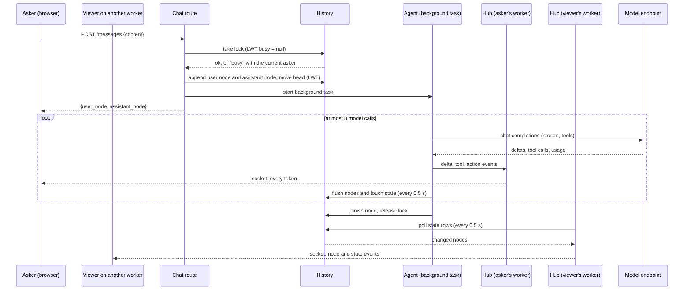
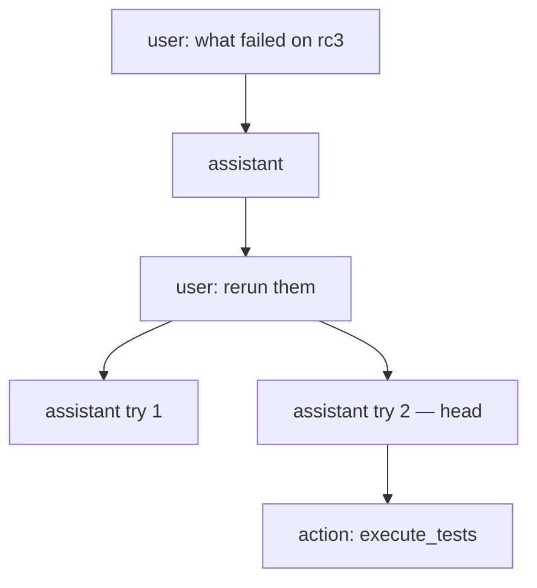
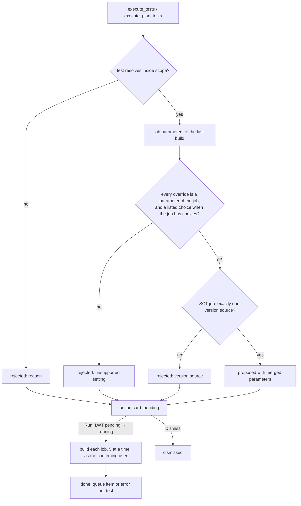

# QATOOLS-617 — Shared chat with memory on releases and views

## Overview

Argus connects to any OpenAI-compatible chat completions endpoint. An
administrator adds connections, probes each endpoint's models and their
capabilities, and picks one default model.

Every release and every view gets one shared conversation. A user opens it
from an anchor bar on the release dashboard, or from a `chat` widget on a
view. The conversation is a message tree: a retry adds a sibling answer, and
an undo moves the active branch back.

Each answer is built from:
- the entity's summary
- its memories: notes and findings with a revision history, which a view
  shares with the releases of its tests
- a set of tools that read Argus

Tools that change Argus outside the memories propose an action card. Nothing
runs until a user confirms the card. Findings show in the release summary.

## Constraints

- **Four gunicorn workers share no memory.** The active branch, the
  generation lock, and every message live in the database. A socket on one
  worker learns about work on another worker through the database.
- **nginx sits in front of the WebSocket.** The production vhost lives in
  scylladb/qatools (`roles/argus`) and needs the `Upgrade` and `Connection`
  headers on the chat socket path. This repository cannot change it, so the
  chat falls back to polling when the socket does not connect.
- **uvicorn needs a WebSocket library.** None is installed today, so
  `websockets` joins the `web-backend` extra.
- **Small local models are first-class.** The test endpoint serves 4B–31B
  GGUF models with a 32k–64k context. Prompts and tool results stay compact,
  and a model without tool calling still answers from the prompt.
- **The database enforces nothing.** One-at-a-time generation, the
  active-branch moves, and single execution of a confirmed action use
  lightweight transactions.
- **Any logged-in user may chat, confirm an action, and edit memories.** The
  existing issue and Jenkins routes check nothing more either.
- **Endpoint tokens never leave the server.** A token stored in the database
  is encrypted.

## Design

### Components

| Component | Role |
|---|---|
| Model adapter | Translates Argus's own message, tool and stream types to and from OpenAI chat completions. Lists and probes models. |
| Configuration service | Merges YAML connections with database connections, keeps the default model, and encrypts tokens. |
| History service | Owns the message tree: reading, appending, the active branch, the generation lock, undo, and the branch switch. |
| Memory service | Memories and their revisions: create, edit, delete, revert, scope. |
| Agent | Builds the prompt, runs the model and the tool loop as a background task, publishes events, and flushes progress to the database. |
| Background tasks | A per-worker registry of running generations, compactions and confirmed actions. A task outlives the request that started it, and a worker shutdown marks its node `stopped`. |
| Hub | A per-worker fan-out from published events to the worker's open sockets. For each entity with a local socket, a watcher polls the entity's state rows and pushes what another worker wrote. It also keeps the presence list. |
| Tools | Argus reads, memory writes, and action proposals, each limited to the entity's tests. |
| Actions | Validate a proposal against Jenkins job parameters, and run it once on confirmation. |
| Chat routes | REST commands that queue work and return at once, the conversation read, memories, and the WebSocket, under `/api/v1/chat/{entity_type}/{entity_id}`. |
| Admin routes | Connections, the probe, the tool-calling test, and the default model. |
| Frontend | The anchor bar, the chat modal, the action card, the memories panel, the context meter, and the admin manager with its model picker. |

### Sending a message



Sockets on the asker's worker get every token. Sockets on other workers get
the flushed node about every half second. A client that disconnects does
not stop the task. A stop request sets a flag on the node, and the task
reads the flag at each flush.

A confirmed action and a compaction run the same way: the route answers at
once, the background task publishes its progress, and every socket sees it.

### The message tree



- **Active conversation:** the path from `head` up to the root. Older
  branches stay readable.
- **Try again:** a new assistant sibling under the last user node. `head`
  moves to it.
- **Branch switch:** `head` moves to the newest leaf under the chosen sibling.
- **Undo:** `head` moves to the parent of the last user node on the active
  path, and that node and its descendants are marked `hidden`. Started jobs
  and memory edits stay; a memory edit has its own revert.
- **Compaction:** the model summarizes the active path since the last
  summary into a `summary` node. The prompt starts from the newest summary on
  the path. Undo removes a summary like any node.

### The prompt

1. **System message,** from a template:
   - the assistant's rules: Argus vocabulary, the confirmation rule, never
     invent job parameters
   - the date
   - the entity: a release with its name, or a view with its name and its
     releases
   - the memories, each with its id, kind, scope and author
   - a compact summary: counts per family and per version, failed and
     aborted tests (capped at 40 names), and open issue keys
2. **The newest summary node** on the active path, if any.
3. **The messages after it.** A user message is prefixed with
   `Full Name (@username): `. A tool result is truncated to about 6 kB.
   Reasoning is never sent back.

The assistant node records the memories it was given, as
`(memory_id, revision)` pairs. The expanded answer lists them.

### Tools

| Tool | Reads or does | Confirmation |
|---|---|---|
| `get_summary(version?, family?, statuses?)` | the release summary, or the view's per-release summaries | — |
| `read_release(release?)` | enabled groups and tests with `build_system_id` | — |
| `read_view()` | the view, its releases, its plan, and its test count | — |
| `get_runs(test, version?, limit)` | a test's recent runs in compact form (at most 20) | — |
| `read_run(run_id)` | one run, its issues, and its last 3 comments | — |
| `get_plan(plan?)` | the plans with tests, groups, labels and target version | — |
| `read_memory(query?)` | the memories in scope | — |
| `write_memory(op, memory_id?, content?, kind?, scope?)` | add, edit or delete a memory | — (can be reverted) |
| `link_issue(run_id, url)` | link an issue to a run | card |
| `unlink_issue(run_id, issue)` | unlink an issue from a run | card |
| `execute_tests(tests, params)` | start tests by reference | card |
| `execute_plan_tests(plan, labels, match_all, params)` | start a plan's tests that carry the labels | card |

**Scope:** every tool is limited to the entity. A release chat reaches its
own tests. A view chat reaches the view's tests and, for reads, their
releases. A run, test or plan outside that scope is refused, with the reason
returned to the model.

**Resolving a test reference:** the same order the command line tool uses:
exact `build_system_id`, then `group/test`, then a unique test name. Plan
labels resolve as the command line tool resolves them: a labelled group fans
out to its enabled tests.

### Validating and running a start



The outcome becomes a `tool` node in the conversation, so the next answer
knows which jobs started. The card follows each queue item to its build and
links the run.

### Failure behavior

| Condition | Behavior |
|---|---|
| No connection or no default model | Chat routes answer `chat not configured`, and the anchor bar says so |
| Another generation is running | The command is refused with the asker's name. The socket already shows the running answer |
| The socket does not connect, or drops | The client retries with backoff, and polls `GET` every 3 s meanwhile |
| A lock older than 5 minutes (worker died) | The next send takes it over and marks the abandoned node `error` |
| The endpoint fails or times out | The assistant node gets `status=error` with the message, the lock is released, and Try again works |
| The model calls an unknown tool or sends bad arguments | The tool node carries the error and the loop continues, so the model can correct itself |
| The tool loop reaches 8 model calls | The answer ends with a note that the limit was reached |
| A tool raises | The error text goes back to the model as the tool result, and the turn continues |
| Jenkins fails while confirming | The card records the error per test. The other tests still start |
| A second confirm, or a confirm after dismiss | Refused by the LWT; the card shows its current state |
| The model has no tool calling | The prompt carries the summary and memories, and no tools are sent |
| The token cannot be decrypted (`SECRET_KEY` rotated) | The connection shows `token unreadable` in the Admin Panel, and the chat answers `chat not configured` until the token is entered again |

## Contracts

### Inputs

```
GET  {endpoint}/models
     # data[].id, and when present: name, context_length, max_context_window,
     # max_model_len, labels[], info.meta.capabilities, info.meta.context_length
POST {endpoint}/chat/completions
     # model, messages, tools, stream=true, stream_options.include_usage
     # stream chunks: choices[0].delta.{content, reasoning_content, tool_calls[]},
     #                choices[0].finish_reason, usage.{prompt_tokens, completion_tokens}
Jenkins job config and last build   # parameter definitions, choices, last parameter values
```

Configuration, `argus_web.yaml`:

```yaml
CHAT_MODELS:
  - name: local-webui                 # unique id, shown in the Admin Panel
    endpoint: https://host/api        # OpenAI-compatible base URL
    token: sk-…
    model: Gemma-4-12B-it-GGUF        # optional fallback default
```

### Outputs

#### Tables

```sql
CREATE TABLE chat_configuration_v1 (
    scope text,                          -- always 'global'
    name text,
    endpoint text,
    token_encrypted text,
    updated_by uuid,
    updated_at timestamp,
    default_connection text static,
    default_model text static,
    default_context_window int static,
    default_tools boolean static,
    default_vision boolean static,
    default_set_by uuid static,
    default_set_at timestamp static,
    PRIMARY KEY (scope, name)
);

CREATE TABLE chat_state_v1 (
    entity_id uuid PRIMARY KEY,
    entity_type text,                    -- 'release' | 'view'
    head timeuuid,
    busy timeuuid,                       -- assistant node being generated
    busy_user uuid,
    busy_since timestamp,
    changed_at timestamp,                -- touched by every write to the conversation
    memory_changed_at timestamp          -- touched by every memory change of this entity
);

CREATE TABLE chat_presence_v1 (
    entity_id uuid,
    user_id uuid,
    seen_at timestamp,
    PRIMARY KEY (entity_id, user_id)
);                                       -- rows written with USING TTL 45, refreshed every 15 s

CREATE TABLE chat_history_v1 (
    entity_id uuid,
    node timeuuid,
    entity_type text,
    parent timeuuid,
    role text,                           -- user | assistant | tool | action | summary
    content text,
    reasoning text,
    user_id uuid,
    tool_calls text,                     -- JSON [{id, name, arguments}]
    tool_call_id text,
    tool_name text,
    action text,                         -- JSON, see Action
    action_state text,                   -- pending | running | done | dismissed
    model_name text,
    prompt_tokens int,
    completion_tokens int,
    memory_snapshot text,                -- JSON [{memory_id, revision}]
    status text,                         -- streaming | done | error | stopped | stop_requested
    error text,
    hidden boolean,
    created_at timestamp,
    updated_at timestamp,
    PRIMARY KEY (entity_id, node)
) WITH CLUSTERING ORDER BY (node ASC);

CREATE TABLE chat_memory_v1 (
    entity_id uuid,
    id timeuuid,
    entity_type text,
    kind text,                           -- note | finding
    content text,
    created_by uuid,
    created_at timestamp,
    updated_by uuid,
    updated_at timestamp,
    deleted boolean,
    revision timeuuid,                   -- latest revision
    source_node timeuuid,
    PRIMARY KEY (entity_id, id)
);

CREATE TABLE chat_memory_revision_v1 (
    entity_id uuid,
    revision timeuuid,
    memory_id timeuuid,
    action text,                         -- create | update | delete | revert
    before text,
    after text,
    kind text,
    user_id uuid,
    source text,                         -- manual | chat
    source_node timeuuid,
    reverts timeuuid,
    PRIMARY KEY (entity_id, revision)
) WITH CLUSTERING ORDER BY (revision DESC);
```

All tables are additive and are created by `sync-models`.

#### Chat API

All routes require a logged-in user and return the `APIResponse` envelope,
except the WebSocket. The prefix is
`/api/v1/chat/{entity_type}/{entity_id}`, where `entity_type` is `release`
or `view`. A command that starts work answers once the work is queued; the
socket carries its progress.

```
GET    ""                         -> Conversation
GET    /meta                      -> {configured, messages, last: {user_id, at} | null}
POST   /messages {content}        -> Started   # queues a generation
POST   /regenerate                -> Started   # retry the last answer on the active path
POST   /compact                   -> Started
POST   /undo                      -> Conversation
POST   /head {node}               -> Conversation
POST   /stop                      -> {stopping: node}
POST   /actions/{node}/confirm    -> Node      # state "running"; results follow on the socket
POST   /actions/{node}/dismiss    -> Node
WS     /ws                        -> Event stream, see below
GET    /memories                  -> [Memory]           # own, plus releases' for a view
POST   /memories {content, kind, scope?}         -> Memory
PUT    /memories/{memory_id} {content?, kind?}   -> Memory
DELETE /memories/{memory_id}      -> Memory
GET    /memories/history          -> [Revision]
POST   /memories/history/{revision}/revert       -> Memory
```

```ts
interface Started { user_node: Node | null; assistant_node: Node }
interface Conversation {
    entity_id: string; entity_type: "release" | "view";
    configured: boolean;
    model: { connection: string; model: string; context_window: number; tools: boolean } | null;
    head: string | null;
    busy: { node: string; user_id: string; since: string } | null;
    nodes: Node[];                            // whole tree, oldest first
    context: { window: number; used: number; last_prompt_tokens: number | null;
               estimated_tokens: number; messages_since_compaction: number };
}
interface Node {
    node: string; parent: string | null;
    role: "user" | "assistant" | "tool" | "action" | "summary";
    content: string; reasoning: string | null; user_id: string | null;
    tool_calls: { id: string; name: string; arguments: string }[];
    tool_call_id: string | null; tool_name: string | null;
    action: Action | null; model_name: string | null;
    usage: { prompt_tokens: number; completion_tokens: number } | null;
    memory_snapshot: { memory_id: string; revision: string }[];
    status: "streaming" | "done" | "error" | "stopped" | "stop_requested";
    error: string | null; hidden: boolean; created_at: string; updated_at: string;
}
interface Action {
    kind: "execute_tests" | "link_issue" | "unlink_issue";
    state: "pending" | "running" | "done" | "dismissed";
    proposal: { tests?: { test_id: string; name: string; group: string;
                          build_system_id: string; params: Record<string, string>;
                          overrides: Record<string, string> }[];
                run_id?: string; test_id?: string; issue_url?: string; issue_id?: string };
    rejected: { test: string; reason: string }[];
    confirmed_by: string | null; confirmed_at: string | null;
    results: { build_system_id?: string; queue_item?: number; issue?: object; error?: string }[];
}
interface Memory {
    id: string; entity_id: string; entity_type: "release" | "view"; entity_name: string;
    kind: "note" | "finding"; content: string; revision: string;
    created_by: string; created_at: string; updated_by: string; updated_at: string;
    source_node: string | null;
}
interface Revision {
    revision: string; memory_id: string; action: "create" | "update" | "delete" | "revert";
    before: string | null; after: string | null; kind: string;
    user_id: string; source: "manual" | "chat"; source_node: string | null; reverts: string | null;
}
```

The WebSocket authenticates with the session cookie, like the pages. Each
frame is one JSON object with a `type`:

```ts
type ServerEvent =
  | { type: "snapshot"; conversation: Conversation }     // on connect and after a resync
  | { type: "node"; node: Node }                         // a node created or changed
  | { type: "delta"; node: string; content: string; reasoning: string }  // appended text, asker's worker only
  | { type: "tool"; node: string; name: string; state: "running" | "done" | "error" }
  | { type: "state"; head: string | null; busy: Conversation["busy"]; context: Conversation["context"] }
  | { type: "memory"; memories: Memory[] }               // the whole list in scope, after a change
  | { type: "presence"; users: string[] }                // user ids with the chat open
  | { type: "error"; message: string };
type ClientEvent = { type: "ping" } | { type: "resync" };
```

A `delta` appends to the node's text. A `node` event replaces the node,
so a socket that only sees flushed nodes still converges. A client that
misses frames sends `resync` and gets a fresh `snapshot`.

#### Admin API

The prefix is `/admin/api/v1/chat`, and every route is for admins only.

```
GET    /connections               -> {connections: Connection[], default: DefaultModel | null}
POST   /connection {name, endpoint, token?}       -> Connection     # upsert; no token keeps the old one
DELETE /connection/{name}         -> {deleted: name}
GET    /connection/{name}/models  -> ProbedModel[]
POST   /connection/{name}/test_tools {model}      -> {tools: boolean, detail: string, latency_ms: number}
POST   /default {connection, model, context_window, tools, vision}  -> DefaultModel
```

```ts
interface Connection { name: string; endpoint: string; source: "config" | "database";
                       token_set: boolean; token_readable: boolean;
                       updated_by: string | null; updated_at: string | null }
interface ProbedModel { id: string; name: string; context_window: number | null;
                        tools: boolean | null; vision: boolean | null }   // null: unknown
interface DefaultModel { connection: string; model: string; context_window: number;
                         tools: boolean; vision: boolean; set_by: string | null; set_at: string | null }
```

The probe reads `context_length`, then `max_model_len`, then
`info.meta.context_length`. It reads `tools` and `vision` from `labels`
(`tool-calling`, `vision`), then from `info.meta.capabilities`. Otherwise
the value is `null`.

#### Release summary

Both routes add `findings`, read at request time and never stored in the
summary row:

```
GET /api/v1/release/{release_id}/version_summary
    -> {…, "findings": Memory[]}                                # the release's findings
GET /api/v1/views/widgets/release_summary?view_id=
    -> {"releases": [{…, "findings": Memory[]}], "findings": Memory[]}   # per release, plus the view's
```

### Module API

```python
# service/chat/llm.py — provider-neutral types and the adapter
@dataclass(slots=True)
class ToolCall: id: str; name: str; arguments: str
@dataclass(slots=True)
class ChatMessage:
    role: Literal["system", "user", "assistant", "tool"]
    content: str
    tool_calls: list[ToolCall] = field(default_factory=list)
    tool_call_id: str | None = None
@dataclass(slots=True, frozen=True)
class ToolSpec: name: str; description: str; parameters: dict
StreamEvent = TextDelta | ReasoningDelta | ToolCallsReady | Usage | Finished

class ChatModelClient(Protocol):
    def stream(self, model: str, messages: list[ChatMessage],
               tools: list[ToolSpec] | None) -> AsyncIterator[StreamEvent]: ...
    async def list_models(self) -> list[ProbedModel]: ...

class OpenAIChatClient(ChatModelClient):
    def __init__(self, endpoint: str, token: str) -> None: ...

# service/chat/config.py
class ChatConfigService:
    async def connections(self) -> tuple[list[Connection], DefaultModel | None]: ...
    async def save_connection(self, name: str, endpoint: str, token: str | None, user: User) -> Connection: ...
    async def delete_connection(self, name: str) -> None: ...
    async def probe(self, name: str) -> list[ProbedModel]: ...
    async def test_tools(self, name: str, model: str) -> ToolTestResult: ...
    async def set_default(self, choice: DefaultModel, user: User) -> DefaultModel: ...
    async def resolve(self) -> ResolvedModel | None: ...   # default with its client, or None

# service/chat/memory.py
class ChatMemoryService:
    async def list(self, entity: ChatEntity) -> list[Memory]: ...       # in scope
    async def create(self, entity: ChatEntity, content: str, kind: str, user: User,
                     scope: UUID | None = None, source_node: UUID | None = None) -> Memory: ...
    async def update(self, entity: ChatEntity, memory_id: UUID, user: User, *, content: str | None = None,
                     kind: str | None = None, source_node: UUID | None = None) -> Memory: ...
    async def delete(self, entity: ChatEntity, memory_id: UUID, user: User,
                     source_node: UUID | None = None) -> Memory: ...
    async def history(self, entity: ChatEntity) -> list[Revision]: ...
    async def revert(self, entity: ChatEntity, revision: UUID, user: User) -> Memory: ...
    async def findings(self, entity_id: UUID) -> list[Memory]: ...

# service/chat/service.py — what the routes call
class ChatService:
    async def conversation(self, entity: ChatEntity) -> Conversation: ...
    async def meta(self, entity: ChatEntity) -> dict: ...
    async def send(self, entity: ChatEntity, content: str, user: User) -> Started: ...
    async def regenerate(self, entity: ChatEntity, user: User) -> Started: ...
    async def compact(self, entity: ChatEntity, user: User) -> Started: ...
    async def undo(self, entity: ChatEntity, user: User) -> Conversation: ...
    async def set_head(self, entity: ChatEntity, node: UUID) -> Conversation: ...
    async def stop(self, entity: ChatEntity) -> UUID | None: ...
    async def confirm(self, entity: ChatEntity, node: UUID, user: User) -> Node: ...
    async def dismiss(self, entity: ChatEntity, node: UUID, user: User) -> Node: ...

# service/chat/hub.py — one per worker
class ChatHub:
    async def subscribe(self, entity: ChatEntity, socket: WebSocket, user: User) -> None: ...  # until it closes
    def publish(self, entity_id: UUID, event: dict) -> None: ...   # local sockets only
async def touch(entity_id: UUID, *, memory: bool = False) -> None: ...  # other workers' watchers see it

# service/chat/tasks.py — one per worker
def spawn(coro: Coroutine, *, name: str) -> asyncio.Task: ...   # kept until done, cancelled at shutdown

@dataclass(slots=True, frozen=True)
class ChatEntity:
    id: UUID
    type: Literal["release", "view"]
    name: str
    release_ids: tuple[UUID, ...]      # the release itself, or the releases of the view's tests
    test_ids: frozenset[UUID] | None   # None for a release: every test of the release
```

## Risks

| Risk | Response |
|---|---|
| A conversation partition grows without bound. Compaction hides old messages from the prompt, not from the read | Reads take the whole partition. A thousand nodes stay within a few hundred kilobytes. Paging is deferred work |
| A small model invents parameters or test names | Every proposal is resolved and validated on the server, and nothing starts without a user's confirmation |
| A prompt injection through run data, such as a comment or an issue title, steers the model | Tools that change Argus only propose. The card shows exactly what runs. Memory writes can be reverted and carry `source=chat` |
| Production nginx does not upgrade the socket until the qatools vhost changes | The client falls back to polling. The pull request names the vhost change. The live check covers the dev server, which runs without nginx |
| Watchers poll the database: one state-row read every 0.5 s per entity with an open socket, per worker | It stops when the last local socket of the entity closes. Ten open chats on four workers are 80 single-row reads a second |
| An endpoint is slow, around 30 seconds before the first token on a cold local model | No request timeout below 5 minutes on the stream. The lock covers 5 minutes. The UI shows "waiting for the model" |
| A rotated `SECRET_KEY` makes stored tokens unreadable | Shown in the Admin Panel. The token is entered again |

## Deferred work

A first pass ships the design above. These follow, and the design leaves
room for each:

- **A second API shape** (the Anthropic Messages API) and the external Zeus
  service, as more adapters behind `ChatModelClient`. Connections then gain
  an additive `provider` column that defaults to `openai`.
- **Role limits** on chatting, confirming and editing memories: a check in
  `ChatService` and the memory routes.
- **A global memory scope:** another `entity_type`, read alongside the
  release and view memories.
- **The event summarizer on the new connections,** in place of its own
  `ANTHROPIC_*` settings.
- **An ArgusEvent kind for chat-started jobs.** A new kind needs an event
  processor too.
- **Paging the conversation read** once partitions grow large.

## Decisions

- The task covers QATOOLS-617 to QATOOLS-621. The stories share one chat, one
  memory, and one tool set, and none is useful alone. (spec)
- Any OpenAI-compatible chat completions endpoint, not one provider or the
  Zeus service. The goal is any model integration with Argus. The agent sees
  only Argus's own types, so another API shape is an adapter. (spec)
- A connection's "API name" is its unique display name. There is one API
  shape for now. (spec)
- Connections come from YAML `CHAT_MODELS` and from the database, which the
  Admin Panel edits. A YAML entry is read-only there. (spec)
- An administrator picks one default model, for every chat, in a modal
  whose list and capabilities are probed from the endpoint. (spec)
- A token stored in the database is Fernet-encrypted with a key derived from
  `SECRET_KEY`, and no route returns it. (spec)
- Memories are discrete entries, each a note or a finding, with a revision
  for every change and a revert. (spec)
- A release chat sees the release's memories. A view chat sees the view's
  memories plus those of the releases of its tests. There is no global
  scope. (spec)
- Findings are memories with `kind=finding`. The release summary shows them
  next to its counts. A recompute never touches them, and the counts stay
  computed. (spec)
- Starting tests and linking or unlinking issues go through a confirmation
  card that any user may confirm. The card records who confirmed. (spec)
- Memory writes from the chat need no confirmation, since each one can be
  reverted. (spec)
- On a view, the chat is a `chat` widget that renders an anchor bar. On the
  release dashboard it is a fixed section. (spec)
- A start validates overrides against the job's own parameters and choices,
  taken from its last build. The plan-wide trigger is not used, since it
  handles only longevity jobs. (spec)
- The active branch and the lock live in their own table, `chat_state_v1`,
  rather than as static columns of `chat_history_v1`. A conditional update
  that sets only static columns cannot name the clustering key, which the
  mapper's conditional update requires. (spec)
- Commands go over REST and return once the work is queued. The work runs
  in background tasks, and every viewer follows it over a WebSocket, with
  presence. Errors keep the REST envelope, and the socket carries only
  events. (build)
- Workers share events through the database: a per-entity state row that
  each write touches, polled by the workers that hold a socket of that
  entity. No message broker is added to the stack. (build)
- The model's reasoning is stored and shown collapsed, and never sent back
  to the model. (spec)
